# Wire II Async Design — Detailed Design (DynamoDB Outbox, SQS, Sweeper, and Regional Takeover)

> **Status: DRAFT — for review.** This document builds on the initial async design draft (`content/planning/wire-ii-async-design.md`, 2026-11-13). The architecture is the same: the DynamoDB item is the outbox, DynamoDB Streams and SQS dispatch the work, a sweeper covers what the push path misses, and regional takeover is fence-first and runbook-driven. This document goes one level deeper on each part and proposes a small number of changes. Every change is listed with its reason in §14, so each one can be accepted or rejected on its own. If the design is adopted, the Capability 10 ADR (ADR-0003, Confluence `3445334201`) must be updated to record the reversal of the inline, synchronous flow. **Reviewed with the squad on 2026-11-17 and accepted overall, with action items.** What changed because of that review is listed in §14.1.

## 1. Context and Goals

**Use case.** PayX submits a payment request to Wire II. Wire II stores it in DynamoDB and converts it to `pain.001.001.11` (V11). A backend step then detokenizes the BAN(s) via Turing and submits the payment to the external OPF API (FIS UEAPI). The outcome is returned to PayX as `.WIRECLEARING` or `.WIRECLEARING.STOP`.

**Goals**

- Tolerate the loss of an entire AWS region with no lost payments and no double settlement.
- Meet the ASPIRE Platinum requirements (all from the Architecture Resiliency & Reliability Standard 2703.1.022 unless noted).
- Close the open questions in the inline design:
  - crash recovery between the OPF POST and persisting its response
  - no back-pressure buffer in front of Turing/OPF
  - Turing and OPF called in series inside the PayX request
- Say exactly what happens in every failure case, so that no payment is ever left without a state and an owner (§11).

**Out of scope.** Stages before Wire II in PayX, later bank outcomes inside OPF, reports to OneLake, sign-on and network changes.

**Design rules**

1. **Accepted means stored.** The API answers 202 only after the item is durably written. From then on Wire II owns the payment.
2. **One source of truth.** The item holds the state. A queue message only says "look at this item".
3. **Push first, sweep second.** The normal path never waits for a timer. The sweeper exists for what the push path missed.
4. **Every step is safe to repeat.** A step claims the item before acting and writes its result under a condition. The OPF call carries the UETR as its idempotency key and the same bytes every time.
5. **Never send late, never guess an outcome.** A payment is submitted only inside a fixed window. If Wire II cannot tell whether OPF took a payment, it says so and a person decides.
6. **Ownership is data.** Which region drives a payment is an attribute on the item, changed only by a conditional write.

**Applicable ASPIRE practices**

| ID | Practice | How this design meets it |
|---|---|---|
| RE-13.3 | Born Platinum | Whole design targets Platinum verification |
| RE-5.1 | RTO / RPO & Resiliency Tier | RPO = 0 at the table with multi-Region strong consistency (§8.1); otherwise RPO ≈ replication lag, with PayX-level RPO = 0 via Arbiter replay (§8.10) |
| RE-10.1 | Compute in multi-AZ + secondary region, active/active | Identical stack live in both regions |
| RE-10.2 | Data stores multi-AZ + secondary region | DynamoDB Global Table; SQS is a disposable trigger, not a store of record |
| RE-10.3 | Regional affinity | All calls region-local; cross-region traffic is only DynamoDB replication |
| RE-11.1 | Automated failover | Cloud-Waze / Bogie Gear for ingress; SmartOps runbook for backlog takeover |
| OE-3.2 | Operational playbooks | SmartOps E2E evacuation runbook per region drives takeover (§8) |
| OE-5.3 | Data-plane recovery | Fencing, ownership and the circuit breaker are DynamoDB data, not control-plane calls (§8.2, §6.6) |
| RE-5.3 / RE-5.4 | Degraded mode / back pressure | SQS buffer, concurrency cap, circuit breaker (§6.6, §10) |
| OE-4.1 | Alerts on region shift and replication lag | §10 |
| CY-5.4 / CY-5.5 | HSHD handling / encryption at rest | §9 |
| RE-2.2 | API intermediary | PayX → Wire II, Turing, PayX status API all via Exchange |

## 2. Architecture Overview

One region, all components:

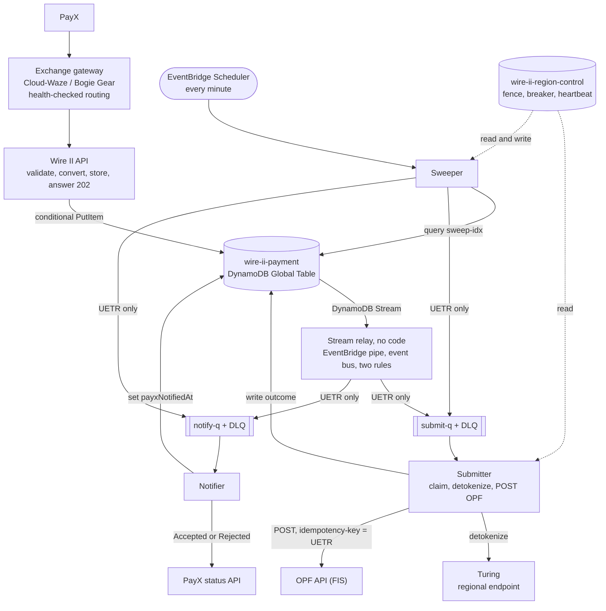

Two regions, what is shared:

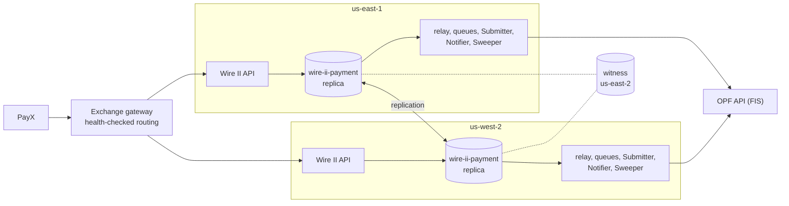

**Key properties**

- **The DynamoDB item is the outbox.** The API makes a single write: one conditional `PutItem` per payment. DynamoDB Streams turns that write into work. There is no dual write ("save to DB, then publish to queue") and therefore no lost-message window.
- **Queues carry only the UETR (a claim check).** No BAN, token, or payload is ever placed on SQS or a DLQ. DynamoDB is the source of truth; any queue message can be lost or deleted without losing a payment, because the sweeper re-derives work from table state.
- **Each region drives only the payments it owns.** Both regions' streams see every item, because Global Tables replicate. The relay filters on `ownerRegion`, so only the owning region acts on an item. Regional takeover (§8) is a controlled rewrite of `ownerRegion`.
- **Region-local dependencies only (RE-10.3).** Turing, PayX, SQS, and Lambda are all called in the same region. OPF is external and reachable from both regions.
- **Waiting happens in the table, not in a queue.** A payment that must wait (backoff, OPF down) sits in the item with a time on it. Nothing waits invisibly, and the wait survives a deploy, a restart and the loss of a region.

| Component | Job | Runs as | Sees clear-text BANs |
|---|---|---|---|
| Wire II API | Validate, convert, store, answer 202; answer replays | ECS Fargate, as provisioned for `bank-wire-rail-ii-api` (Lambda is the alternative, §14) | No |
| `wire-ii-payment` | The item for every payment and the index of unfinished work | DynamoDB Global Table | No, tokens only |
| Stream relay | Turn a stream event into a queue message holding the UETR | One EventBridge pipe per region on the table's stream, a small event bus and two rules. No code | No |
| submit-q, notify-q | Buffer and pace the work; each has a DLQ | SQS standard, per region | No, UETR only |
| Submitter | Claim, detokenize, POST to OPF, write the outcome | Lambda (Go), SQS trigger | Yes, in memory only |
| Notifier | Tell PayX the outcome, mark the item notified | Lambda (Go), SQS trigger | No |
| Sweeper | Re-drive due items, end retries, vendor probe, takeover pass | Lambda (Go), started by EventBridge Scheduler | No |
| `wire-ii-region-control` | Fence state, circuit breakers and sweeper heartbeat per region | Small DynamoDB Global Table | No |

**Languages.** The API is Java on ECS Fargate and holds the conversion library. The three Lambdas are written in Go: Java is discouraged for Lambdas because of cold starts, and the team's Lambda templates are in Go. None of the Lambdas needs the conversion library, because the request is converted and stored by the API.

## 3. Request Lifecycle (Happy Path)

The path is shown in three short diagrams so that each stays readable.

**Accept and push**

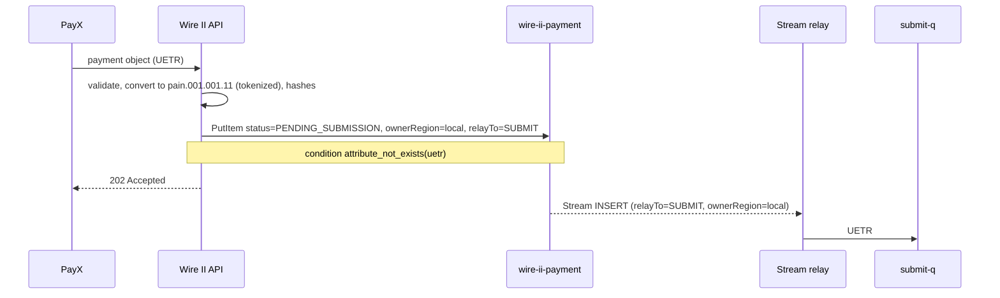

**Submit**

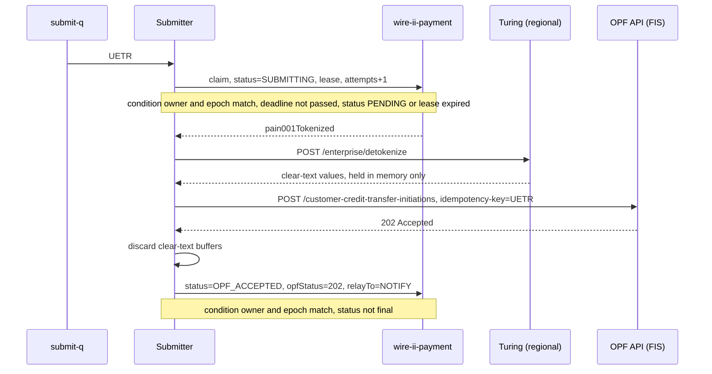

**Notify**

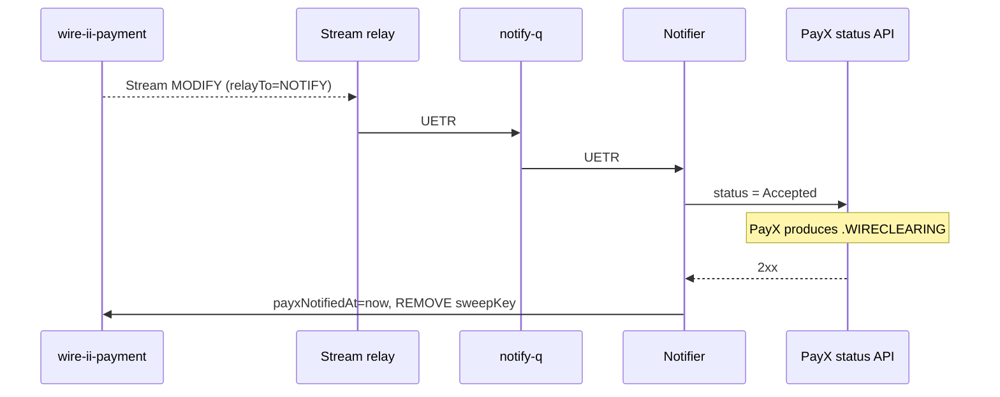

Step by step:

1. **Accept.** The API validates the request against the contract and converts the payment object to the OPF request with account numbers still tokenized. It refuses a payment that is too old to be sent. It writes the item with the condition that the UETR does not exist. Then it answers 202.
2. **Push.** The stream emits the insert. The relay passes only items that this region owns and that carry the push marker `relayTo`, and sends the UETR to submit-q.
3. **Claim.** The submitter sets `SUBMITTING` with a lease. The write succeeds only if the status is `PENDING_SUBMISSION`, or `SUBMITTING` with a lease that has ended; this region owns the item at the current epoch; and the submit deadline has not passed. If the claim fails, the message is deleted.
4. **Send.** The submitter checks the stored request against its hash, detokenizes through Turing in memory, checks that enough of its lease remains for the call, POSTs to OPF with the UETR as idempotency key, and discards the clear-text values. The clear values are substituted into the stored text. The request is not rebuilt, so the bytes are the same on every attempt.
5. **Record.** A clear answer from OPF, accepted or refused, is written as long as the item is not already final. An unclear result is written only by the holder of the lease.
6. **Notify.** The stream emits the outcome. The relay sends the UETR to notify-q. The notifier calls the PayX status API, then marks the item notified. That removes it from the index of unfinished work.

**Contract change for PayX.** In this design the PayX→Wire II call returns 202 Accepted, and the final status arrives later from the notifier. Capability 10 already has Wire II "call PayX's API with the final status", so the outbound status call is unchanged. What changes is that the inbound call no longer blocks until OPF responds. One addition is proposed: a third status, Outcome unknown, for the one case where Wire II cannot say whether OPF took the payment (§6.4).

**Why the conversion sits in the API**

- A payment that cannot be converted is refused at once with a clear error, before Wire II has accepted it.
- The request sent to OPF is fixed at acceptance, so every attempt sends the same bytes. OPF refuses a repeated key with a different body.
- The submitter stays small: read, detokenize, POST.

The conversion is a pure function of the payment object. Message identifiers and the creation time are derived from the request, not from the clock, so converting the same payment twice in any region gives the same bytes.

## 4. Data Model

Table `wire-ii-payment`. A DynamoDB Global Table with replicas in us-east-1 and us-west-2, encrypted with a customer-managed KMS key (CY-5.5). Proposed mode: multi-Region strong consistency, with a witness in us-east-2 (§8.1; fallback in §8.10). Partition key: `uetr`.

| Attribute | Type | Purpose |
|---|---|---|
| `uetr` | S (PK) | Idempotency key end-to-end (PayX → Wire II → OPF) |
| `status`, `statusReason` | S | State machine (§5), and a short code for a reject or a failure |
| `ownerRegion` | S | Region currently responsible for driving this payment |
| `ownerEpoch` | N | Incremented on every ownership change; fences stale writers (§8.2) |
| `payloadHash` | S | SHA-256 over the fields of the PayX payment object that the conversion reads, in a fixed order and form. Detects a replay that reuses a UETR with different content |
| `paymentObject` | S (JSON) | The request as received, tokenized. Kept so a later channel can convert from the original (§13) |
| `pain001Tokenized`, `requestHash` | S (JSON), S | V11 JSON with token values only in account fields, and its SHA-256. The submitter checks the hash before sending |
| `mapperVersion` | S | Version of the conversion that produced the request |
| `attempts` | N | Claims in the current cycle |
| `unansweredAttempts` | N | How many of those claims may have reached OPF without a clear answer. Raised at the claim, taken back only on a clear answer or on proof that nothing was sent |
| `firstAttemptAt` | S (ISO-8601) | Time of the first claim. Start of the window in which OPF still remembers the idempotency key |
| `nextActionAt` | S (ISO-8601) | When the sweeper should next look at the item (grace, lease end, backoff) |
| `leaseOwner` / `leaseExpiresAt` | S | Submitter claim lock |
| `submitDeadline` | S (ISO-8601) | After this the payment is never sent automatically (§11.4) |
| `opfStatus` / `opfErrorCode` / `opfReference` / `opfRespondedAt` | S/N | Status, error codes and OPF's reference only — never the raw response body |
| `payxNotifiedAt`, `notifyAttempts` | S, N | Set once PayX has the terminal outcome; callback attempts so far |
| `outcomeSeq` | N | Rises each time an outcome is recorded. Sent with every notification, so PayX can tell a correction from a stale message |
| `sweepKey` | S | `ownerRegion` plus a shard number, for example `us-east-1#3`. Present only while work remains, which makes the index below sparse |
| `relayTo` | S | `SUBMIT` or `NOTIFY`. The push marker. Set only by the writes that must push (§6.2); every other write removes it |
| `attentionKey` | S | Present while a `FAILED_TECHNICAL` payment is unresolved. Feeds the work list for the people who resolve them |
| `version`, `createdAt`, `updatedAt`, `purgeAfter` | — | Optimistic locking, audit, retention cleanup |

All times are UTC in a fixed-width text form, so they sort correctly.

GSI `sweep-idx`. Partition key `sweepKey`, sort key `nextActionAt`. Only in-flight items carry `sweepKey`, so the index stays small. The key is split into a few shards per region, so a burst of new payments cannot overload one index partition. The index carries keys and status only.

GSI `attention-idx`. Partition key `attentionKey`. Holds only unresolved `FAILED_TECHNICAL` payments.

Table `wire-ii-region-control`. A small Global Table read by every component. Partition key `controlKey`. It holds three kinds of item.

The region item, one per region (`controlKey` = region name):

| Attribute | Example | Purpose |
|---|---|---|
| `controlKey` (PK) | `us-east-1` | — |
| `state` | `ACTIVE` \| `FENCED` | `FENCED` = this region must stop starting new work |
| `epoch` | `7` | Incremented on each fence/unfence |
| `takeoverBy` | `us-west-2` | Region adopting this region's in-flight items |
| `fencedAt` | ISO-8601 | Start of the takeover grace period |

The breaker item, one per dependency and region (`controlKey` = `us-east-1#breaker#OPF`, `us-east-1#breaker#TURING`):

| Attribute | Example | Purpose |
|---|---|---|
| `state` | `CLOSED` \| `OPEN` \| `PROBING` | Whether this region may call the dependency |
| `failedUetrs` | set of UETRs | The different payments that failed in a row; the breaker opens on a count of these |
| `openedAt`, `nextProbeAt` | ISO-8601 | When it opened and when the next probe is due |
| `probeUetr` | UETR | The one payment allowed through while probing |
| `probeStartedAt` | ISO-8601 | When the current probe was named. A probe older than the lease time has lapsed |
| `probeInterval` | `4 min` | The current wait between probes. Doubles after a failed probe, up to 15 minutes; reset when the breaker closes |
| `changedBy` | `submitter`, `sweeper` or a user id | Who made the last change, for the audit of manual actions |
| `version` | N | Optimistic locking. Every change is a conditional write |

The sweeper item, one per region (`controlKey` = `us-east-1#sweeper`):

| Attribute | Example | Purpose |
|---|---|---|
| `heartbeatAt` | ISO-8601 | Written on every sweeper run. A stale value raises an alarm and is evidence for the evacuation runbook |
| `runId`, `runUntil` | — | Ensures one run at a time per region |

None of this changes the payment table. The breaker and the heartbeat are extra items in the control table. If the automatic takeover trigger of §8.11 is adopted, one more item is added (`controlKey` = `fence`, attribute `fencedRegion`), so that only one region can be fenced at a time.

## 5. State Machine

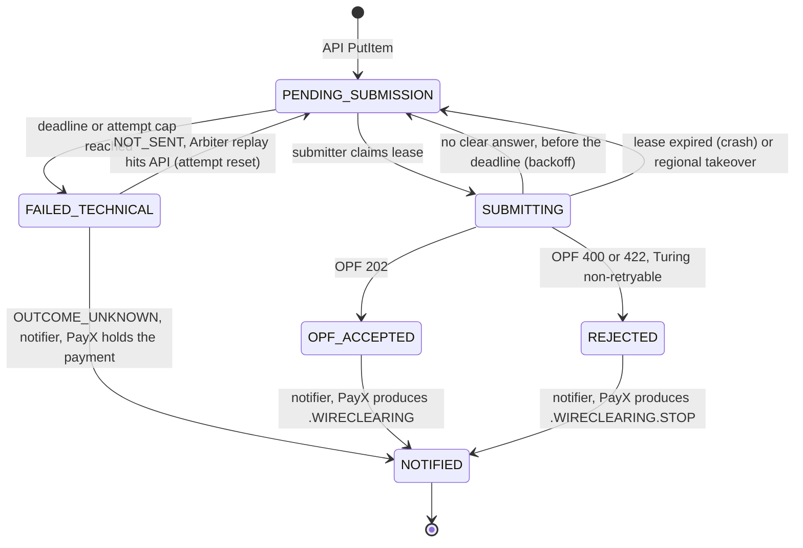

`NOTIFIED` is not a separate `status` value. It is the terminal status with `payxNotifiedAt` set and `sweepKey` removed.

| Status | It means | Final |
|---|---|---|
| `PENDING_SUBMISSION` | Stored and waiting to be sent: new, put back after an attempt without a clear answer, or waiting while OPF is down | No |
| `SUBMITTING` | One submitter holds the payment under a lease and is calling OPF | No |
| `OPF_ACCEPTED` | OPF answered 202 | Yes |
| `REJECTED` | OPF or Turing refused this payment as invalid | Yes |
| `FAILED_TECHNICAL` | Retries ended without an answer. Its reason says which of two cases applies | Yes, until Arbiter replays or a person resolves it |

`FAILED_TECHNICAL` carries one of two reasons in `statusReason`, and they are very different:

- **`NOT_SENT`:** no attempt ever reached OPF, for example because OPF was down the whole time. The payment was certainly not submitted. PayX is not told. Arbiter replays, and the API resets the item and sends it (§6.1). This is always safe, because nothing can be sent twice.
- **`OUTCOME_UNKNOWN`:** at least one attempt ended without a clear answer. OPF may have taken the payment. PayX **is told**, so that the payment is held: it is not replayed, not restarted under a new UETR and not reversed. A person checks OPF and records the truth (§11.6). Wire II never resends it by itself.

The outcome mapping follows Capability 10, with the retry rules of §11:

| Response | Next state | PayX stage |
|---|---|---|
| OPF 202 | `OPF_ACCEPTED` | `.WIRECLEARING` |
| OPF 400, OPF 422 for an invalid message | `REJECTED` | `.WIRECLEARING.STOP` |
| Turing 203 codes 105 / 106 / 108, Turing 400 | `REJECTED` + alert | `.WIRECLEARING.STOP` |
| OPF 500 / 503, timeout, Turing 203 code 109, Turing 500 | `PENDING_SUBMISSION` with backoff → `FAILED_TECHNICAL` at the deadline or the attempt cap | `NOT_SENT`: none (Arbiter replays). `OUTCOME_UNKNOWN`: a hold stage, to be agreed with PayX (§15) |
| OPF or Turing 401 / 403 | Stays `PENDING_SUBMISSION`; the circuit breaker opens and pages (§6.6). No retries are burned | none |

**Rules for every write**

- Every update carries a condition on `version`, and raises it. A write based on a stale read fails.
- `OPF_ACCEPTED` and `REJECTED` are never changed.
- `FAILED_TECHNICAL` changes in three ways only: a clear answer from OPF that arrives late for the same payment, the reset of a `NOT_SENT` payment on an Arbiter replay (§6.1), or the audited resolution action (§11.6). A change to a payment that was reported as unknown raises `outcomeSeq` and is reported to PayX as a correction.
- An unclear result is written only by the holder of the lease. A clear answer is written unless the item is already final.

## 6. Components

### 6.1 Wire II API (ingress)

1. Validate the request, convert it to tokenized pain.001 V11 JSON, and compute `payloadHash` and `requestHash`. Refuse a payment that is older than the accepted age.
2. Write the item with `PutItem` and the condition `attribute_not_exists(uetr)`. Initial values:
   - `status=PENDING_SUBMISSION`, `attempts=0`, `unansweredAttempts=0`
   - `ownerRegion=<local>`, `ownerEpoch=<current epoch for local region>`
   - `sweepKey=<local>#<shard>`, `nextActionAt=now + 2 min` (the grace before the sweeper would step in)
   - `relayTo=SUBMIT`, `submitDeadline` (§11.4)
3. If the condition fails, this UETR has been seen before (PayX Arbiter replay or a client retry). Read the item:
   - `payloadHash` differs: reject with 409 as a duplicate UETR with different content.
   - `FAILED_TECHNICAL` with `NOT_SENT`: reset to `PENDING_SUBMISSION` with `attempts=0`, `ownerRegion=<local>`, a new `submitDeadline` and `relayTo=SUBMIT`. Arbiter replay is the redrive mechanism. Nothing ever reached OPF, so the reset is always safe.
   - `FAILED_TECHNICAL` with `OUTCOME_UNKNOWN`: never reset by a replay. The API answers with the current status. OPF may already hold the payment, so only the resolution action (§11.6) changes it.
   - Owned by a region whose control item is `FENCED`: adopt it using the same conditional ownership change as the sweeper (§8.4).
   - Otherwise: return 202 with the current status. The call is idempotent.
4. Return 202 Accepted.

| Situation | Answer |
|---|---|
| New UETR, stored | 202 Accepted |
| UETR already held, same content | 202 with the current status. Nothing is created |
| UETR already held, different content | 409 Conflict. Nothing is created or changed |
| Request invalid, cannot be converted, or too old | 4xx with the reason. Nothing is stored |
| The table cannot be written, or this region is fenced | 503. Nothing is stored; the retry lands in the healthy region |

"Same content" is decided on the fields that the conversion reads. Fields that do not reach OPF may differ between a call and its replay. The comparison does not depend on the version of the converter, so a new release cannot turn a replay into a conflict.

Compute: ECS Fargate, as already provisioned for the component. The existing `PaymentInitiationV9Converter` code is reused, extended for V11.

### 6.2 Stream relay

The relay is configuration, not code. In each region:

1. **One EventBridge pipe** reads the table's DynamoDB Stream. It is the only reader of the stream, which is what AWS recommends for a global table.
2. The pipe's **filter** keeps only the events that must push (below).
3. The pipe's **input transformer** reduces the event to `{ "uetr": ..., "relayTo": ... }` and sends it to a small **event bus** owned by Wire II.
4. **Two rules** on the bus route it: `relayTo=SUBMIT` to submit-q, `relayTo=NOTIFY` to notify-q. Each rule's input transformer passes on only `{ "uetr": ... }`.

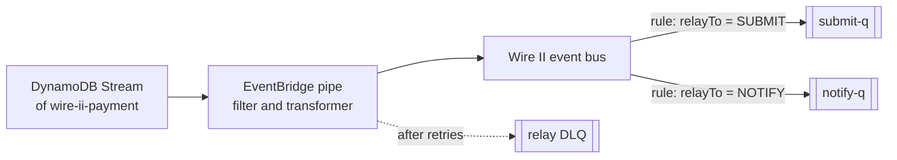

Why a bus sits between the pipe and the queues: a pipe has exactly one target, and there are two queues. Two pipes would put two readers on the stream. If the platform confirms that two readers are acceptable on this table, two pipes straight to the queues is the simpler variant (§15).

Pipe filter:

```json
{ "eventName": ["INSERT", "MODIFY"],
  "dynamodb": { "NewImage": {
    "relayTo":     { "S": ["SUBMIT", "NOTIFY"] },
    "ownerRegion": { "S": ["us-east-1"] } } } }
```

Each region deploys its own region name in the filter. The two rule patterns are `{ "detail": { "relayTo": ["SUBMIT"] } }` and the same with `NOTIFY`.

`relayTo` is a push marker. Only these writes set it:

| Write | Marker |
|---|---|
| Acceptance by the API | `SUBMIT` |
| A clear outcome written by the submitter | `NOTIFY` |
| The takeover rewrite of an item (§8.4) | `SUBMIT` or `NOTIFY`, by the item's state |
| The reset of a `NOT_SENT` payment on an Arbiter replay | `SUBMIT` |
| `FAILED_TECHNICAL` with `OUTCOME_UNKNOWN` written by the sweeper, and a later correction of it | `NOTIFY` |

Every other write removes the marker: the claim, a put-back with backoff, the sweeper moving `nextActionAt`, the notifier marking the item notified. A stream filter can only match fixed values on the new image. It cannot compare old and new. Without the marker, every one of those writes would enqueue the payment again.

Settings:

- The pipe starts from the oldest record still in the stream (`TRIM_HORIZON`), never from "now", so nothing is skipped while it is created or updated. Old events are harmless: their claims fail.
- The pipe retries a failing batch a few times, splits it to isolate a bad record, then sends that record to the relay's dead-letter queue. One bad event must not block the events behind it.
- Each rule has its own retry policy and dead-letter queue, for a queue that cannot be reached.
- The relay acts on the marker in the latest image. The sweeper covers anything the relay drops: a payment that was not pushed is queued when its `nextActionAt` passes.
- The relay holds no business logic, so nothing in it changes when the Submitter or the Notifier changes.
- Alarms: the pipe's iterator age, failed invocations of the rules, and messages in the relay's dead-letter queues.

### 6.3 Submitter (the only component that sees clear-text BANs)

```
0. Read the local wire-ii-region-control items (cached <= 10 s).
   If own region is FENCED: delete the SQS message and stop. DynamoDB state is
   the truth; the takeover region will pick the item up.
   If the OPF or Turing breaker is OPEN, or PROBING and this UETR is not the
   probe: delete the message and stop. The item stays PENDING_SUBMISSION.
   If a control item cannot be read: treat it as fenced / open. Do not send.
1. Claim (conditional UpdateItem):
     SET status=SUBMITTING, leaseOwner=:me, leaseExpiresAt=:now+LEASE,
         nextActionAt=:now+LEASE, attempts=attempts+1,
         unansweredAttempts=unansweredAttempts+1
     REMOVE relayTo
     IF  ownerRegion=:myRegion AND ownerEpoch=:epoch AND submitDeadline > :now
     AND (status=PENDING_SUBMISSION OR (status=SUBMITTING AND leaseExpiresAt < :now))
   Condition fails -> someone else owns it or it is finished; delete message, exit.
2. Read pain001Tokenized. Verify it against requestHash.
3. POST /enterprise/detokenize (Turing, regional Exchange endpoint).
4. Substitute clear-text values into the request body in memory only.
5. Check that enough of the lease remains for the OPF timeout. If not, stop.
   POST /customer-credit-transfer-initiations, idempotency-key = UETR.
6. Discard clear-text buffers.
7. Write the outcome.
   Clear answer (202, 400, 422 invalid):
     SET status, opfStatus, opfErrorCode, opfReference, relayTo=NOTIFY,
         nextActionAt=:now, unansweredAttempts=unansweredAttempts-1; clear lease
     IF ownerRegion=:myRegion AND ownerEpoch=:epoch AND status is not final
   No clear answer (timeout, 5xx):
     SET status=PENDING_SUBMISSION, nextActionAt=:now+backoff; clear lease
     IF leaseOwner=:me AND ownerRegion=:myRegion AND ownerEpoch=:epoch
   Proof that nothing was sent (connection refused, Turing down):
     as above, and unansweredAttempts=unansweredAttempts-1
8. Delete the SQS message. It is deleted in every handled case.
```

- Compute: a Lambda written in Go, started by the SQS event source.
- `LEASE` must exceed the full call time: Turing timeout + OPF timeout + write time. Example: 5 s + 20 s + margin, function timeout 45 s, lease 90 s. Explicit client timeouts are required (RE-5.4).
- Timing rule: client timeouts add up to less than the function timeout; the function timeout is shorter than the lease; the queue visibility timeout is at least six times the function timeout.
- SQS event-source `MaximumConcurrency` caps the request rate to Turing and OPF. Size it from OPF's rate limits. Reserved concurrency on the function, if set at all, is at or above that number: used as the limit, it throttles and throttled messages can be dropped.
- Batch size 1, or report partial batch failures so one bad message doesn't redrive the whole batch. Send to the DLQ after at least 5 receives. The DLQ holds only UETRs.
- A timeout or a 5xx is never retried at once, because OPF may still be working on the first request. One immediate retry is allowed only when the request provably never left.

### 6.4 Notifier

Calls the in-region PayX status API with Accepted, Rejected or Outcome unknown. On success it sets `payxNotifiedAt` and removes `sweepKey`, with the same owner and epoch condition as the submitter. Compute: a Lambda written in Go, started by the SQS event source.

- If the call fails, the notifier writes a later `nextActionAt`, raises `notifyAttempts` and deletes the message. The sweeper re-queues it when due. Waits: 1, 2, 5, 15 minutes, then every 15 minutes.
- "Already recorded" from PayX counts as success. The status API must be idempotent on UETR.
- A permanent refusal stops the retries and raises an alert.
- `FAILED_TECHNICAL` with `NOT_SENT` is deliberately not reported, matching Capability 10. Operations are alerted. Arbiter's Replay Time expires, PayX replays, and the API resets the item (§6.1).
- `FAILED_TECHNICAL` with `OUTCOME_UNKNOWN` **is reported**, as Outcome unknown, and the payment goes on the work list (`attention-idx`). PayX must hold it: no replay, no restart under a new UETR, no reversal. Silence would be dangerous here. OPF may already hold the payment, and a replay after FIS has forgotten the idempotency key, or a restart under a new UETR, would move the money twice.
- Every notification carries `outcomeSeq`. PayX keeps the highest and ignores anything lower. The only correction it ever sees is from Outcome unknown to Accepted, Rejected or Not submitted, after a person has resolved the payment (§11.6) or a clear answer from OPF has arrived late.

### 6.5 Sweeper

An EventBridge Scheduler `rate(1 minute)` schedule in each region starts the sweeper Lambda, written in Go. Scheduler delivers at least once, so the sweeper is built to be safe when it fires twice.

- **Heartbeat.** Each run writes `heartbeatAt` on its sweeper control item and takes the run lock. A second run that finds a live lock exits.
- **Normal pass.** Query `sweep-idx` for each local `sweepKey` with `nextActionAt < now`, oldest first. For each item, first move `nextActionAt` forward by one SQS retry window (see below) with a condition on the value that was read, then enqueue the UETR to the right queue. Two runs can never both enqueue the same payment. This catches:
  - a stream event the relay dropped, or lost after the 24-hour Streams retention
  - expired leases (a crash mid-submit)
  - backoffs that have come due
  - missed notifications
- **One live message per payment.** Once a message is on a queue, SQS delivers it up to five times by itself. Another message for the same payment in that time gains nothing and only adds failing work when the Submitter is broken. So when the sweeper queues a payment it moves `nextActionAt` ahead by one full **SQS retry window**: `maxReceiveCount` times the visibility timeout, plus a margin. With the proposed settings that is 25 minutes. The first look is the one exception: two minutes after acceptance, because the relay's push is not confirmed and a dropped push must not cost 25 minutes. The result: while the Submitter is failing, a payment has at most two messages in flight, and the sweeper adds one more only after SQS has given up on those.
- **Deadline pass.** For an item whose `submitDeadline` has passed, or whose `attempts` reached the cap: wait for a live lease to end, then write `FAILED_TECHNICAL` with `NOT_SENT` if `unansweredAttempts` is 0, and `OUTCOME_UNKNOWN` otherwise. Alert. For `OUTCOME_UNKNOWN`, set `attentionKey` and `relayTo=NOTIFY` so that PayX is told. For `NOT_SENT`, remove `sweepKey`: nothing more is due until Arbiter replays.
- **Breaker pass.** While a local breaker is open, pending payments are not re-queued. When a probe is due, name one payment as the probe and enqueue it. After the breaker closes, re-queue the waiting payments oldest first, a set number per run (§6.6).
- **Takeover pass.** Active only while another region's control item says `state=FENCED` and `takeoverBy=<local>`. See §8.
- **Limits.** It stops at a time budget and a count per run and continues in the next run. It does not re-queue while submit-q itself is backed up further than the payment has waited.

The submitter's claim condition makes a duplicate enqueue harmless.

### 6.6 Circuit breaker

One breaker item per dependency and region in `wire-ii-region-control`: OPF as seen from us-east-1, OPF as seen from us-west-2, and the same for Turing. A region can lose its route to OPF while the other still has one, so the two do not share a breaker.

**Why a record and not a library inside the function.** A Lambda runs as many short-lived copies, in two regions, each with its own memory. A breaker held in memory would exist once per copy: one copy would stop calling OPF while the next keeps calling. The state therefore lives in the control table, where every copy reads the same value. The Submitter caches it for at most 10 seconds.

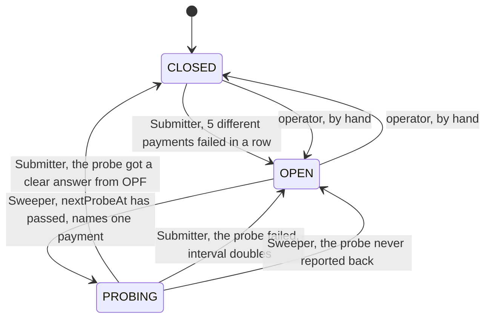

| Who | Reads the breaker | Writes the breaker |
|---|---|---|
| Submitter | At the start of every invocation, before the claim (§6.3 step 0) | Adds a failing UETR to `failedUetrs`; empties the set after any clear answer; sets `OPEN` at the threshold; sets `CLOSED` or `OPEN` after a probe |
| Sweeper | On every run | Sets `PROBING` with `probeUetr` when a probe is due; resets a probe that lapsed; paces the drain after closing |
| Notifier | Not at all | Nothing. It does not call OPF |
| Operator | Through the audited action | `OPEN` or `CLOSED` by hand |

Every change is a conditional write on `version`. When several Submitters reach the threshold together, one write opens the breaker and the others find it already open. A clear answer includes a reject: a 400 or 422 proves that OPF is answering.

- **Closed to open.** The submitter records each failing UETR on the breaker item. When a set number of *different* payments have failed in a row (5xx, timeout, 401, 403), it writes `OPEN` and pages. One payment that fails repeatedly does not open it.
- **While open.** A submitter that receives a message reads the breaker first. It does not claim and does not write; it deletes the message. The item stays `PENDING_SUBMISSION` in the index. Nothing is written per payment while the dependency is down, and no attempts are burned. The API keeps accepting and storing payments.
- **Probe.** Once per interval the sweeper moves the breaker to `PROBING`, names one payment as the probe and enqueues it. The submitter sends it like any other payment; the sweeper never calls OPF. Success closes the breaker. Failure reopens it with a longer interval, and the next probe is a different payment. A probe that never reports back lapses.
- **Drain.** After closing, the sweeper re-queues the waiting payments oldest first at a set rate; the submit-q concurrency cap also protects OPF.
- **Manual control.** Operations can open or close a breaker by hand. That action is restricted and audited, since it can stop every payment.

**Why a probe and not a health check.** FIS exposes no health endpoint for the Universal Execution API. A connection test proves the network path and says nothing about whether OPF accepts payments. The only test that means something is one real payment. That is the probe: a payment that is waiting anyway, sent with its normal idempotency key. If OPF is back, that payment is simply done, and the breaker closes. Nothing else closes the breaker by itself.

**Proposed values.** These are configuration, to be tuned with OPF's rate limit.

| Setting | Proposed |
|---|---|
| Opens after | 5 different payments failing in a row |
| First probe | 1 minute after opening |
| Probe interval | Doubles after each failed probe: 1, 2, 4, 8 minutes, then every 15 minutes |
| A probe that never reports back | Lapses after the lease time; the next sweeper run sends a new one |
| Drain after closing | 60 payments per sweeper run, oldest first |
| Opened or closed by hand | Allowed; restricted and audited |

**At low volume the breaker may never open**, because several *different* payments must fail. Each payment then follows its own backoff (§11.1). The effect is the same: nothing is lost, and OPF is called at most a few times a minute.

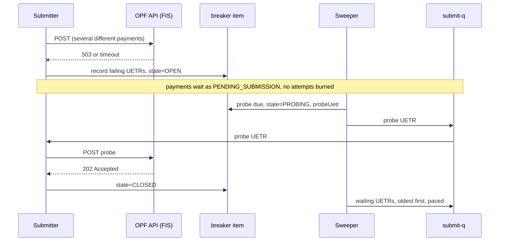

## 7. Why Both DynamoDB Streams and SQS?

Streams and SQS do different jobs. Streams is the trigger: it says "this item changed". SQS is the work buffer: it decides how many submissions run at once and what happens to failures.

| Concern | Streams → Lambda directly | Streams → relay → SQS → Lambda |
|---|---|---|
| Retention of undelivered work | 24 h | 4–14 days (and the sweeper covers both) |
| Concurrency control | Bound to shard count / `ParallelizationFactor` | `MaximumConcurrency` set independently of the table |
| Per-item backoff | Not native; a failing record holds its shard until retried or skipped | The item waits in the table with `nextActionAt`; no blocking of other items |
| Poison-message isolation | Needs bisect-on-error + on-failure destination | Native: maxReceiveCount → DLQ, console redrive |
| Backlog visibility | Iterator age only | `ApproximateNumberOfMessagesVisible`, `ApproximateAgeOfOldestMessage` |
| Takeover surge | Takeover rewrites hit the shard all at once | Queue absorbs the surge; concurrency cap protects OPF |
| Readers on the stream | The business logic is the reader | One small relay is the only reader, as AWS advises for a global table |

The takeover row matters most. When one region adopts the other's backlog, the burst of work goes through the same concurrency-capped queue as normal traffic, so OPF and Turing aren't flooded.

**The DLQ and the sweeper: two paths, one payment.** A queue message is only a pointer to the item. The payment is never in the DLQ; it is in the table.

1. **When a message reaches the DLQ.** Only when the function itself fails to finish it five times: a bug, a bad deploy, a missing permission. A payment that waits never burns receives, because the submitter deletes its message in every handled case.
2. **What the sweeper does meanwhile.** The item is still unfinished. The sweeper looks once two minutes after acceptance, in case the push was lost, and puts a *new* message on the queue. After that it waits a full SQS retry window before it queues the payment again (§6.5), so it does not pile messages on a broken Submitter. While the fault lasts, each of its messages fails the same way and also ends in the DLQ.
3. **When the fault is fixed.** The next message the sweeper queues is processed normally. No one has to move anything.
4. **What is left in the DLQ.** Stale pointers, each only a UETR. Nothing reads the DLQ: not the Submitter, not the sweeper.
5. **Nobody cleans it. It empties itself.** A DLQ keeps a message for 24 hours, counted from the moment the message was first created, and SQS then deletes it. No person purges it and no extra function is needed. The working queues keep messages for 12 hours; AWS advises that a DLQ keeps them longer than its source queue.
6. **The alarm is on arrival, not on presence.** It fires when messages start arriving in a DLQ and clears by itself when they stop. It does not stay raised until someone empties the queue.
7. **Whether the incident is over is read from the table, not from the DLQ.** The age of the oldest in-flight item returns to normal only when the stuck payments have really been processed. That is the signal that closes the incident.
8. **For the review afterwards.** For 24 hours the DLQ still lists the UETRs that hit the fault, and the Submitter's error log has the cause.

**One payment, with clock times.** The Submitter is broken from 09:55 and fixed at 10:25.

| Time | What happens | On the item |
|---|---|---|
| 10:00 | The API stores the payment. The relay puts one message on submit-q. The Submitter crashes on it | `PENDING_SUBMISSION`, `attempts` 0, `nextActionAt` 10:02 |
| 10:02 | The sweeper's first look: the payment is pending and due. It moves the time ahead and queues it once more, in case the first message was lost | `nextActionAt` 10:27 |
| 10:04 to 10:18 | SQS hands the first message over four more times. Each try crashes. The sweeper leaves the payment alone | Unchanged |
| 10:22 | Five tries are used up. SQS moves the message to the DLQ. The alarm fires | Unchanged. The item knows nothing about the DLQ |
| 10:25 | The fix is deployed | Unchanged |
| 10:27 | The retry window is over and the payment is still pending. The sweeper queues a fresh message. The Submitter claims the payment and sends it | `SUBMITTING`, then `OPF_ACCEPTED` |
| after | No more messages arrive in the DLQ, so the alarm clears. SQS deletes the old messages 24 hours after they were created | Finished |

The five tries are counted by SQS on the message, not on the item. The sweeper never reads the DLQ and never takes a message out of it.

Options that were considered and not taken: a person purging the DLQ, which is a manual step that can be forgotten; a function that checks each DLQ message against the table and deletes it, which is more code to own for something SQS does by itself; and automatic re-drive to the source queue, which needs its own check that the Submitter is healthy again.

So nothing is ever recovered *from* the DLQ. It tells a person that code or configuration is broken, and which UETRs hit it. If the fault outlasts a payment's deadline, the sweeper closes that payment as `NOT_SENT` (§11.4).

**Simpler variant (not recommended for Platinum).** Drop the relay and SQS and let the stream Lambda call Turing and OPF directly, relying on the sweeper for recovery. This means fewer resources, but concurrency becomes shard-bound, a failing record blocks its shard, and takeover surges aren't throttled.

## 8. Regional Takeover

### 8.1 Principles

1. **New traffic and in-flight backlog fail over separately.** New PayX requests move automatically when Cloud-Waze / Bogie Gear marks the region unhealthy (RE-11.1). Both regions are already active, so new payments land in the healthy region within the health-check interval. Takeover covers only payments the failed region accepted but had not finished.
2. **Ownership is data, not infrastructure.** Every in-flight item has an `ownerRegion` and `ownerEpoch`. Takeover is a conditional rewrite of those two attributes. The healthy region's relay starts acting on an item the moment its replica shows the new owner.
3. **Fence first, then take over.** The failed region is told to stop before another region adopts its work. The fence is a replicated DynamoDB control item, so a partially alive region learns about it through the data plane with no control-plane access needed (OE-5.3).
4. **Takeover is deliberate, not timer-driven.** It is triggered by the SmartOps E2E evacuation runbook (OE-3.2), not by a timer, so a backlog, a paused submitter or a brief blip never causes a takeover by accident. The sweeper heartbeat and the age of the oldest in-flight item are alarms that tell the operator when to run it. Whether the same sequence should later start by itself is discussed in §8.11.
5. **Regions agree before they act.** Proposed table mode: DynamoDB multi-Region strong consistency (MRSC), with replicas in us-east-1 and us-west-2 and a witness in us-east-2. A write returns only after a second region holds it, and a conditional write is seen the same way by both regions.
6. **OPF's idempotency key is the final safeguard.** Fencing and strong consistency make double processing very unlikely. Reusing the UETR as OPF's `idempotency-key`, with identical bytes, makes it harmless if it happens anyway.

What strong consistency gives the design:

- **One accept.** The same UETR cannot be accepted twice, even if two calls arrive in two regions at the same instant.
- **One owner.** A claim or a takeover in one region is immediately true in the other. A final status cannot be replaced by a stale write from the other region.
- **Nothing lost at a region failure.** A payment answered with 202 is already in a second region. RPO is 0 at the table.
- **A cut-off region stops by itself.** A region that cannot reach either of the others cannot write. Its API answers 503 and its submitters cannot claim.

What it costs: writes take longer, since a second region confirms each one; a write that collides with a write to the same item in the other region fails and is retried; the mode has no TTL and no transactions. The design uses neither: retention is a scheduled purge (§12). If the platform cannot offer this mode, §8.10 describes the fallback.

### 8.2 Fencing

The control item `wire-ii-region-control[us-east-1]` is set to `state=FENCED, epoch=epoch+1, takeoverBy=us-west-2, fencedAt=now`. The write happens in the healthy region (us-west-2).

What each east component does once it reads `FENCED`:

| Component | Behavior when own region is fenced |
|---|---|
| API | Rejects with 503, so Cloud-Waze / PayX retry lands in the healthy region |
| Relay | Drops events; nothing new is enqueued |
| Submitter | Deletes messages without claiming (§6.3 step 0); in-progress calls finish, but their outcome write fails the epoch condition once the item has been taken over |
| Notifier | Stops; outstanding notifications are adopted with the items |
| Sweeper | Skips its normal pass |

If east is completely down, the fence never reaches it, and that is fine because nothing there is running. If east comes back later, it reads the fence before doing any work (§8.7).

**Best-effort control-plane fencing.** If the east control plane is reachable, the runbook *also* disables east's event-source mappings and schedule. This step is optional; correctness doesn't depend on it.

### 8.3 Takeover Sequence

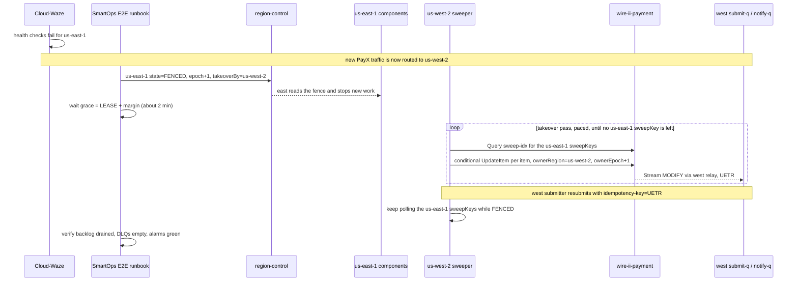

**Runbook steps (SmartOps E2E: "Evacuate us-east-1")**

1. **Confirm traffic shift.** Verify that Cloud-Waze has marked us-east-1 unhealthy and new PayX traffic is landing in us-west-2. If it hasn't, force the shift first.
2. **Fence.** In us-west-2, write the `wire-ii-region-control[us-east-1]` control item (§8.2).
3. **Best-effort control-plane fence.** Disable east's event-source mappings and scheduler, if reachable.
4. **Wait out the grace period.** Wait `grace = LEASE + margin` (e.g., 90 s + 30 s). This lets any east submission already talking to OPF finish or time out. Under the fallback mode of §8.10, add the p99 `ReplicationLatency`.
5. **Takeover pass begins automatically.** West's sweeper sees `takeoverBy=us-west-2` and the elapsed grace, then pages through `sweep-idx` for the us-east-1 `sweepKey` values. It is paced, e.g. 50 items/s, to avoid flooding OPF; the submit-q concurrency cap also protects OPF.
6. **Verify.**
   - `sweep-idx` count for the us-east-1 `sweepKey` values is 0.
   - West outbox-age and queue-age metrics return to baseline.
   - No growth in either DLQ.
7. **Stay in takeover mode until failback.** West keeps polling for east-owned items.

The same runbook is used when a region is alive but cannot reach OPF: its OPF breaker stays open while the other region's is closed. Evacuating it moves its waiting payments to the region that can still send.

### 8.4 What Takeover Does to Each Item

Each update is a conditional `UpdateItem`: `SET ownerRegion=:west, sweepKey=:westShard, ownerEpoch=ownerEpoch+1, relayTo=…` with the condition `ownerRegion=:east AND ownerEpoch=:readEpoch`.

| Item state at takeover | Rewrite | What happens next in west |
|---|---|---|
| `PENDING_SUBMISSION` | Ownership; `relayTo=SUBMIT` | Relay → submit-q → submit |
| `SUBMITTING` (any lease) | Ownership; `status=PENDING_SUBMISSION`; clear lease; `nextActionAt=now`; `relayTo=SUBMIT`. `unansweredAttempts` stays as it is | Resubmitted. If east already reached OPF, OPF returns the idempotent result for the same UETR |
| `OPF_ACCEPTED` / `REJECTED`, not notified | Ownership; `relayTo=NOTIFY` | Relay → notify-q → PayX gets the outcome |
| `FAILED_TECHNICAL`, `OUTCOME_UNKNOWN`, not notified | Ownership; `relayTo=NOTIFY` | Relay → notify-q → PayX is told to hold the payment |
| `FAILED_TECHNICAL`, `NOT_SENT` | Not in `sweep-idx` | Adopted by the API when the Arbiter replay lands in west (§6.1) |
| Terminal and notified | Not in `sweep-idx` | Nothing to do |

The API uses the same rewrite (§6.1) when a PayX replay arrives for an item that a fenced region still owns. Arbiter replays during takeover are therefore handled immediately instead of waiting for the sweeper.

### 8.5 Gray Failure (east partly alive)

If east is degraded rather than down, an east submitter might still be calling OPF for an item that west is about to take over.

- **The grace period** (step 4) makes this unlikely: east's lease expires, and east reads the fence, before west resubmits.
- **Epoch fencing** stops east's stale outcome write once the item has been taken over: `ownerEpoch` no longer matches. With strong consistency this is true from the moment of the takeover write.
- **OPF idempotency** makes a residual double submit harmless. Both calls carry `idempotency-key=UETR` with an identical payload, because the payload is the stored `pain001Tokenized`, not a rebuild.
- **Duplicate PayX notification** is possible in this corner case. The PayX status API must be idempotent on UETR (§15).

### 8.6 Writes That Never Left the Failed Region

With strong consistency there are none: the API answers 202 only after a second region holds the item, and every later write is confirmed the same way. A payment that PayX believes was accepted is always visible to the surviving region.

A request that failed before the 202 was never accepted. PayX retries or Arbiter replays it with the same UETR, and the healthy region accepts it.

**Arbiter Replay Time** must be longer than the normal p99 async completion time, including backoff. Shorter is still safe, but adds noise.

### 8.7 Failback

1. Restore east and verify health: deploys, alarms, Turing and OPF reachability from east's egress.
2. Confirm that no us-east-1 `sweepKey` items remain that west has not adopted.
3. **Unfence.** Set the control item to `state=ACTIVE, epoch+1, takeoverBy=null`. West's takeover pass stops.
4. **Don't move items back.** In-flight items stay with west until they finish. East starts on new work only.
5. **Re-enable** east's event-source mappings and schedule if they were disabled.
6. **Return traffic.** Let Cloud-Waze restore active/active routing.
7. **No queue clean-up is needed.** UETR-only messages left in east's queues from before the fence are harmless: each claim checks ownership and epoch, and the queues empty themselves within their retention.

### 8.8 RTO Budget (placeholders — set per Resiliency Verification)

| Phase | Target |
|---|---|
| New traffic shifted (Cloud-Waze detection + routing) | ≤ 3 min |
| Fence written (runbook) | ≤ 2 min after detection |
| Grace period | LEASE + margin (≈ 2 min) |
| Takeover pass + backlog drained | Backlog size ÷ OPF-safe throughput |
| In-flight payments recovered | ≤ RTO registered in ServiceNow (RE-5.1) |

### 8.9 Testing

- **QA game day (each direction).**
  - Hard-kill a region during sustained load: verify zero loss and zero double-acceptance in the OPF sandbox.
  - Gray failure: keep east's submitter alive and slow while west takes over.
  - A region cut off from the others: verify it cannot accept, claim or send.
  - Crash mid-submit: kill the submitter after the OPF POST.
  - The same request sent to both regions at the same instant.
  - Arbiter replay during takeover.
  - Failback.
  - Partial failure: block one region's route to OPF; verify the breaker, the alarm and the evacuation.
  - Two identical repeats arriving at OPF together; and whether OPF's own duplicate checks stop a second payment.
- **Component tests before go-live.** OPF mock failing for hours (breaker, probe, drain); OPF mock that accepts and then times out; relay switched off; queue purged; a poison message into the DLQ; a burst larger than the concurrency cap.
- **Production:** enterprise Game Days and TREx using the SmartOps E2E evacuation runbook (OE-3.2, RE-12.1).

### 8.10 If Strong Consistency Is Not Available

If the platform can only offer the eventually consistent mode (replicas in us-east-1 and us-west-2, asynchronous replication), the same design runs as in the initial draft, with these differences. They are weaker and should be accepted knowingly.

| Topic | With eventual consistency |
|---|---|
| Two accepts of one UETR | Possible within the replication delay. Both regions may send. The same key and bytes make the second a retry at OPF |
| Conditional writes | Checked only against the local replica, so a claim or takeover is not linearizable across regions. Fencing plus the grace period make double processing unlikely; OPF idempotency makes it harmless |
| Conflicting writes | Last-writer-wins for the whole item. An outcome could be replaced by a stale write. The outcome is therefore also written once to a separate item that no other write touches, and every reader checks it first |
| A payment accepted just before a region fails | Its last writes (typically under 1 s of replication lag) may never reach the other region. PayX never receives `.WIRECLEARING`; Arbiter's Replay Time expires and PayX replays with the same UETR; the replay lands in the healthy region and the API creates a fresh item. Effective RPO at the PayX level is 0 |
| Late replication after recovery | Last-writer-wins keeps the newer version. If the failed region had already reached OPF for that UETR, OPF idempotency covers it |
| Grace period | `LEASE + p99 ReplicationLatency` |
| Failback | Wait until `ReplicationLatency` is normal and the east replica has caught up before unfencing |
| Retention | TTL is available and can replace the scheduled purge |

### 8.11 Partial Failures, and Automating the Takeover

**A region that is alive but cannot send.** Example: a security group or proxy change stops one region's Submitter from reaching the partner gateway. That region still accepts payments, claims them and writes to the table; every call to OPF times out.

- That region's OPF breaker opens once several different payments have failed. Its payments wait. The other region's breaker stays closed and it keeps working.
- The alarm "breaker open in one region, closed in the other" names the situation exactly.
- The region is evacuated with the same runbook: fence, grace period, takeover pass. Its waiting payments are sent by the other region.
- New traffic can leave without a person: the API health check includes "this region's OPF breaker has been open for more than a set time while the other region's is closed", so routing moves new payments away.
- The attempts that timed out count as unanswered, although nothing reached OPF. The resubmission from the other region resolves them.

**Should the takeover start by itself?** The view in the design review was: ideally yes, once the conditions are thought through. With the strongly consistent table an automatic start is safe for correctness, because the fence and every ownership change are seen the same way by both regions; a takeover that was not needed only moves work. The risk is operational: moving a backlog because of a blip.

Proposed path:

1. **Go live with the runbook.** A person starts it; the alarms tell them when.
2. **Then automate the trigger, not the sequence.** The healthy region's sweeper writes the fence itself when all of these hold for a set time (proposed: 10 minutes):
   - the other region's sweeper heartbeat is stale, or its OPF breaker is open while this region's is closed;
   - the other region has overdue in-flight payments;
   - this region's own breakers are closed and it is not fenced.

   Everything after the fence is unchanged: grace period, paced takeover pass, failback by a person.
3. **One fence at a time.** The fence is taken with a conditional write on a single control item, so two regions can never fence each other.
4. **Limits.** A payment is taken over a limited number of times, then escalated to a person. Operations can switch the automatic trigger off.

An automatic start is not proposed under the eventually consistent fallback (§8.10). There, a region that is cut off looks the same as one that is dead.

## 9. HSHD / BAN Handling (CY-5.4)

- Clear-text BANs exist only in submitter memory for a single call. DynamoDB, both queues, both DLQs, logs, and traces carry only tokens or UETRs.
- Turn off HTTP client wire logging. Exclude request and response bodies from tracing (X-Ray/OTel). Never cache detokenized values in static or warm-container state.
- Store only OPF status, error codes and OPF's reference. Raw error bodies may echo payload fields.
- The submitter verifies the stored request against `requestHash` before sending, so an altered item is never submitted.
- Give the submitter a dedicated IAM role and its own Exchange client for Turing. It is the component in scope for the HSHD / Un-tokenized Data Handling Procedure review. The API cannot detokenize.
- Encrypt the tables, Streams, and queues with customer-managed KMS keys (CY-5.5), one per region. If a key is disabled, that region's table and queues stop; that is treated as a region failure.
- The payment object also holds names and addresses. It is classified and encrypted accordingly and is removed by the purge.
- Writes to the fence, the breakers and the resolution action are restricted to a small group and audited.
- Payload-level encryption to FIS stays an open, FIS-pending item (currently TLS-only under a UTEP). It is unaffected by this design.

## 10. Back-Pressure, Degraded Mode, and Alerts

- **Back pressure (RE-5.4):**
  - submit-q `MaximumConcurrency` caps OPF and Turing call rates
  - backoff via `nextActionAt`: 1, 2, 5, 15 minutes, then every 15 minutes, with a random spread
  - explicit client timeouts
  - takeover and breaker drain are paced per sweeper run
- **Degraded mode (RE-5.3):** if OPF or Turing fails for several different payments in a row, the circuit breaker for that dependency and region opens (§6.6). The API keeps accepting and persisting payments and the backlog grows in the table; nothing is lost and no attempts are burned. One probe at a time tests recovery; the backlog then drains at a set rate.
- **Alerts per region (OE-4.1, Tier 0):**
  - oldest in-flight item age (sweeper query on `sweep-idx`) — the one alarm that catches every stuck case
  - SQS `ApproximateAgeOfOldestMessage` for both queues
  - messages arriving in a DLQ (clears by itself; a DLQ empties itself within 24 hours)
  - relay: pipe iterator age, failed rule invocations, relay DLQ depth
  - sweeper heartbeat missing
  - items the sweeper had to start (the push path is broken)
  - breaker open, by dependency
  - breaker open in one region while closed in the other (a partial regional failure)
  - items in `SUBMITTING` past `leaseExpiresAt`
  - `FAILED_TECHNICAL` count, by reason
  - PayX status API failures
  - OPF and Turing error rates by code, and latency
  - DynamoDB write conflicts and write latency; `ReplicationLatency` under the fallback mode
  - region-control state change (fence or unfence)
  - takeover backlog remaining

## 11. Failure Handling

### 11.1 Retries

- **Inside one attempt:** one immediate retry only when the request provably never left, such as a refused connection. A timeout or a 5xx is never retried at once.
- **Between attempts:** the submitter puts the item back to `PENDING_SUBMISSION` with a later `nextActionAt` and deletes the queue message. The sweeper re-queues the item when it is due.
- **The clock.** `nextActionAt` is set two minutes ahead at acceptance, to the end of the lease at a claim, to the backoff time after an attempt without a clear answer, one SQS retry window ahead when the sweeper queues the item, and to now when an outcome is written. The sweeper acts only on items whose time has passed.
- **The counts.** `attempts` and `unansweredAttempts` both rise at the claim. `unansweredAttempts` is taken back when the attempt ends with a clear answer, or with proof that nothing was sent. After a timeout, a 5xx or a crash it stays. A submitter that dies mid-call therefore leaves its attempt counted as unanswered.

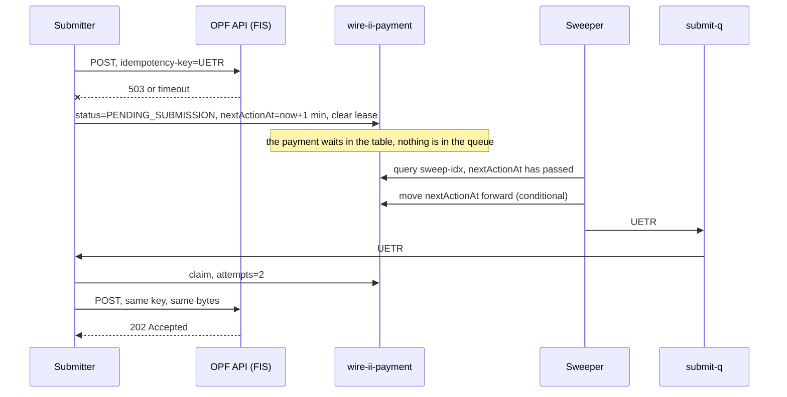

### 11.2 How Each Answer Is Treated

| Answer | Meaning | Action |
|---|---|---|
| OPF 202 | Accepted | `OPF_ACCEPTED`, notify |
| OPF 400, or 422 for an invalid message | The payment is wrong | `REJECTED`, notify, no retry |
| OPF 422 or 409 for a reused key with a different body | Should be impossible, since the body is fixed | `FAILED_TECHNICAL` with `OUTCOME_UNKNOWN` at once, alert. Never reported as a reject |
| An error for a repeat with the same key and body | OPF does not replay its first answer | Accepted only if FIS guarantees that this error means the first request was accepted. Otherwise `OUTCOME_UNKNOWN` |
| OPF 409 for a request still in progress | OPF is working on an earlier attempt | Retry later, counted as unanswered |
| 401 | Token expired | Refresh once and retry in place |
| 401 after refresh, 403, 404, 405 | Our set-up is wrong, or one payload is blocked on the way | Retry later. The breaker opens and pages when several different payments get the same answer |
| 408, 429 | Slow down | Retry later, honor Retry-After |
| OPF 5xx, timeout | Unknown whether OPF took it | Retry later with the same key and body, counted as unanswered |
| Connection refused, DNS or TLS failure | The request never left | One immediate retry, then retry later; not counted as unanswered |
| Turing 203 codes 105 / 106 / 108, Turing 400 | The payment cannot be detokenized | `REJECTED` + alert |
| Turing 203 code 109, Turing 500 | Turing is failing | Retry later; not counted as unanswered, since nothing reached OPF |

### 11.3 Crashes

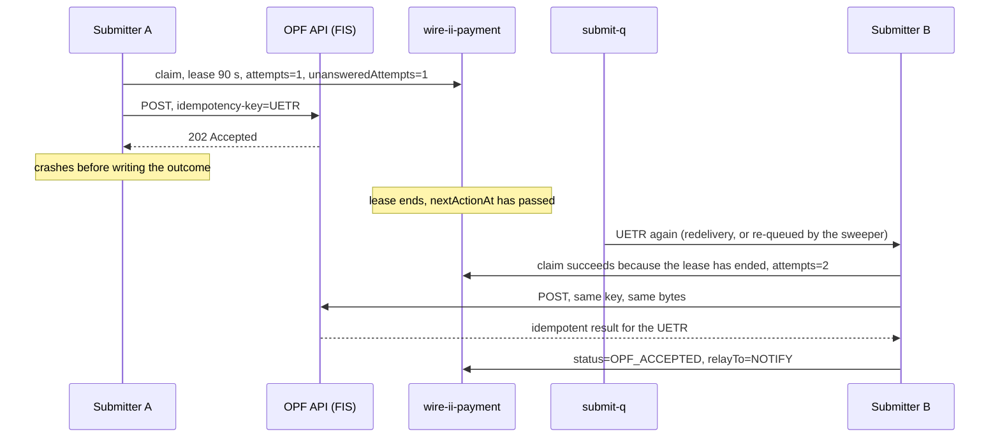

- **Submitter dies before the call:** the queue redelivers after the visibility timeout, and the sweeper re-queues at lease end. The claim succeeds once the lease has ended.
- **Submitter dies after OPF answered 202 but before writing:** as in the diagram. This case depends on how OPF treats a repeat (§15, question 1).
- **Submitter stalls past its lease, then wakes:** before sending, it checks that enough of the lease remains for the whole call. If it had already sent, its "no clear answer" write fails because it no longer holds the lease.
- **Relay fails:** the stream keeps events for 24 hours. The sweeper finds the item after its two minutes of grace in any case.
- **Notifier fails:** the item stays in the index and the sweeper re-queues it.
- **Sweeper stops:** the push path still works. The heartbeat alarm and the oldest-item alarm fire.

### 11.4 The Deadline

`submitDeadline` is set at acceptance. It is the earliest of three limits: how long FIS remembers an idempotency key, the cut-off for the payment's execution date, and how long product allows a payment to wait. An attempt cap sits beside it for a single payment that keeps failing while others succeed.

- The claim itself checks the deadline, so no submitter can start an attempt after it.
- When the deadline passes or the cap is reached, the sweeper writes `FAILED_TECHNICAL`, with `NOT_SENT` if `unansweredAttempts` is zero and `OUTCOME_UNKNOWN` otherwise. It waits for a live lease to end first.
- Operations are alerted. For `NOT_SENT`, PayX is not told and Arbiter replays. For `OUTCOME_UNKNOWN`, PayX is told to hold the payment (§6.4).

This rule closes every "late duplicate" case: after the window in which OPF would recognize a repeat, Wire II never sends again by itself.

### 11.5 What Can Go Wrong, and What Happens

| # | Situation | What the design does | What remains |
|---|---|---|---|
| 1 | The same request arrives twice | Conditional write; the second call gets the current status | Nothing |
| 2 | Same UETR, different content | `payloadHash` differs; refused as a conflict | Nothing |
| 3 | API stores the item, then dies before answering | The caller retries and gets the current status | Nothing |
| 4 | Same UETR arrives in both regions at the same instant | Strongly consistent conditional write: one succeeds | Fallback mode: both may send; OPF idempotency |
| 5 | A payment arrives days late, or after its item was purged | Refused as too old; the purge leaves a tombstone, so the UETR is still recognized | Age limit to be set |
| 6 | Stream event delivered twice | The claim lets one worker through | Nothing |
| 7 | Relay down or misconfigured | Sweeper queues the item after the grace period; alarm on items the sweeper had to start | Up to two minutes of delay |
| 8 | An update to an item re-triggers the relay in a loop | The relay matches a marker that only the pushing writes set | Nothing |
| 9 | Queue message lost or queue purged | Sweeper | Delay only |
| 10 | The queue is backed up for longer than the grace period | The sweeper sees the backlog and does not add duplicates to it | Nothing |
| 11 | Submitter dies mid-call | Redelivery, lease end, same key and body | Depends on OPF replay semantics |
| 12 | Timeout after OPF received the request | No immediate retry; a later retry with the same key and body | Depends on OPF replay semantics |
| 13 | A stalled submitter wakes after its lease ended | It checks the remaining lease before sending; its stale write fails | Nothing |
| 14 | OPF gives a clear answer after the lease has ended | The answer is written unless the item is already final | Nothing |
| 15 | The stored request was altered | The submitter checks it against `requestHash` | Nothing |
| 16 | OPF down for hours | Breaker opens; nothing is written per payment; one probe; drained at a set rate | Payments wait until the deadline |
| 17 | One region loses its route to OPF, the other does not | Breakers are per region; the working region carries on | Operations evacuate the affected region |
| 18 | OPF answers 403 for every payment | Breaker opens once several different payments have failed; no payment is failed | Needs a person to fix the set-up |
| 19 | One payload is blocked on the way and fails every time | One payment cannot open the breaker; it stops at the attempt cap | A person looks at it |
| 20 | Turing is down | Its own breaker; payments wait without attempts | Payments wait until the deadline |
| 21 | A burst of payments arrives | Queue buffers; the trigger's concurrency sets the call rate; the index is sharded | Concurrency must match OPF's rate limit |
| 22 | A message the code cannot process | DLQ after five receives; alert; the sweeper still drives the payment | A person looks at it |
| 23 | Retry after FIS has forgotten the key | The deadline is inside FIS's window and is checked in the claim; an unknown outcome is never reset by a replay | Needs the window from FIS |
| 24 | The deadline passes after an unanswered attempt | `OUTCOME_UNKNOWN`: PayX is told to hold the payment; on the work list; never resent by Wire II | A person checks OPF |
| 25 | The deadline passes and nothing was ever sent | `NOT_SENT`: not reported; Arbiter replay resets it and it is sent | Nothing |
| 26 | Call to the PayX status API fails | Retry with backoff; a PayX replay also returns the current status | Status API must be idempotent |
| 27 | Outcome written, notifier never triggered | Item stays in the index; sweeper queues it | Delay only |
| 28 | Two sweeper runs overlap, or the schedule fires twice | One run at a time; conditional move of the time before queueing | Nothing |
| 29 | A region fails with payments waiting | Runbook fences it; the other region's sweeper takes its items over | Up to the RTO of §8.8 |
| 30 | A region is busy, paused or draining a backlog | No takeover without the runbook | Nothing |
| 31 | A region is cut off from the others but still running | It cannot write, so it cannot accept, claim or send | Fallback mode: fence and grace period |
| 32 | Failed region returns with old messages | Each claim checks ownership, epoch and deadline on the current item | Nothing |
| 33 | A deploy changes the conversion while payments wait | The converted request is stored, so waiting payments keep their bytes | Nothing |
| 34 | A final status is overwritten by a late write | Every write is conditional on the version; accepted and rejected are never changed | Nothing |
| 35 | The table is restored from a backup | Sweeper, relay and notifier stay off until the restored items are reconciled | Runbook step |
| 36 | A clear answer arrives, or a person resolves the payment, after it was reported as unknown | The item is corrected and PayX gets the correction with a higher `outcomeSeq` | PayX must accept a correction |
| 37 | PayX replays a payment whose outcome is unknown | The API answers with the current status and does not reset it | Nothing |

### 11.6 Resolving a `FAILED_TECHNICAL` Payment

A person checks OPF, then records the truth through an audited action: accepted with OPF's reference, or not submitted. A `NOT_SENT` payment may instead be released for another attempt with a new deadline. An `OUTCOME_UNKNOWN` payment is never resent before OPF has been checked. Its resolution is sent to PayX as a correction with a higher `outcomeSeq`, which releases the hold.

**Daily reconciliation, three ways:** what PayX sent, what Wire II holds, and what OPF reports. Inside Wire II: accepted by the API equals accepted by OPF plus rejected plus failed plus in flight.

**Go-live gate.** Wire II repeats a request with the same key by design, after a crash or an unclear result. It must not go live until FIS has confirmed in writing how OPF treats such a repeat, and until that has been tested in the FIS sandbox with two repeats arriving at the same time. A mock cannot prove it.

### 11.7 FIS Down for Hours: a Worked Example

OPF is a vendor system and Wire II cannot shorten its outage. The goal is that an outage of hours costs delay and nothing else. Example: OPF stops answering at 13:00 and returns at 17:00. The values are the proposed ones from §6.6.

| Time | What happens | State |
|---|---|---|
| 13:00 | OPF starts timing out. Payments in flight end without a clear answer and are put back with backoff | A few payments carry an unanswered attempt |
| 13:01 to 13:02 | Five different payments have failed in a row. The breaker opens and pages | Breaker `OPEN` |
| from 13:02 | The API keeps answering 202. New payments are stored as `PENDING_SUBMISSION`. The relay pushes each once; the Submitter sees the open breaker, deletes the message and does not claim | **The queues stay empty. The backlog is in the table** |
| 13:03, 13:05, 13:09, 13:17, then every 15 minutes | The sweeper lets one probe payment through each time. Each fails. The next probe is a different payment | About 19 probes in four hours |
| any time | A payment whose `submitDeadline` passes, for example at its cut-off, is closed: `NOT_SENT` if it was never attempted, `OUTCOME_UNKNOWN` if an attempt went out | Some payments may fail on time, not on OPF |
| 17:00 | OPF is back | |
| by 17:15 | The next probe gets 202. The breaker closes | Breaker `CLOSED` |
| from 17:15 | The sweeper re-queues the backlog oldest first, 60 per run. The submit-q concurrency cap limits the call rate | Backlog ÷ 60 minutes to drain |
| after | Payments that carried an unanswered attempt are resent with the same key and bytes. If OPF had taken the first request, it answers with that result | Depends on OPF replay semantics (§15) |

What this costs, and what it does not:

- **Writes during the outage:** none per waiting payment. Only the probes and the breaker item are written.
- **Calls to OPF during the outage:** one per probe interval.
- **Unanswered attempts:** each probe that times out leaves one payment with an unanswered attempt. Probes rotate, so no single payment collects them.
- **Noticing the recovery:** at most one probe interval, 15 minutes at the longest. A person can close the breaker by hand sooner if FIS confirms the recovery.
- **PayX side:** Arbiter may replay during the outage. The API answers 202 with the current status and changes nothing.
- **Limit:** a payment waits only until its `submitDeadline`. The deadline value, and whether a payment may wait past its cut-off, are product decisions (§15).

### 11.8 Failure Mode and Effects Analysis (FMEA)

Asked for in the architecture review. One row per failure point. Severity is the effect on a payment if the automatic response did not exist: **High** means money could move twice or a payment could be lost, **Medium** means payments are delayed, **Low** means no effect on payments.

| # | Component | Failure mode | Effect | Detected by | Automatic response | Operator action | Severity | What remains |
|---|---|---|---|---|---|---|---|---|
| 1 | Wire II API | Down in one region | New requests fail there | Routing health check | Routing sends requests to the other region | None | Low | Nothing |
| 2 | Wire II API | Cannot write to the table | No payment is accepted in that region | 503 rate; health check | Answers 503; the region leaves routing; PayX retries | Find the cause | Medium | Nothing is stored, nothing is lost |
| 3 | Wire II API | Crashes after the write, before the 202 | PayX does not know the payment was accepted | PayX timeout | PayX retries; the API answers with the current status | None | Low | Nothing |
| 4 | `wire-ii-payment` | A region cannot reach a second region | That region cannot write: no accept, no claim | Write errors; health check | The region stops by itself; the other carries on | Evacuate if it lasts | Medium | The fallback mode behaves differently (§8.10) |
| 5 | `wire-ii-payment` | Writes throttled, or an index partition is hot | Slow accepts and claims | Throttle metrics; write latency | Retries; the index is sharded | Raise capacity | Medium | Nothing |
| 6 | `wire-ii-payment` | KMS key disabled | Table and queues of the region stop | Access-denied errors | Treated as a region failure | Restore the key, or evacuate | Medium | Nothing |
| 7 | Stream relay, pipe | Stopped, or not publishing | Payments are not pushed | Pipe iterator age; "items the sweeper had to start" | The sweeper queues each payment after its grace | Fix the pipe | Medium | Up to two minutes more per payment |
| 8 | Stream relay, pipe | Filter wrong after a change | Nothing is pushed, or everything is | Same; queue depth | The sweeper covers "nothing"; the claim makes "everything" harmless | Fix the filter | Medium | Nothing |
| 9 | Stream relay, rule | Cannot deliver to a queue | One queue gets no messages | Failed invocations; relay DLQ | The rule retries, then its DLQ; the sweeper covers | Fix the rule or the queue. Nothing to clean up | Medium | Delay |
| 10 | submit-q, notify-q | Message lost, or queue purged | The pointer to the work is gone | Oldest in-flight age | The sweeper re-queues from the table | None | Low | Delay |
| 11 | submit-q | Poison message, or the Submitter cannot run: bug, bad deploy, missing permission | Messages fail five times and go to the DLQ | Messages arriving in the DLQ; oldest in-flight age | The sweeper re-queues after each SQS retry window; payments wait in the table; the DLQ empties itself | Fix the code. Nothing to clean up | Medium | Payments wait until the fix, or until their deadline |
| 12 | Submitter | Crashes mid-call | OPF may hold a payment that the item does not show | Item in `SUBMITTING` past its lease | Redelivery and sweeper; same key, same bytes | None | High | Depends on OPF replay semantics; go-live gate |
| 13 | Submitter | Stalls, then wakes after its lease | Could send late, or write a stale result | Not needed | Checks the remaining lease before sending; a stale write fails its condition | None | High | Nothing |
| 14 | Submitter | Throttled, or concurrency used up | Slower submissions | Queue age | Messages wait; the cap is on the event source | Raise the cap if OPF allows | Low | Nothing |
| 15 | Submitter, one region | **Cannot reach OPF from this region** (security group, proxy, route) while the region is otherwise healthy | Every call from this region times out; items are still updated | Breaker open here and closed in the other region; timeout rate | This region's breaker opens; its payments wait; the other region keeps working | Evacuate the region by runbook (§8.11), then fix the network | Medium | The timed-out attempts count as unanswered though nothing reached OPF; resolved on resubmission |
| 16 | Turing | Down or slow | Payments cannot be detokenized | Error rate; Turing breaker | The Turing breaker opens; payments wait without attempts | Contact the Turing team | Medium | Payments wait until their deadline |
| 17 | Turing | One value cannot be detokenized | That payment cannot be sent | Turing code | `REJECTED` and an alert | Look into the token | Low | Nothing |
| 18 | OPF API | 5xx or timeout on some calls | Unknown whether OPF took them | Error rate | No immediate retry; backoff; same key | None | High | Depends on OPF replay semantics |
| 19 | OPF API | Down for hours | No payment can be sent | Breaker open; oldest in-flight age | Breaker, probe, paced drain (§11.7) | Contact FIS; may close the breaker by hand | Medium | Payments past their deadline fail |
| 20 | OPF API | Rejects our credentials or set-up (401, 403) | No payment is accepted | The same answer for several payments | The breaker opens and pages; no payment is failed | Fix the credentials or the set-up | Medium | Payments wait |
| 21 | OPF API | Accepts a repeat as a new payment | The money moves twice | Reconciliation; OPF's duplicate checks | None possible inside Wire II beyond same key, same bytes and a deadline inside the key window | Stop; check with FIS | High | **Must be ruled out with FIS before go-live** |
| 22 | OPF API | Slow, close to the timeout | Leases run close to expiry | Latency alarm | Client timeouts below the function timeout below the lease; remaining-lease check | Tune the timeouts | Medium | Nothing |
| 23 | Notifier, PayX status API | PayX cannot be reached | PayX does not learn the outcome | Callback failure rate | Backoff; the sweeper re-queues; a PayX replay returns the status | Contact PayX | Medium | Delay |
| 24 | PayX status API | Refuses permanently | The outcome is never delivered by callback | Alert | Retries stop | Look into it with PayX | Medium | The outcome is still returned on a replay |
| 25 | Sweeper | Not running | No recovery, no deadline, no probe | Heartbeat missing; oldest in-flight age | The push path still works | Restart; check the schedule | Medium | Stuck payments wait |
| 26 | Sweeper, Scheduler | Fires twice, or runs overlap | Could queue a payment twice | Not needed | Run lock; conditional move of `nextActionAt` | None | Low | Nothing |
| 27 | `wire-ii-region-control` | Cannot be read | Fence and breaker state unknown | Read errors | Treated as fenced and open: nothing is sent | Find the cause | Medium | Payments wait |
| 28 | Region | Whole region down | Its in-flight payments stop | Routing health check; heartbeat; oldest in-flight age | New traffic moves by itself | Run the evacuation runbook | Medium | Up to the RTO of §8.8 |
| 29 | Region | Cut off from the others, still running | Could act on stale data | Write errors | It cannot write, so it cannot accept, claim or send | Evacuate | High | The fallback mode relies on fence and grace period |
| 30 | Deploy | Bad release of a Lambda | As row 11 | DLQ; error rate | Payments wait in the table | Roll back | Medium | Nothing |
| 31 | Deploy | The conversion changes | Waiting payments could be sent with different bytes | Not needed | The converted request is stored at acceptance | None | High | Nothing |
| 32 | Credentials | OPF or Turing token expired | Calls fail with 401 | 401 rate | Refresh once and retry in place | Rotate if the refresh fails | Low | Nothing |
| 33 | Operations | Table restored from a backup | Old pending items look current | Runbook | Sweeper, relay and notifier stay off | Reconcile first | High | Runbook step |

The seven High rows are 12, 13, 18, 21, 29, 31 and 33. Five are closed by the design. Rows 12 and 18 depend on one answer from FIS, and row 21 is the reason for the go-live gate.

## 12. Configuration That Matters

These are the settings where a wrong value causes an incident.

| Part | AWS service | Settings |
|---|---|---|
| Wire II API | ECS Fargate behind the Exchange gateway | Health check includes "can write to the table" and "region is not fenced". A region that cannot write is taken out of routing |
| `wire-ii-payment` | DynamoDB Global Table, MRSC: replicas in us-east-1 and us-west-2, witness in us-east-2 | Streams on both replicas with new and old images; the view type cannot be changed later. Point-in-time recovery and deletion protection. The table must be empty when it is converted to this mode |
| Stream relay | EventBridge pipe on the DynamoDB Stream, a Wire II event bus and two rules, per region. No code | The pipe is the only reader on the stream. Filter on `relayTo` and `ownerRegion`. Start at `TRIM_HORIZON`. Bounded retries, batch splitting, a dead-letter queue on the pipe and on each rule |
| submit-q, notify-q | SQS standard, each with a DLQ | Visibility timeout at least six times the function timeout. `maxReceiveCount` at least 5. Not FIFO: it adds blocking and no benefit here. Retention 12 hours on the working queues and 24 hours on each DLQ, so a DLQ empties itself. Alarm when messages arrive in a DLQ; it clears by itself (§7) |
| Submitter, Notifier | Lambda (Go), SQS event source | Batch size 1 or partial batch responses. `MaximumConcurrency` on the event source. Client timeouts < function timeout < lease < visibility timeout. Proxy route to OPF and Turing |
| Sweeper | Lambda (Go), started by EventBridge Scheduler `rate(1 minute)`, one schedule per region | Delivered at least once: one run at a time, and `nextActionAt` moved with a condition before queueing, by one SQS retry window (proposed 25 minutes; 2 minutes for the first look after acceptance). Heartbeat on every run. Time budget and count per run |
| `wire-ii-region-control` | Small DynamoDB Global Table, same mode as the payment table | Read by every component, cached at most 10 s. Writes restricted and audited |
| Retention of finished payments | Scheduled purge of the table, once a day (MRSC has no TTL). Unrelated to purging a DLQ | Removes the two payloads of finished items older than the retention period and leaves a small tombstone: UETR, hashes, final status and OPF reference. A UETR that was ever used is recognized for good |
| Alarms | CloudWatch | The list in §10 |

**Deploying.** The item carries a schema version. Code that reads a new field is deployed before code that writes it. A change to the conversion never touches payments already accepted, since their request is stored.

**After a restore from backup.** The sweeper, the relay and the notifier stay switched off until the restored items have been reconciled against OPF and PayX. A restored table can show payments as pending that were sent long ago.

## 13. Reuse After Phase 1

The OPF connection is transitional. This is what carries over when Wire II later sends files to correspondent banks and, in the end state, messages to Fed or SWIFT.

| Part | Phase 1: OPF by API | Phase 2: files to correspondent banks | End state: messages to Fed or SWIFT |
|---|---|---|---|
| API, contract, validation | Built | Reused | Reused |
| Tables, states, `sweep-idx` | Built | Reused | Reused |
| Notifier and status path | Built | Reused, driven by file acknowledgements | Reused |
| Sweeper, deadline, takeover, fencing | Built | Reused | Reused |
| Circuit breaker | Built | Reused per bank connection | Reused |
| Alarms, runbook, reconciliation | Built | Reused | Reused |
| Relay and submit-q | Built | Replaced by a scheduled batcher that reads the same index and builds files | Reused |
| Submitter | Built | Replaced by the batcher | Reused, with the channel call swapped |
| Conversion to the OPF format | Built | Replaced by the bank file formats | Replaced by the Fed and SWIFT formats |

In short: the OPF-specific parts are the conversion and one outbound call. The file phase swaps the push pair for a batcher. Everything else stays. The original payment object is stored beside the converted request so that a later channel can convert from the original.

## 14. Changes From the Initial Draft

The architecture of the initial draft is kept. These are the points where this document proposes something different or adds something. Each can be accepted or rejected on its own.

| # | Topic | Initial draft | This document | Reason |
|---|---|---|---|---|
| 1 | Table mode | Eventually consistent Global Table; strong consistency as optional hardening | Strong consistency (MRSC) proposed, with the eventually consistent mode as the fallback (§8.10) | Its constraints were checked (§16). It removes double accepts, stale overwrites of a final status and the loss of the last writes of a failed region |
| 2 | Relay filter | Two filters on `status` | One filter on a push marker, `relayTo` | A filter cannot compare old and new images. With a status filter, the sweeper's own writes, a put-back and a takeover rewrite all enqueue the payment again |
| 3 | Backoff | Relay sets `DelaySeconds` from `nextActionAt`, up to 900 s; the sweeper covers longer waits | The item waits in the table; the sweeper re-queues it when due | One scheduler for every wait, and nothing waits invisibly in a queue. The `DelaySeconds` variant also works; this is a choice for the review |
| 4 | Vendor outage | Circuit breaker named; 401 / 403 → `FAILED_TECHNICAL` + page | Breaker specified: per dependency and region, opens on several different payments, one probe, paced drain. Payments wait as pending | Nothing is written per payment during an outage and no payment is failed because of our own set-up |
| 5 | End of retries | Attempts exhausted | `submitDeadline`, checked in the claim, plus an attempt cap | A retry must never reach OPF after it has forgotten the idempotency key or after the payment's cut-off |
| 6 | `FAILED_TECHNICAL` | One state, never reported to PayX; Arbiter replay always resets it | Two reasons. `NOT_SENT`: as in the initial draft. `OUTCOME_UNKNOWN`: reported to PayX as Outcome unknown so the payment is held, never reset by a replay, resolved by a person, with the correction sent under a higher `outcomeSeq` | OPF may already hold the payment. A replay after FIS has forgotten the key, or a restart under a new UETR, would move the money twice. That is the one failure this design must never produce |
| 7 | Counting attempts | `attempt` | `attempts` and `unansweredAttempts`, counted at the claim | Tells "certainly not sent" from "may have been sent", even when the submitter dies mid-call |
| 8 | Retry after a timeout | Not stated | Never retried at once | If OPF records the key only when a request completes, an immediate repeat could create two wires |
| 9 | Outcome write | Requires the lease | A clear answer is written unless the item is final, as long as owner and epoch match | A clear answer from OPF is never thrown away because a lease ended a moment earlier |
| 10 | Hashes | `payloadHash` over the whole payment object | `payloadHash` over the fields the conversion reads; `requestHash` checked before sending | A replay that differs only in fields that never reach OPF is not a conflict; an altered item is never sent |
| 11 | `sweepKey` | Equals `ownerRegion` | `ownerRegion` plus a shard number | All in-flight items of a region otherwise share one index partition |
| 12 | Retention | `ttl` | Scheduled purge that leaves a tombstone | MRSC has no TTL, and a purged UETR must still be recognized when a late replay arrives |
| 13 | Sweeper | Runs every 1–2 minutes | One run at a time, conditional move of `nextActionAt` before queueing, heartbeat, backlog check | The schedule can fire twice; two runs must not both enqueue a payment |
| 14 | Control table | Fence state per region | Also holds the breakers and the sweeper heartbeat | One small table for everything a component reads before acting |
| 15 | API compute | Lambda (Java 21 + SnapStart), per PE-1.2 | ECS Fargate, as already provisioned for the component | The component and its pipeline exist, and Java is discouraged for Lambdas because of cold starts. Lambda remains an option if PE-1.2 is to be followed for the API as well |
| 16 | Stored payload | `pain001Tokenized` | `pain001Tokenized` and the original `paymentObject` | Later channels convert from the original (§13) |

### 14.1 Changes After the Review of 17 November 2026

| Point raised in the review | Change | Section |
|---|---|---|
| Use EventBridge Pipes for the relay, to avoid a Lambda | The relay is one pipe, an event bus and two rules per region. No code | 2, 6.2, 12 |
| Java is discouraged for Lambdas | Submitter, Notifier and Sweeper are written in Go. The Java conversion stays in the API | 2, 6.3 to 6.5 |
| What closes the breaker, without a call to the OPF API? | Nothing can: there is no health endpoint. One real payment is the probe. Values proposed | 6.6 |
| How do the DLQ and the sweeper interact? | Written out as two paths for one payment | 7 |
| What if FIS is down for hours? | Worked example with timings | 11.7 |
| Failure mode and effects analysis | Added, 33 rows by component | 11.8 |
| Partial regional failures, such as one region unable to reach the partner gateway | Per-region breaker, a dedicated alarm, evacuation; FMEA row 15 | 8.11, 11.8 |
| Should takeover be automated? | A path is proposed: runbook at go-live, then an automatic trigger with guard conditions. The decision is open | 8.11, 15 |
| Would OPF's duplicate checks stop a second payment? | Added to the questions for FIS and to the tests | 8.9, 15 |
| Who cleans the dead-letter queue? (raised after the review) | Nobody. It empties itself after 24 hours; the alarm is on arrival; whether the incident is over is read from the table | 7, 12 |
| While SQS is still retrying a message, should the sweeper add another? (raised after the review) | No. One live message per payment: after queueing, the sweeper waits a full SQS retry window | 6.5, 7 |

## 15. Open Questions / Confirm Before Build

**FIS / OPF**

1. **OPF replay semantics.** Does a repeat call with the same `idempotency-key` and an identical payload return 202 again? Capability 10 documents only 422 for a *different* payload. Crash recovery (§11.3) and gray-failure safety (§8.5) depend on the answer. This is the go-live gate of §11.6. Also: if a repeat were ever accepted as a second payment, would OPF's own duplicate checks stop it?
2. **When is a key recorded:** when the request arrives, or when it completes? What comes back for a repeat while the first is still in progress?
3. **How long is a key remembered?** It bounds `submitDeadline`.
4. **Error codes** that tell an invalid message from a key conflict. Does the 202 carry a reference? Is there any way to ask OPF about one payment by UETR?
5. **FIS allow-listing.** Both regions' egress (NAT) IPs must be allow-listed with FIS; add this to the Capability 2 FIS-pending list. Without it, the surviving region can't submit.
6. **FIS/OPF availability.** Is FIS itself multi-site? If not, Platinum is capped by the FIS dependency. Record that in the failure mode analysis (RE-4.1).
7. **OPF rate limits** set the submitter concurrency cap, the breaker drain rate and takeover pacing.

**PayX**

8. **PayX status API idempotency.** It must tolerate duplicate notifications for the same UETR (§8.5), and a notification that arrives before the caller has finished handling the 202.
9. **Arbiter Replay Time / Replay Limit** for `.WIRECLEARING` must be set above p99 async completion and above the takeover RTO.
10. **Outcome unknown.** The status API needs a third status and PayX needs a stage that holds the payment: no replay, no restart under a new UETR, no reversal. Which stage is it, and can the status API carry `outcomeSeq` and a later correction? Does any path in PayX restart a payment under a new UETR after a technical failure?

**Platform**

11. **Strong consistency.** Is the MRSC mode, with a witness region, available through the provisioning template, with customer-managed keys and point-in-time recovery?
12. **EventBridge Pipes** is confirmed as an approved service. Open: how a pipe, an event bus and its rules are deployed through the pipeline; whether two readers on the stream would be accepted, in which case two pipes replace the bus; EventBridge Scheduler and the SQS event-source `MaximumConcurrency` through the pipeline.
13. **Turing** must be active/active, with regional Exchange endpoints in both regions (RE-10.3).
14. **Egress** from a Lambda to OPF and Turing: proxy route and secrets. Does the route open the encrypted traffic?

**Product**

15. How long may a payment wait before it is escalated, and who is alerted? Retention period for the item, and the oldest payment Wire II should still accept.

**Architecture**

16. **ADR update.** If adopted, Capability 10 / ADR-0003 must record the reversal of the "no SQS, inline" decision, and the PayX contract change (202 on the inbound call, final status via the notifier).
17. The choices in §14, in particular rows 1, 3, 6 and 15.
18. **Takeover trigger.** Runbook only, or the automatic trigger of §8.11 once the game days have shown that its conditions are reliable.

## 16. References

- Initial async design draft: `content/planning/wire-ii-async-design.md` (2026-11-13).
- Capability 10 (Wire II — pain.001 Generation, Detokenization & OPF Submission) — ADR-0003, Confluence `3445334201`.
- Capability 2 (OPF API integration) — ADR-0003, Confluence `3424399244` (FIS-pending items).
- Architecture Resiliency & Reliability Standard 2703.1.022 (ASPIRE RE-5.x, RE-10.x, RE-11.1, RE-13.x, OE-3.2, OE-4.1, OE-5.3).
- Application Intermediaries Standard 2703.1.001 (RE-2.2).
- Information Security Standard 2701.1.001 (CY-5.5); HSHD Procedure (CY-5.4).
- Support: `#architecture-governance`, `#resiliency-verification`, `#smartops`.

**AWS facts this design relies on** (checked against the AWS documentation on 14, 16 and 18 November 2026):

- *DynamoDB global tables.* The eventually consistent mode resolves conflicting writes by last-writer-wins for the whole item, and a conditional write is checked only against the local replica. The strongly consistent mode replicates a write to at least one other region before it returns and gives a recovery point of zero; a colliding write fails with a conflict error; a region that cannot reach a second region cannot write. It needs exactly three regions, as three replicas or two replicas and a witness; in the US the set is N. Virginia, Ohio and Oregon. Streams and global secondary indexes are supported in that mode; TTL, transactions and local secondary indexes are not. The table must be empty when it is converted.
- *DynamoDB Streams.* A stream keeps records for 24 hours and cannot deliver to SQS by itself. No more than two readers per shard, and one is recommended for a global table. The view type cannot be changed after the stream is created. An event filter matches fixed values and cannot compare the old and new image.
- *SQS and Lambda.* Delay on send is at most 15 minutes; retention is at most 14 days. In a standard queue a message expires by its original enqueue time, which does not change when it moves to a dead-letter queue; AWS advises a longer retention on the dead-letter queue than on its source. The SQS event source has its own maximum concurrency, from 2 upward; with reserved concurrency instead, throttled messages are retried until the visibility timeout passes and can then be dropped. AWS recommends a visibility timeout of at least six times the function timeout. The same message can reach the function more than once, and failures can be reported per message.
- *EventBridge Pipes.* A pipe connects one source to one target. A DynamoDB stream is a supported source, with a filter on the event and an input transformer; SQS and an EventBridge event bus are supported targets. An event bus fans out to several targets through rules. For a global table AWS recommends one simultaneous reader on the stream; two are supported for single-Region tables only.
- *EventBridge Scheduler* delivers at least once.
