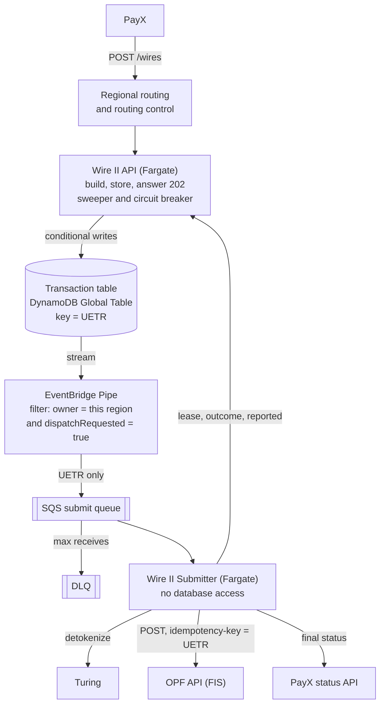
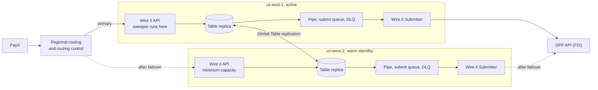
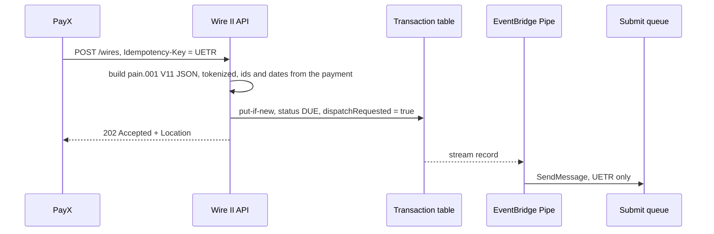
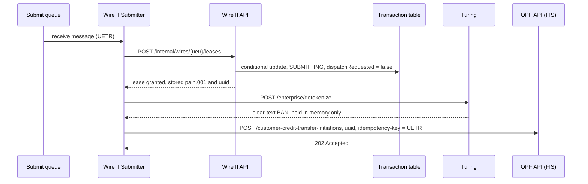
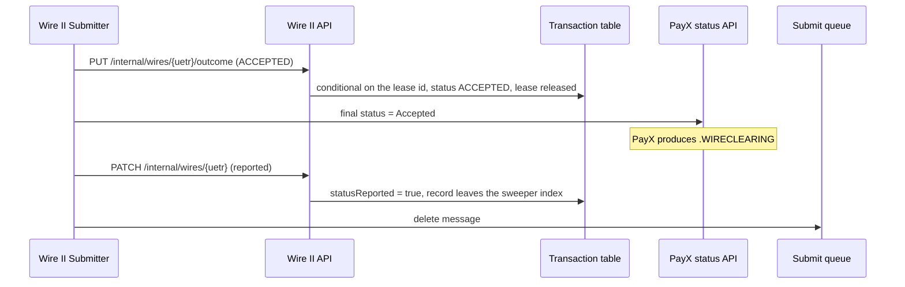
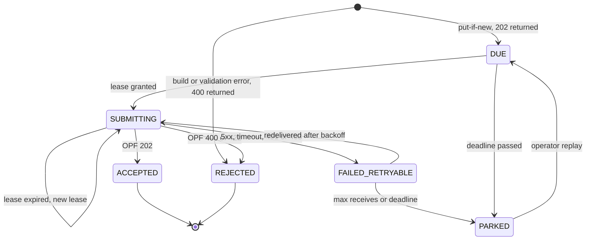
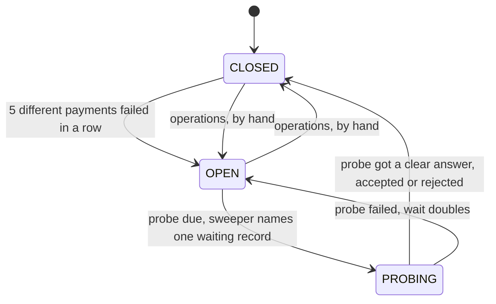
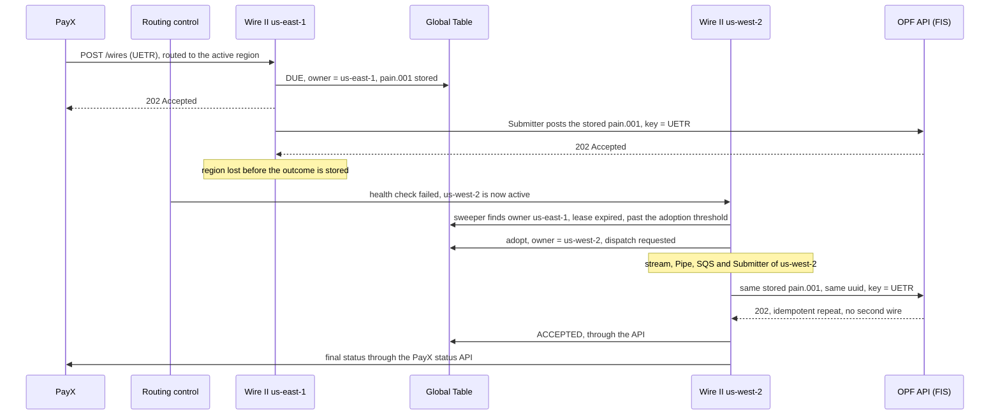

# Wire II Async Design — Detailed Design (Wire II API, Wire II Submitter, Pipe and SQS)

> **Status: DRAFT — for review.** This document follows the Capability 10 ADR page (the Wire II API) and the Capability 3 ADR page (dispatch and the Wire II Submitter) as updated on 2026-11-18. It describes option A of those pages with the agreed additions: the circuit breaker at the lease, the submit deadline with its parked reasons, the handling of a partial regional failure and the failure analysis. It supersedes the earlier detailed design, which described an event-driven pipeline with a notify path. Where the two differ, this document applies (§14.2). All starting values are proposals, to be tuned in performance and resilience testing.

## 1. Context and Goals

**Use case.** PayX must initiate payment instructions in OPF, but it does not call OPF's external API (FIS UEAPI) itself. Wire II (ASVWIREII) sits between them. It converts the completed PayX payment object into the `pain.001.001.11` (V11) JSON that OPF requires, resolves the tokenized account numbers through Turing, submits to OPF, and returns the outcome to PayX, which produces `.WIRECLEARING` or `.WIRECLEARING.STOP`. OPF is a third-party API on an external network. Its latency and availability are outside Capital One's control.

**Goals**

- The PayX call does not wait on third-party latency (OPF, and Turing in front of it).
- The PayX-facing API is idempotent on the UETR.
- Wire II owns recovery after the 202, up to the report that lets PayX produce `.WIRECLEARING`.
- Accepting a payment and submitting it are separate microservices, scaled and deployed independently.
- Clear-text BAN values are never persisted or logged.
- Replay is safe: no duplicate wire at FIS, and no `.WIRECLEARING.STOP` for a wire OPF accepted.
- The loss of us-east-1 is recovered without a manual data restore.
- A vendor outage of hours costs delay and nothing else.
- Every failure case has a defined state and an owner (§11).

**Out of scope.** pain.008 (Phase 2). Stages before Wire II in PayX. Later bank outcomes inside OPF: no pain.002 over MQ is received in Phase 1. The field mapping from the v9 converter to V11, which is on the Capability 10 ADR page. Reports, sign-on and network changes.

**Design rules**

1. **Accepted means stored.** The API answers 202 only after the record is written. From then on Wire II owns the payment.
2. **One data owner.** Only the Wire II API reads or writes the transaction table.
3. **The record is the truth.** A queue message is a pointer: it carries the UETR and nothing else.
4. **One way to submit.** Everything that needs a submission sets `dispatchRequested` on the record and lets the Pipe enqueue it.
5. **Every step is safe to repeat.** A lease admits one attempt. Every attempt sends the stored payload byte for byte, with the same `uuid` and the same idempotency key.
6. **Never rebuild, never send late.** A stored payload is never built again. Nothing is sent after the submit deadline. If Wire II cannot tell whether OPF took a payment, it says so and a person checks.
7. **The component that holds clear-text BANs has no data-store access.**
8. **Ownership is data.** Which region drives a payment is an attribute on the record, changed by a conditional write.

**Applicable ASPIRE practices**

| ID | Practice | How this design meets it |
|---|---|---|
| RE-13.3 | Born Platinum | The design is written for Platinum verification. Open point for verification: the topology is active and warm standby, not active/active (RE-10.1) |
| RE-5.1 | RTO / RPO & Resiliency Tier | New payments resume when routing switches. In-flight payments resume within the routing switch plus the adoption threshold and one sweep (minutes). Recovery point is the Global Table replication lag, typically about a second, covered by one PayX replay (§8.4), or zero with strong consistency (§8.8) |
| RE-10.1 | Compute in multi-AZ + secondary region, active/active | Both microservices run in both regions. us-east-1 serves traffic and us-west-2 is a warm standby at minimum capacity. This is active/passive and must be agreed at verification |
| RE-10.2 | Data stores multi-AZ + secondary region | DynamoDB Global Table with a replica in each region. SQS holds pointers only and is not a store of record |
| RE-10.3 | Regional affinity | API, Pipe, queue and Submitter of a region work together inside that region. Cross-region traffic is table replication only. Turing and the PayX status API are assumed reachable from both regions |
| RE-11.1 | Automated failover | A regional routing control with health checks decides the active region. The active region's sweeper adopts in-flight records by itself. Whether the switch is automatic or by runbook is open (OQ-E) |
| OE-3.2 | Operational playbooks | Three operator actions need a playbook: switching the routing control, replaying a PARKED record, and opening or closing a breaker by hand |
| OE-5.3 | Data-plane recovery | Adoption is a write to the record. The breaker and the sweeper lock are records. The one outside input is the routing control state, which the API reads |
| RE-5.3 / RE-5.4 | Degraded mode / back pressure | SQS buffer, consumer concurrency, visibility backoff, circuit breaker (§6.6, §10) |
| OE-4.1 | Alerts on region shift and replication lag | §10 |
| CY-5.4 / CY-5.5 | HSHD handling / encryption at rest | §9 |
| RE-2.2 | API intermediary | PayX → Wire II, Turing and the PayX status API go through Exchange. The internal endpoints between the two microservices are private to ASVWIREII and are not published on Exchange |

## 2. Architecture Overview

One region, all components:



Two regions, active and warm standby:



**Key properties**

- **One data owner.** Only the Wire II API touches the table. The Submitter reaches a record through the API's internal endpoints.
- **No dual write.** The queue message is produced from the committed write, by the stream and the Pipe. There is no gap between storing a payment and queueing it.
- **The queue carries the UETR only.** No payload, token or personal data enters SQS or a DLQ. Any message can be lost without losing a payment, because the sweeper dispatches from the table.
- **Each region's Pipe passes only that region's records.** Replicated writes from the other region are never dispatched twice.
- **Retries wait in SQS, an outage waits in the table.** A retry is a redelivery after a visibility backoff. While a circuit breaker is open, payments wait as records and the queues stay empty.
- **Recovery belongs to Wire II.** SQS redelivery handles normal retries. The recovery sweeper catches anything whose message is gone.
- **Clear-text BANs exist in one place:** Submitter memory, for one attempt.

| Component | Job | Runs as | Data access | Sees clear-text BANs |
|---|---|---|---|---|
| Wire II API | Idempotent `POST /wires` and `GET /wires/{uetr}`. Builds and stores the pain.001. Owns every state change. Internal endpoints for the Submitter | ECS Fargate, both regions | Sole reader and writer of the transaction table | No |
| Recovery sweeper | Puts stalled, unreported and adopted records back on the normal path. Enforces the deadline. Drives probe and drain | Inside the Wire II API, active region only, every minute | Through the API's own table access | No |
| Circuit breaker | Stops submissions to OPF or Turing while the dependency fails | Control record and logic inside the Wire II API | Control items in the transaction table | No |
| Transaction table | One record per payment, the sweeper index, the control items | DynamoDB Global Table, replicas in us-east-1 and us-west-2 | — | No, tokens only |
| Dispatch | Turns a committed write that requests dispatch into a queue message | DynamoDB stream → one EventBridge Pipe per region → SQS submit queue with a DLQ. Managed, no code | Stream read, queue send | No, UETR only |
| Wire II Submitter | Receives from SQS, leases, detokenizes, submits to OPF, records the outcome, reports the final status to PayX, marks it reported | ECS Fargate, both regions, scales on queue depth | None. Works only through the internal API | Yes, in memory only |
| Routing control | Single source of truth for which region is active | Regional routing control, for example Route 53 ARC (OQ-E) | Read by the Wire II API | No |

**Languages and runtime.** The API holds the conversion, which extends the existing pain.001 converter. The Submitter needs no conversion code, because it sends what the API stored. If the Submitter were run as a Lambda with an SQS trigger instead of an ECS service, it would be written in Go, since Java is discouraged for Lambdas because of cold starts. The contract is the same.

## 3. Request Lifecycle (Happy Path)

**Accept and dispatch**



**Lease and submit**



**Outcome and report**



Step by step:

1. **Build.** The API builds the pain.001.001.11 JSON in memory with the BAN fields still tokenized. Every generated identifier and timestamp comes from the UETR and the payment, never from the wall clock. A build or validation failure is a rejection.
2. **Store.** One conditional put-if-new keyed on the UETR writes the payload hash, the built payload, the `uuid`, status DUE, the owning region, the submit deadline and `dispatchRequested` = true. A UETR that already exists is a repeat (§6.1).
3. **Answer.** The API responds 202 with a `Location`. The response never waits on Turing or OPF. Nothing in steps 1 to 3 leaves Capital One.
4. **Dispatch.** The stream record passes the Pipe filter of the owning region, and the Pipe sends one SQS message holding the UETR.
5. **Lease.** The Submitter asks the API for a lease. The API moves the record to SUBMITTING, clears `dispatchRequested` and returns the stored payload and `uuid`.
6. **Detokenize.** The Submitter calls Turing. The clear-text value is used for the next step only and never reaches DynamoDB, SQS or the logs.
7. **Submit.** The Submitter posts the stored payload to OPF with the `uuid` header and `idempotency-key` = UETR.
8. **Record.** The Submitter records ACCEPTED, REJECTED or FAILED_RETRYABLE through the API.
9. **Report.** For a terminal outcome the Submitter calls the PayX status API, marks the record reported through the API and deletes the message.

**Contract change for PayX**

- The inbound call returns 202 Accepted and no longer waits for OPF. The final status arrives later through the PayX status API (OQ-G).
- The `Idempotency-Key` header must equal the UETR in the payload. A mismatch is a 400.
- PayX re-calls when it got no 202 (timeout or 5xx). The call is idempotent on the UETR.
- When `.WIRECLEARING` misses its SLA, PayX alerts and replays the call once with the same UETR (OQ-D). Wire II still owns recovery in every case where the record exists. The replay matters only when the record is missing (§8.4).
- `GET /wires/{uetr}` lets PayX check a payment whose status report it did not receive.
- Paths and payloads are finalized in the Wire II API specification.

## 4. Data Model

**Transaction record.** DynamoDB Global Table, replicas in us-east-1 and us-west-2, owned by the Wire II API. Partition key `uetr`.

| Attribute | Type | Purpose |
|---|---|---|
| `uetr` (partition key) | string | Idempotency key from the Payment Network Gateway. One record per payment |
| `status` | string | DUE, SUBMITTING, ACCEPTED, REJECTED, FAILED_RETRYABLE or PARKED (§5) |
| `payloadHash` | string | SHA-256 of the canonical PayX payment object. Detects a reused UETR with different content |
| `pain001` | string | The built pain.001 V11 JSON with BAN fields still tokenized. Re-sent byte for byte on every attempt |
| `requestUuid` | string | The `uuid` header. Derived from the UETR as a name-based UUID, not random, and reused on every attempt. A record created again in the other region sends exactly the same headers (OQ-A) |
| `ownerRegion` | string | The region whose Pipe dispatches the record and whose Submitter may lease it |
| `dispatchRequested` | boolean | Set by the API on create, by the recovery sweeper and by operator replay. Cleared by a lease. The Pipe filter matches on it |
| `pendingRegion` / `checkAt` | string / number | Keys of the sparse sweeper index. Present only while the record is non-terminal or its outcome is unreported. `pendingRegion` = owner. `checkAt` = last update + stall threshold |
| `leaseId` / `leaseUntil` | string / number | The current attempt's claim and its expiry |
| `attempts` | number | OPF submission attempts |
| `unansweredAttempts` | number | How many attempts may have reached OPF without a clear answer. Raised when a lease is granted. Taken back when the outcome is clear, or when the Submitter reports that nothing was sent |
| `submitDeadline` | string (ISO-8601) | Set at acceptance. After it, no lease is granted and the payment is never sent automatically (§11.4) |
| `parkedReason` | string | Set with PARKED: `MAX_RECEIVES`, `NOT_SENT` or `OUTCOME_UNKNOWN`. Tells the operator whether a replay is safe |
| `opfResponse` | map | HTTP status, OPF error code and time of the last response. Never a clear-text BAN |
| `statusReported` | boolean | Whether PayX has been told the final status |
| `createdRegion` | string | Where the record was created, for failover diagnostics |
| `createdAt` / `updatedAt` | string (ISO-8601) | Audit timestamps |
| `version` | number | Optimistic-lock counter checked on every conditional update |
| `expiresAt` | number | DynamoDB TTL. Retention to be set with records management (OQ-F) |

- Access is by UETR (get, conditional put, conditional update) plus the sweeper index, and only from the Wire II API.
- Encryption at rest uses a customer-managed KMS key in each replica region. The record holds Turing tokens, never clear-text BAN values.

**Sparse sweeper index.** A global secondary index on `pendingRegion` and `checkAt`. Only records that still need work carry these attributes, so the index stays small. Removing `pendingRegion` when a record is terminal and reported takes it out. The index exists in every replica, so the active region can see the other region's pending records.

**Control records.** The API keeps a few small control items in the same table under reserved keys. Only the API reads or writes them. The Submitter never sees them. It only sees a granted or a refused lease.

| Control item | One per | Holds |
|---|---|---|
| Circuit breaker | Dependency (OPF, Turing) and region | `state` (CLOSED / OPEN / PROBING), the UETRs that failed in a row, `nextProbeAt`, `probeUetr`, `probeInterval` |
| Sweeper lock | Region | A lock taken by a conditional write with a short expiry, so one task sweeps at a time. A duplicate sweep would be harmless anyway |

## 5. State Machine



| Status | It means | Terminal |
|---|---|---|
| `DUE` | Stored, 202 returned, waiting to be leased. Also a payment that waits while a breaker is open, and a record an operator has replayed | No |
| `SUBMITTING` | One Submitter holds the record under a lease. If the lease expires (stopped task, region loss), redelivery or the sweeper leads to a new lease | No |
| `FAILED_RETRYABLE` | The last attempt ended with 5xx, a timeout, 401 / 403 or a retryable Turing error. The message is redelivered after backoff, or the record waits while a breaker is open | No |
| `PARKED` | Automatic work has stopped. `parkedReason` says why. Alerted until an operator replays the record | No |
| `ACCEPTED` | OPF answered 202 | Yes |
| `REJECTED` | The build failed, OPF refused the payment (400, 422), or Turing gave a non-retryable answer (§11.3) | Yes |

**Reasons on PARKED.** The two deadline reasons are very different:

| `parkedReason` | Set when | What the operator may do |
|---|---|---|
| `NOT_SENT` | The submit deadline passed and no attempt ever reached OPF, for example because the breaker was open the whole time | Replay. It is always safe |
| `OUTCOME_UNKNOWN` | The submit deadline passed and at least one attempt ended without a clear answer (`unansweredAttempts` above zero). OPF may hold the payment | Check OPF first. Never replay before that |
| `MAX_RECEIVES` | The message reached the maximum number of receives while the record was not terminal | Find the cause, fix it, then replay |

**Rules for every write**

- Only the Wire II API writes. Every update is conditional and checks and raises `version`.
- One record per UETR, created by a conditional put. Two first calls at the same moment resolve to one winner.
- A lease is granted only if: the owner is this region, no lease is live, the outcome is not reported, the submit deadline has not passed, and the breakers for OPF and Turing are closed or this UETR is the probe.
- An outcome is written only with the matching lease id. The first terminal outcome wins.
- ACCEPTED and REJECTED never change, and a terminal record never causes another OPF call.
- PARKED is for non-terminal records only. A terminal record whose report to PayX keeps failing stays terminal.
- "Reported" is written only on a terminal record. It removes the record from the sweeper index.
- A re-dispatch always changes the item: the sweeper raises `version` and moves `checkAt`, also when `dispatchRequested` is already true. A write that changes nothing produces no stream event.
- A stored payload is never rebuilt.

## 6. Components

### 6.1 Wire II API

**PayX-facing API, idempotent on the UETR**

| Request | Response | Effect |
|---|---|---|
| `POST /wires`, new UETR | 202 Accepted + `Location: /wires/{uetr}` | Payment stored and dispatched. The outcome follows through the PayX status API |
| `POST /wires`, build or validation failure | 400 Bad Request, reason in the error body | Recorded as REJECTED. PayX produces `.WIRECLEARING.STOP` |
| `POST /wires`, `Idempotency-Key` differs from the UETR in the payload | 400 Bad Request | — |
| `POST /wires`, same UETR, same payload, in flight | 202 Accepted, same as the first response | No change. Recovery is owned by Wire II |
| `POST /wires`, same UETR, same payload, terminal | 200 OK with the stored outcome | OPF is never called again |
| `POST /wires`, same UETR, different payload | 409 Conflict, duplicate UETR with different content | Record unchanged. Alert. PayX produces `.WIRECLEARING.STOP` |
| Two first calls at the same moment | One 202. The other gets the repeat response | The conditional put admits exactly one |
| The table cannot be written | 5xx | Nothing is stored. PayX re-calls |
| `GET /wires/{uetr}` | 200 OK with the current status | Lets PayX check a payment whose status report it did not receive |

**Idempotency rules**

1. **One record per UETR.** The first call creates it with a conditional put. Any later call with the same UETR is a repeat.
2. **Same UETR, different content** (payload hash differs): 409, record unchanged, alert.
3. **Terminal record** (ACCEPTED or REJECTED): 200 with the stored outcome. OPF is never called again. If PayX was never told, the sweeper dispatches a report-only attempt.
4. **In flight** (DUE, SUBMITTING, FAILED_RETRYABLE or PARKED): 202 and no change. Recovery is SQS redelivery, the recovery sweeper and operator replay. A repeat from PayX never re-drives a record.
5. **Never rebuild a stored payload.** Every attempt re-sends the stored pain.001 with the stored `uuid` and the same idempotency key.
6. **Deterministic generation.** The BAH business message identifier and the group-header message identifier are the UETR with hyphens removed (32 characters, within the 35-character limit). Creation date and time come from the PayX payment's creation timestamp (OQ-C). The `uuid` header is derived from the UETR in the same way. A payload built again, in either region, is byte-identical.
7. **At-least-once delivery is expected.** SQS may deliver a message twice, and the sweeper may dispatch a record that already has a message. The conditional lease admits one attempt, and the OPF idempotency key covers anything that slips through.

The stored record of a build failure is terminal from the start. Whether it counts as already reported, since the 400 is the answer, is to be fixed in the Wire II API specification.

### 6.2 Internal API

Used only by the Submitter, plus two operator actions. Private to ASVWIREII, authenticated service to service, not published on Exchange.

| Endpoint | Purpose | Guard |
|---|---|---|
| `POST /internal/wires/{uetr}/leases` | Claim the record for one attempt. Returns the stored payload, `uuid` and status | Conditional: owner = this region, no live lease, not reported, submit deadline not passed, and the breakers for OPF and Turing closed (or this UETR is the probe). A terminal but unreported record returns the outcome, so the Submitter can report it |
| `PUT /internal/wires/{uetr}/outcome` | Record the result and release the lease: ACCEPTED, REJECTED or FAILED_RETRYABLE. With FAILED_RETRYABLE the Submitter states the cause and whether the request left Capital One | Conditional on the lease id. The first terminal outcome wins |
| `PATCH /internal/wires/{uetr}` | Mark the outcome as reported to PayX | Only on a terminal record |
| `POST /internal/wires/{uetr}/dispatches` | Operator replay: request dispatch again, to revive a PARKED record or force a re-drive | Operations role only. Never on a terminal record that is already reported |
| Open or close a breaker by hand (path to be set in the API specification) | Manual control of a circuit breaker | Operations role only. Restricted and audited |

What the API does with the outcome call, besides the status:

- It counts FAILED_RETRYABLE results by cause for the breaker of that dependency (§6.6).
- It keeps `unansweredAttempts` right: taken back on a clear answer, or when the Submitter reports that nothing was sent.

| Lease answer | Submitter does |
|---|---|
| Granted | Detokenize, submit, record the outcome |
| Terminal, not yet reported | Go straight to reporting |
| Refused: breaker open | Delete the message. The record waits and the sweeper dispatches it again later |
| Refused: not owner, lease held, already reported, deadline passed | Delete the message, or leave it to reappear |

A refused lease is normal. It is how duplicates, stale messages and stranded messages from another region are discarded.

### 6.3 Dispatch (stream, Pipe, SQS)

Dispatch is configuration, not code. The table's change stream feeds one EventBridge Pipe in each region. The Pipe passes only records owned by that region whose `dispatchRequested` flag is true, and sends an SQS message carrying the UETR alone.

Pipe filter (proposed form; each region deploys its own region name):

```json
{
  "eventName": ["INSERT", "MODIFY"],
  "dynamodb": {
    "NewImage": {
      "ownerRegion": { "S": ["us-east-1"] },
      "dispatchRequested": { "BOOL": [true] }
    }
  }
}
```

| Setting | Value |
|---|---|
| Pipes | One per region. Source: the stream of that region's replica. Target: that region's submit queue |
| Message | The UETR only, produced by the Pipe's input transformer |
| Undeliverable events | Pipe retries, then the Pipe's own DLQ. Anything lost is re-dispatched by the recovery sweeper |
| Submit queue | SQS standard queue with a DLQ. Order is not preserved and not needed |
| Retention | Working queue 12 hours, DLQ 24 hours (proposed), so a DLQ empties itself |
| Maximum receives | Set so that it equals about 2 hours of retries (proposed). With the backoff of §11.1 that is 12 to 13 receives |
| Visibility timeout | Longer than the worst-case Turing + OPF attempt, like the lease |
| Encryption | Queue and DLQs with a customer-managed KMS key |
| us-west-2 | Pipe, queue and DLQ are deployed and enabled before any failover, not created at failover time |

**A re-dispatch must change the item.** A stream filter matches fixed values on the new image. It cannot compare old and new. And a write that changes nothing produces no stream event at all. So every dispatch request is a real change to the record: the sweeper sets `dispatchRequested`, raises `version` and moves `checkAt`, and an operator replay follows the same rule. The lease clears the flag, so later writes (outcome, reported) do not match the filter and enqueue nothing.

If EventBridge Pipes cannot be deployed through the pipeline, a small stream-triggered Lambda applies the same filter and sends to SQS (OQ-H). Nothing else changes.

### 6.4 Wire II Submitter

The only component that holds a clear-text BAN. It has no DynamoDB permissions.

1. **Receive** the SQS message (UETR).
2. **Lease** the record: `POST /internal/wires/{uetr}/leases`. On a grant the API has moved the record to SUBMITTING and returns the stored payload and `uuid`. Other answers are handled as in §6.2.
3. **Detokenize** the BAN value(s) through Turing: `POST /enterprise/detokenize`, OAuth token from the DevExchange Gateway, type BAN, GLOBALBAN, UKBAN or NONUSBAN. The clear-text value is held in memory for this attempt only. It replaces the token in the stored payload in memory. Nothing else in the payload changes.
4. **Submit** the stored payload to OPF: `POST /customer-credit-transfer-initiations` with the stored `uuid` and `idempotency-key` = UETR.
5. **Record the outcome** through the API: ACCEPTED, REJECTED or FAILED_RETRYABLE, with cause and whether the request left Capital One.
6. **Finish.**
   - Terminal outcome: report the final status through the PayX status API, mark it reported, delete the message. If the report fails, the message is left for redelivery, and the next lease answers "terminal, not yet reported".
   - Retryable outcome: leave the message and set its visibility to the next backoff. SQS redelivers it.
   - After the maximum number of receives the message moves to the DLQ and a non-terminal record is marked PARKED with `MAX_RECEIVES`, with an alert.

**No immediate retry after a timeout.** A timeout or a 5xx is never retried at once inside the attempt, because OPF may still be working on the first request. The next attempt is the redelivery.

**Runtime**

- An ECS Fargate service in each region. It scales on queue depth and the age of the oldest message, independently of the API.
- Consumer concurrency is the back-pressure limit on Turing and OPF. Bursts wait in the queue.
- On deploy or scale-in, tasks stop receiving on SIGTERM and finish in-flight attempts within the stop timeout. An attempt that is cut off leaves its message to reappear and its lease to expire.
- Each step is an internal call to the API, so the Submitter depends on the API being up in its region.

### 6.5 Recovery sweeper

- **Where and when.** Inside the Wire II API, in the active region only, every minute. A per-region lock item lets one task sweep at a time.
- **How it finds work.** It queries the sparse index for `pendingRegion` = this region with `checkAt` ≤ now. For adoption it queries `pendingRegion` = each inactive region and takes the records whose lease has expired and that are past the adoption threshold.
- **Thresholds (proposed).** The same-region stall threshold is about 20 minutes. It exceeds the longest SQS backoff plus the lease time, so the sweeper never races normal retries. The adoption threshold is about 2 to 3 minutes (lease time plus a margin), because the owning region is no longer active.
- **It never calls Turing or OPF.** It only sets `dispatchRequested`, and the owner when adopting. Every submission still goes through the Pipe, the queue, the lease and the stored payload.
- **Sweepers run only in the active region,** so the two regions never adopt from each other at the same time.

| Found | Sweeper action |
|---|---|
| DUE, SUBMITTING with an expired lease, or FAILED_RETRYABLE, owned by this region and stalled | Request dispatch again. The Submitter re-sends the stored payload with the same key |
| ACCEPTED or REJECTED with the outcome not reported to PayX | Request dispatch again. The lease answers "terminal, not yet reported" and the Submitter only reports. Repeated until PayX has been told |
| Any pending record owned by an inactive region, lease expired, past the adoption threshold | Adopt (owner = this region) and request dispatch |
| The circuit breaker of this region is open | **Hold.** Do not request dispatch for pending records. When a probe is due, name one waiting record as the probe and request dispatch for it only |
| The circuit breaker has just closed | **Drain.** Request dispatch for the waiting records, oldest first, 60 per sweep (proposed) |
| A pending record whose `submitDeadline` has passed, with no live lease | Mark PARKED with `parkedReason` = `NOT_SENT` or `OUTCOME_UNKNOWN`. Alert (§11.4) |
| PARKED | No automatic action. It stays alerted until an operator replays the record |

### 6.6 Circuit breaker

OPF is a vendor system. Without a breaker, every in-flight payment retries on its own during an outage until its message reaches the DLQ, and operators would have to replay hundreds of records afterwards.

**Why a record.** The API runs as several tasks in two regions, each with its own memory. A breaker held in memory would exist once per task. As a control record, every task reads the same state. There is one record per dependency (OPF, Turing) and per region, because one region can lose its route to OPF while the other still has one.

**Why at the lease.** A Submitter cannot call OPF without a lease, so refusing leases stops the calls. The Submitter needs no breaker logic and no access to the control record. A refused lease burns no receive and counts no attempt.



| Who | Reads the breaker | Writes the breaker |
|---|---|---|
| API, outcome call | — | Adds each FAILED_RETRYABLE UETR by cause. Sets OPEN at the threshold and pages. After a probe: CLOSED on a clear answer, OPEN with a doubled wait on a failure |
| API, lease call | On every lease request | Nothing. It refuses the lease while the breaker is open, except for the probe UETR |
| Sweeper (inside the API) | On every sweep | Names the probe when one is due. Holds while open. Drains after closing |
| Operations | Through the API | OPEN or CLOSED by hand. Restricted and audited |
| Submitter | Never | Never. It sees a granted or a refused lease |

| Step | What happens |
|---|---|
| Opens | When a set number of *different* payments have failed in a row, the API sets the breaker to OPEN and pages. One payment that keeps failing does not open it. Counted: OPF 5xx, timeout, 401 / 403. For Turing: 203 code 109, 401 / 403, 500 |
| While open | Lease requests are refused. The Submitter deletes the message. The record stays DUE or FAILED_RETRYABLE. The API keeps answering 202 to PayX. Queues stay empty. The backlog is in the table |
| Probe | When a probe is due, the sweeper names one waiting record and requests dispatch. The API grants the lease for that UETR only. A clear answer from OPF, accepted or rejected, closes the breaker. A failure reopens it and doubles the wait. The next probe is a different payment |
| Drain | After closing, the sweeper requests dispatch for the waiting records oldest first. Consumer concurrency still caps the call rate |

**Proposed values** (configuration, to be tuned with OPF's rate limit, OQ-J)

| Setting | Proposed |
|---|---|
| Opens after | 5 different payments failing in a row |
| First probe | 1 minute after opening |
| Probe interval | Doubles after each failed probe: 1, 2, 4, 8 minutes, then every 15 minutes |
| Drain after closing | 60 records per sweep, oldest first |
| Opened or closed by hand | Allowed. Restricted and audited |

**A probe, not a health check.** FIS has no health endpoint, so the only test that means something is one real payment. The probe is a payment that is waiting anyway, sent with its normal idempotency key. If OPF is back, that payment is done and the breaker closes. A rejection also closes it: a 400 proves that OPF is answering.

**At low volume the breaker may never open,** since it takes several different payments. Each payment then follows the normal redelivery backoff, which has the same effect.

The Turing breaker uses the same record and the same steps. The ADR pages describe the probe result in OPF terms. What exactly closes the Turing breaker is to be fixed in build.

## 7. Why a Stream, a Pipe and SQS; and What the DLQ Means

The three do different jobs. The stream turns a committed write into an event. The Pipe filters it and hands it over without code. SQS is the work buffer: it decides how many submissions run at once and what happens to failures.

| Concern | This design | The alternative and its weakness |
|---|---|---|
| Storing and queueing | One write. The message comes from the committed write | The API writes, then sends to SQS itself: a crash between the two strands a payment |
| Dispatch code | None. A managed Pipe with a filter | A reconciler or worker inside the API: request handling and third-party calls share one runtime, and all scheduling is custom code |
| Retry timing | SQS redelivery with visibility backoff | A custom timer per record |
| Rate toward Turing and OPF | Consumer concurrency on one queue. Bursts wait | Calls at the rate payments arrive |
| A message that cannot be processed | Maximum receives, then the DLQ and an alarm | Blocks or loops |
| Backlog visibility | Queue depth and age of the oldest message | Custom queries |
| Failover and drain surges | Adopted and drained records pass the same queue and the same concurrency limit | A burst straight at OPF |
| A lost message | The sweeper dispatches from the table after the stall threshold | — |

A stream alone is not enough: it keeps records for 24 hours and cannot deliver to SQS by itself.

**What the DLQ means**

1. A queue message is only a pointer. The payment is in the table, never in the DLQ.
2. A message reaches the DLQ after the maximum number of receives. That means a defect (code, deploy, permission), or a payment that failed for about two hours while others succeeded.
3. A vendor outage does not fill the DLQ. The breaker refuses leases, messages are deleted, and payments wait in the table.
4. The record of that message is marked PARKED with `MAX_RECEIVES`, if it is not terminal.
5. The operator replays the **record** through the API (`POST /internal/wires/{uetr}/dispatches`), never the message. There is no DLQ redrive.
6. DLQ messages expire by themselves. DLQ retention is 24 hours and the working queue's is 12 hours. Nobody purges a DLQ.
7. The alarm is on arrival: it fires when a message arrives in the DLQ, not for as long as one is present.
8. A terminal record whose report to PayX keeps failing may also leave a message in the DLQ. The record stays terminal, and the sweeper keeps dispatching report-only attempts until PayX has been told.
9. Whether an incident is over is read from the table: the PARKED count and the stalled-record alarm.

**One payment, with clock times.** The Submitter is broken from 09:55 to 10:40: a bad deploy leaves it with a wrong OPF client set-up, and every call is refused with 401. Volume is low, so fewer than five different payments fail and the breaker stays closed. Values are the proposed ones.

| Time | What happens | On the record |
|---|---|---|
| 10:00:00 | The API stores the payment and answers 202. The Pipe sends one message. Receive 1: lease, Turing, OPF call refused. The Submitter records the failure and sets the visibility to 30 s | FAILED_RETRYABLE, `checkAt` about 10:20 |
| 10:00:30 | Receive 2. Fails. Visibility 1 min | Updated, `checkAt` moves |
| 10:01:30 | Receive 3. Fails. Visibility 2 min | Updated |
| 10:03:30 | Receive 4. Fails. Visibility 5 min | Updated |
| 10:08:30 | Receive 5. Fails. Visibility 10 min | Updated |
| 10:18:30 | Receive 6. Fails. Visibility 15 min | `checkAt` about 10:38 |
| every minute | The sweeper runs. Each attempt updated the record, so its `checkAt` is always ahead of the clock. **The sweeper does nothing for this payment.** It would act only if the message were lost and the record stood still for 20 minutes | Unchanged by the sweeper |
| 10:33:30 | Receive 7. Fails. Visibility 15 min | `checkAt` about 10:53 |
| 10:40 | The fix is deployed | Unchanged |
| 10:48:30 | Receive 8. Lease, Turing, OPF 202. Outcome recorded, PayX told, message deleted | ACCEPTED, reported, out of the index |

If the fix had not come:

| Time | What happens | On the record |
|---|---|---|
| 10:48 to 11:48 | The message is redelivered every 15 minutes and fails each time | FAILED_RETRYABLE |
| about 12:00 | The maximum number of receives is reached after about two hours. SQS moves the message to the DLQ. The alarm fires on arrival. The record is marked PARKED | PARKED, `MAX_RECEIVES` |
| after | The sweeper leaves a PARKED record alone. The alert stays until someone acts | PARKED |
| after the fix | The operator calls `POST /internal/wires/{uetr}/dispatches`. The Pipe sends a new message. The Submitter leases and sends the stored payload with the same key | DUE, SUBMITTING, then ACCEPTED |
| 24 hours after the message was created | SQS deletes the old message from the DLQ. Nobody touches it | — |

If the Submitter cannot run at all, it can neither set a backoff nor tell the API about a final attempt. The message then reappears each time its visibility timeout ends and moves to the DLQ at the receive limit, and the sweeper re-dispatches the stalled record after the stall threshold. The DLQ alarm and the stalled-record alarm point at the fault. How the record is marked PARKED in that case is an implementation point to settle.

## 8. Regional Failover

### 8.1 Topology

Active and passive. us-east-1 serves traffic. us-west-2 runs the same two microservices at minimum capacity, with its own Pipe, queue and DLQ, against its Global Table replica. Each Pipe passes only its own region's records, so us-west-2 never dispatches us-east-1's work. A regional routing control is the single source of truth for which region is active (OQ-E).

### 8.2 Detection and switch

When the us-east-1 health check fails, the routing control marks us-west-2 active and new calls go there. There is no data restore step: the table is already replicated. Whether the switch is automatic on the health check or a runbook step is open (OQ-E).

### 8.3 Adoption

- New payments are owned by us-west-2 from the start.
- Payments that were in flight in us-east-1 are adopted by the us-west-2 sweeper once their lease has expired and the adoption threshold has passed.
- Adoption is just a write: owner = us-west-2 and dispatch requested. The us-west-2 Pipe enqueues the record and its Submitter re-sends the stored payload.
- OPF treats a payload it already accepted as an idempotent repeat (to be confirmed, OQ-A).

**Recovery objectives.** New payments resume as soon as routing switches. In-flight payments resume within the routing switch time plus the adoption threshold and one sweep, which is minutes. The recovery point is the Global Table replication lag, typically about a second.

### 8.4 The replication-lag window and the PayX replay

A payment accepted in the last moment before the loss, whose record had not yet replicated, is not in us-west-2. This is the one case Wire II cannot heal by itself, because the record is not there.

- When `.WIRECLEARING` misses its SLA, PayX replays the call once with the same UETR (OQ-D).
- us-west-2 has no record, creates it and submits.
- Deterministic generation makes the payload and the `uuid` identical. If us-east-1 had already reached OPF, this is an idempotent repeat.
- When us-east-1 returns, the older copy of the record loses to the newer one.
- Without a replay, the payment would wait until us-east-1's data replicates on recovery.

### 8.5 Stranded messages and fallback

- Messages left in the us-east-1 queue are harmless. When us-east-1 returns, its Submitter's lease request is refused because the record is owned by us-west-2, and the message is deleted.
- Fallback: flip the routing control back once replication has caught up. The us-east-1 sweeper then adopts any stalled us-west-2 records under the same rule.

### 8.6 Split-brain

DynamoDB conditional writes are evaluated per region, and concurrent writes in two regions resolve last-writer-wins. So the lease is not a cross-region lock. Protection comes from five things together:

1. the single routing control,
2. region-scoped Pipes,
3. sweepers that run only in the active region,
4. the deterministic payload and `uuid`,
5. the UETR idempotency key at OPF, which is the backstop.

### 8.7 Partial regional failure

A region can be healthy and still unable to send, for example when a security group or proxy change cuts the active region's Submitter off from the partner gateway. The API accepts payments and grants leases. Every OPF call times out.

- The breaker of that region opens (§6.6). Payments wait. None is parked or sent to the DLQ because of it.
- The alarm "breaker open in the active region, closed in the other" names the situation.
- "OPF breaker open for longer than a set time" is an input to the routing control (OQ-E). When the active region is switched, the other region's sweeper adopts the waiting records under the normal adoption rule and its Submitter sends them.
- Attempts that timed out count as unanswered although nothing reached OPF. The resend with the same key and bytes resolves them.

### 8.8 Strong consistency as an option

With DynamoDB multi-Region strong consistency (replicas in us-east-1 and us-west-2 and a witness in a third region), the 202 is given only after a second region holds the record.

| Topic | Effect |
|---|---|
| Replication-lag window | Disappears. The recovery point at the table is zero |
| Lease | Becomes a real cross-region lock |
| Cost | Writes wait for a second region. A write that collides with one in the other region fails and is retried. A region that cannot reach a second region cannot write |
| Limits | The mode has no TTL and no transactions, so `expiresAt` would need another retention mechanism. The table must be empty when it is converted |
| Status | An option. It needs platform confirmation (OQ-I). The design above works without it |

### 8.9 Failover prerequisites (required before go-live)

- FIS allow-lists the NAT egress IPs of both regions.
- OPF, Turing and PayX status API credentials, and the Secrets Manager secrets, exist in us-west-2.
- KMS keys for the table, queues and secrets exist in both regions.
- The us-west-2 Pipe, queue and DLQ are deployed and enabled.
- The routing control and its health checks are in place, and the Wire II API can read the control state in both regions.
- A regional failover game day passes in a non-production environment.

### 8.10 Failover and adoption, the worst case

us-east-1 is lost after OPF accepted the wire, before the outcome was recorded or PayX was told.



### 8.11 Testing

- **Failover game day**, non-production, before go-live: lose the active region under load, verify adoption, no lost payment and no second wire. Then fall back.
- **Mid-attempt loss:** stop a Submitter after the OPF call and before the outcome call.
- **Partial failure:** block one region's route to OPF. Verify the breaker, the alarm and the switch.
- **Outage:** an OPF mock that fails for hours. Verify open, probe, drain, and that nothing reaches the DLQ.
- **Dispatch:** Pipe stopped, queue purged, a message that cannot be processed.
- **Contract test:** build the same payment twice and compare the bytes, including the `uuid`.
- **FIS sandbox:** a repeat with the same key and payload, and two repeats at once (§11.7).

## 9. HSHD / BAN Handling and Least Privilege (CY-5.4, CY-5.5)

- Clear-text BANs exist only in Submitter memory, for one attempt. The table, the queue, the DLQs and the logs carry only tokens or UETRs.
- Turn off HTTP client wire logging in the Submitter. Exclude request and response bodies from tracing. Never cache detokenized values.
- `opfResponse` holds the HTTP status, OPF's error code and the time. Raw error bodies are not stored, because they may echo payload fields.
- Logs carry the UETR for correlation, and never a clear-text BAN or a full request or response body.
- The Submitter is the component in scope for the HSHD / un-tokenized data handling review. It has its own identity and no data-store access. The API cannot detokenize.
- The table is encrypted with a customer-managed KMS key in each replica region. Queues and DLQs are encrypted with a customer-managed key.
- The stored pain.001 also holds names and addresses. Its retention follows the data classification (OQ-F).
- Operator replay is limited to an operations role. Manual breaker control is restricted and audited.
- Payload-level encryption to FIS stays an open, FIS-pending item (TLS only today). It is unaffected by this design.

| Identity | Allowed | Not allowed |
|---|---|---|
| Wire II API | Conditional get / put / update and the sweeper index query on the transaction table. KMS for the table. Read the routing control state | SQS. Turing. OPF. PayX status API |
| EventBridge Pipe | Read the table stream. Send to the submit queue | Anything else |
| Wire II Submitter | Receive / delete / change visibility on its queue. Turing. OPF. PayX status API. The Wire II internal endpoints | Any DynamoDB access |

## 10. Back-Pressure, Degraded Mode, and Alerts

**Back pressure (RE-5.4)**

- Submitter consumer concurrency caps the call rate to Turing and OPF. Bursts wait in the queue.
- Visibility backoff spaces the retries of one payment: 30 s, 1, 2, 5, 10, then 15 minutes (proposed).
- The drain after an outage is paced: 60 records per sweep (proposed).
- The Submitter scales on queue depth and the age of the oldest message.

**Degraded mode (RE-5.3)**

| Condition | Behavior |
|---|---|
| OPF or Turing fails for several different payments | The breaker for that dependency and region opens. The API keeps answering 202. The backlog grows in the table. One probe at a time tests recovery, then the backlog drains |
| PayX status API unreachable | The outcome is already stored. The message is redelivered, and the sweeper dispatches report-only attempts. `GET /wires/{uetr}` and a repeat `POST` also return the outcome |
| Wire II API down in a region | The Submitter of that region cannot work. The routing control switches region |
| Sweeper not running | The normal path still works. Lost messages wait until it runs again |

**Alerts, per region (OE-4.1)**

- A metric per state transition, tagged with the region.
- Age of the oldest message in the submit queue.
- A message arriving in the DLQ.
- Pipe delivery failures, and records the sweeper had to re-dispatch.
- Records that are terminal but not reported to PayX within the expected window.
- Stalled records.
- Any OPF 422, and any 409 from the API.
- Global Table replication latency.
- A circuit breaker opens, by dependency and region.
- A breaker is open in the active region while the other region's is closed.
- PARKED records, by `parkedReason`.
- Sweeper metrics per run: records re-dispatched, records adopted, PARKED count. Alarm when no sweep has run in the active region for five minutes.
- A change of the active region.
- On the PayX side: `.WIRECLEARING` not produced within the SLA. This is the last line of defense, and it triggers the one replay.

## 11. Failure Handling

### 11.1 Retries

| Layer | Owner | Trigger | Proposed starting values |
|---|---|---|---|
| Pipe dispatch | EventBridge Pipe | A write with `dispatchRequested` = true and owner = this region | Pipe retries and its own DLQ for undeliverable events. Anything lost is re-dispatched by the sweeper |
| Redelivery with backoff | SQS + Wire II Submitter | Retryable outcome (5xx, timeout, 401 / 403, Turing 203 code 109) while the breaker is closed | Visibility set from the receive count: 30 s, 1 min, 2 min, 5 min, 10 min, then 15 min |
| Circuit breaker | Wire II API | Several different payments failing in a row | Opens after 5. Probes after 1, 2, 4, 8 minutes, then every 15. Drains 60 per sweep (§6.6) |
| Lease expiry | SQS | A Submitter task stopped mid-attempt | Visibility timeout and lease time both exceed the worst-case Turing + OPF attempt |
| Parking | SQS DLQ, Wire II API | Maximum receives reached (about 2 hours of retries), or the submit deadline | Alarm when a message arrives in the DLQ. The API marks the record PARKED with its reason |
| Recovery sweep | Wire II API, active region | Stalled or unreported record. Record of an inactive region | Every minute. Stall threshold about 20 min. Adoption threshold about 2 to 3 min (§6.5) |
| Operator replay | Operations | Investigated PARKED record | `POST /internal/wires/{uetr}/dispatches`. The DLQ message is not needed |
| PayX call retry | PayX | No 202 received (timeout or 5xx) | Per PayX policy. Idempotent on the UETR |
| PayX replay | PayX | `.WIRECLEARING` missed its SLA | Once, with the same UETR (OQ-D) |

SQS redelivery handles normal retries. The sweeper acts only after the stall threshold, which is longer than the longest backoff, so the two never race.

### 11.2 OPF response mapping

| OPF response | Wire II status | Reported to PayX | PayX stage |
|---|---|---|---|
| 202 Accepted | ACCEPTED | Accepted | `.WIRECLEARING` |
| 400 Bad Request (validation) | REJECTED | Rejected | `.WIRECLEARING.STOP` |
| 422 Idempotent replay, different payload | REJECTED (alert) | Rejected, duplicate UETR with different content | `.WIRECLEARING.STOP` |
| 401 / 403 | FAILED_RETRYABLE (alert). Counts toward the breaker | Nothing yet. Redelivered after backoff, or held while the breaker is open | None until a terminal outcome |
| 500 / 503 / timeout | FAILED_RETRYABLE. Counts toward the breaker | Nothing yet. Redelivered after backoff, or held while the breaker is open | None until a terminal outcome |
| Maximum receives reached | PARKED (alert), reason `MAX_RECEIVES` | Nothing yet. An operator replay revives it | None until a terminal outcome |

A 422 should be impossible on a genuine repeat, because the stored payload is re-sent byte for byte and a payload built again is identical. Any 422 therefore signals a defect or a reused UETR, and raises an alert.

### 11.3 Turing response handling

Read against Turing's documented error codes for 203, not as one blanket policy. "Retryable" means the message is redelivered after backoff.

| Turing response | Meaning | Treatment |
|---|---|---|
| 200 | Success, clear-text value returned | Proceed to the OPF submission |
| 203, code 105 (ID parameter length exceeds limit) | Malformed request construction | Block submission. Non-retryable. Alert: a Wire II defect, not a transient issue |
| 203, code 106 (VALUE parameter invalid or out of range) | The stored token value itself is malformed | Block submission. Non-retryable. Alert: a bad token upstream of this call |
| 203, code 108 (token parameter invalid) | Not a valid Turing token | Block submission. Non-retryable. Alert |
| 203, code 109 (lookup database internal error) | Transient backend lookup failure | Retryable. Counts toward the Turing breaker |
| 400 | Bad request (malformed call) | Block submission. Non-retryable. Alert. Same bucket as OPF 400 |
| 401 / 403 | Unauthorized, or client not entitled | Technical failure. Alert. Same bucket as OPF 401 / 403. Counts toward the Turing breaker |
| 500 | Turing backend error | Technical failure, retryable. Counts toward the Turing breaker |

The ADR pages do not name the status for the non-retryable rows. This document reads them as REJECTED, as for OPF 400, since that is the only non-retryable outcome the API accepts. To be confirmed. A Turing failure means nothing was sent to OPF, so the Submitter reports that the request did not leave Capital One and the attempt is not counted as unanswered.

### 11.4 Submit deadline and unknown outcome

`submitDeadline` is set at acceptance. It is the earliest of three limits (OQ-L):

- how long FIS remembers an idempotency key (OQ-A),
- the cut-off for the payment's execution date,
- how long product allows a payment to wait.

No lease is granted after it, so a retry can never reach OPF after the key has been forgotten. When the deadline passes, the sweeper marks the record PARKED once no lease is live:

- **`NOT_SENT`** if `unansweredAttempts` is zero. Nothing ever reached OPF. A replay is always safe.
- **`OUTCOME_UNKNOWN`** if `unansweredAttempts` is above zero. OPF may hold the payment. It is not replayed before someone has checked OPF. A status inquiry by UETR would help here, if OPF offers one (OQ-B).

What else holds:

- PayX is told nothing while a record is PARKED. A repeat call from PayX gets 202 and changes nothing.
- The lease guard refuses a record whose deadline has passed. A replay after the deadline therefore needs a new deadline. How the operator sets it is not yet defined and belongs with OQ-L.
- PARKED reached through maximum receives keeps the reason `MAX_RECEIVES`.

### 11.5 FIS down for hours: a worked example

OPF stops answering at 13:00 and returns at 17:00. Values are the proposed ones.

| Time | What happens | State |
|---|---|---|
| 13:00 | OPF calls start to time out. Each failing attempt is recorded as FAILED_RETRYABLE, and its message gets a visibility backoff | A few payments carry an unanswered attempt |
| about 13:02 | Five different payments have failed in a row. The API opens the breaker and pages | Breaker OPEN |
| from 13:02 | The API keeps answering 202. New payments are stored as DUE and dispatched once. The lease is refused, and the Submitter deletes the message. Redelivered messages of the earlier failures end the same way | **Queues empty. The backlog is in the table** |
| 13:03, 13:05, 13:09, 13:17 | Probes after 1, 2, 4 and 8 minutes. Each is one real payment. Each fails, and the next is a different payment | Breaker OPEN, then PROBING, then OPEN |
| 13:32 to 16:47 | A probe every 15 minutes. Each fails | Fewer than 20 probes in four hours |
| any time | A waiting payment whose `submitDeadline` passes is parked: `NOT_SENT` if nothing was sent, `OUTCOME_UNKNOWN` if an attempt went out | PARKED, alert |
| 17:00 | OPF is back | — |
| 17:02, at the latest 17:15 | The first probe after 17:00 gets a clear answer. The breaker closes | Breaker CLOSED |
| from then | The sweeper drains the backlog oldest first, 60 per sweep, which is 60 a minute. Consumer concurrency caps the call rate | Backlog ÷ 60 minutes to drain |
| after | Payments that carried an unanswered attempt are re-sent with the same key and bytes | Depends on how OPF treats a repeat (§11.7) |

What this costs, and what it does not:

- No message reaches the DLQ and no operator action is needed.
- No receive is burned and no attempt is counted while the breaker is open.
- Each failed probe leaves one payment with an unanswered attempt. Probes rotate, so no single payment collects them.
- The recovery is noticed within one probe interval, 15 minutes at the longest. Operations can close the breaker by hand sooner if FIS confirms the recovery.
- A payment waits only until its submit deadline.

### 11.6 Failure analysis

Severity is the effect on a payment if the response did not exist: **High** = money could move twice or a payment could be lost. **Medium** = delay. **Low** = none.

| # | Component | Failure | Detected by | Response | Severity |
|---|---|---|---|---|---|
| 1 | Wire II API | Down in the active region | Routing health check | Routing control switches region. The other sweeper adopts | Medium |
| 2 | Wire II API | Stops after the write, before the 202 | PayX timeout | PayX re-calls and gets the repeat response | Low |
| 3 | Transaction table | Cannot be written | 5xx rate, health check | API answers 5xx. PayX re-calls. Nothing is stored | Medium |
| 4 | Pipe | Stopped, or not delivering to SQS | Pipe failures. Records the sweeper had to re-dispatch | Pipe retries and its DLQ. The sweeper re-dispatches after the stall threshold | Medium |
| 5 | Submit queue | Message lost or queue purged | Stalled-record alarm | Sweeper re-dispatches | Low |
| 6 | Submitter | Stops mid-attempt, after OPF accepted | Lease expiry | Redelivery or sweeper. Same payload, same key | High |
| 7 | Submitter | Cannot run: defect, bad deploy, missing permission | Message in the DLQ. Stalled records | Record PARKED with `MAX_RECEIVES`. Operator replay after the fix | Medium |
| 8 | Submitter | Cannot reach OPF from the active region | Breaker open here, closed in the other region | Breaker. Switch the active region (§8.7) | Medium |
| 9 | Turing | Down | Breaker for Turing | Payments wait. Probe. Drain | Medium |
| 10 | OPF | 5xx or timeout on some calls | Error rate | Redelivery with backoff. Same key | High |
| 11 | OPF | Down for hours | Breaker open | Wait in the table. Probe. Drain (§11.5) | Medium |
| 12 | OPF | Rejects our credentials or set-up (401 / 403) | Same answer on several payments | Breaker opens and pages. No payment is failed | Medium |
| 13 | OPF | Accepts a repeat as a new payment | Reconciliation. OPF duplicate checks | None beyond same key, same bytes and the deadline. Must be ruled out with FIS (OQ-A, OQ-K) | High |
| 14 | PayX status API | Unreachable | Terminal-not-reported alarm | Message redelivered. The sweeper dispatches report-only attempts until PayX is told. The record stays terminal, never PARKED | Medium |
| 15 | Sweeper | Not running in the active region | No-sweep alarm | The normal path still works. Lost messages wait | Medium |
| 16 | Region | Lost with payments in flight | Health check | Routing control. Adoption by the other sweeper | Medium |
| 17 | Region | Record not replicated before the loss | PayX SLA alert | PayX replays once with the same UETR and the active region creates the record again (§8.4). Without a replay it waits for the region. Removed by strong consistency (§8.8) | High |
| 18 | Deploy | The conversion changes while payments wait | Contract test | The stored payload is re-sent, never rebuilt | High |

Rows added from the risks on the Capability 10 ADR page. Their severity is proposed here.

| # | Component | Failure | Detected by | Response | Severity |
|---|---|---|---|---|---|
| 19 | Wire II API | A non-deterministic field slips into the payload | OPF 422 alarm. Contract test | Deterministic-generation rule. Contract test that builds the same payment twice and compares the bytes | High |
| 20 | Routing | Both regions serve traffic at once | Routing control state | Active / passive routing. Region-scoped Pipes. The OPF idempotency key is the backstop | High |
| 21 | Region | us-west-2 not allow-listed at FIS, or credentials missing there | Failover fails at the first OPF call | Prerequisites checklist and the failover game day (§8.9) | Medium |
| 22 | PayX | The same UETR arrives with different content | 409 alarm | 409. Record unchanged. PayX produces `.WIRECLEARING.STOP` | High |

The High rows are 6, 10, 13, 17, 18, 19, 20 and 22. Rows 6, 10 and 13 depend on one answer from FIS, which is the go-live gate below.

### 11.7 Go-live gate

Wire II repeats a request with the same key by design: after a stopped task, an unclear result, a redelivery or a regional failover. It must not go live until FIS has confirmed how OPF treats such a repeat (OQ-A):

- how long the idempotency key is remembered,
- whether the payload comparison is byte-exact,
- whether the `uuid` header takes part,
- what OPF returns for a repeat that arrives while the first request is still in progress.

This must also be tested in the FIS sandbox: a repeat with the same key and payload, and two repeats at once. A mock cannot prove it. If idempotency cannot be guaranteed, Wire II would have to query OPF by UETR before any re-send (OQ-B).

## 12. Configuration That Matters

These are the settings where a wrong value causes an incident. Values are proposals.

| Part | AWS service | Settings |
|---|---|---|
| Wire II API | ECS Fargate, both regions | Reads the routing control state. Health check feeds the routing control. us-west-2 at minimum capacity |
| Transaction table | DynamoDB Global Table, replicas in us-east-1 and us-west-2 | Stream enabled on each replica with the new image. The view type cannot be changed later. Sparse sweeper index. TTL on `expiresAt`. Customer-managed KMS key per replica |
| Dispatch | EventBridge Pipes, one Pipe per region | Source: the replica's stream. Filter on `ownerRegion` and `dispatchRequested`. Target: the submit queue. Message = UETR only. Retries and the Pipe's own DLQ |
| Submit queue | SQS standard, with a DLQ, per region | Retention 12 hours, DLQ 24 hours. Visibility timeout above the worst-case attempt. Maximum receives equal to about 2 hours of retries. Alarm on arrival in the DLQ. Encrypted |
| Wire II Submitter | ECS Fargate service, both regions | Consumer concurrency sized from OPF's rate limit. Scales on queue depth and oldest-message age. Explicit client timeouts on Turing and OPF. Visibility backoff 30 s, 1, 2, 5, 10, then 15 min. Stops receiving on SIGTERM. Stop timeout above one attempt |
| Lease | Attribute on the record | Lease time above the worst-case Turing + OPF attempt |
| Recovery sweeper | Inside the Wire II API | Every minute, active region only. Lock per region. Stall threshold about 20 min. Adoption threshold about 2 to 3 min |
| Circuit breaker | Control items in the table | Opens after 5 different payments. Probes after 1, 2, 4, 8 min, then every 15. Drain 60 per sweep. Manual control restricted and audited |
| Submit deadline | Attribute on the record | Earliest of FIS key retention, execution cut-off and the allowed wait (OQ-L) |
| Routing | Regional routing control, for example Route 53 ARC | One active region. Health checks. Readable by the API in both regions (OQ-E) |
| Secrets and keys | Secrets Manager, KMS | OPF, Turing and PayX status API credentials in both regions. Keys for table, queues and secrets in both regions |
| Alarms | CloudWatch | The list in §10 |

## 13. Reuse After Phase 1

The ADR pages record this path as transitional: the V11 JSON generation, the Submitter, the dispatch resources and the failover configuration exist for OPF's interim API and are retired at the full OPF exit in Phase 2. The table below is a proposal, not a decision. It shows what could carry over if the same pattern is used for a later channel.

| Part | Phase 1: OPF by API | Phase 2: files to correspondent banks | End state: messages to Fed or SWIFT |
|---|---|---|---|
| Wire II API, contract, idempotency rules | Built | Reusable | Reusable |
| Transaction table, states, sweeper index | Built | Reusable | Reusable |
| Internal API: lease, outcome, reported, operator replay | Built | Reusable | Reusable |
| Status report to PayX | Built, done by the Submitter | Reusable, driven by file acknowledgements | Reusable |
| Recovery sweeper, submit deadline, adoption | Built | Reusable | Reusable |
| Circuit breaker | Built | Reusable per bank connection | Reusable |
| Alarms, playbooks, failover set-up | Built | Reusable | Reusable |
| Pipe and submit queue | Built | Replaced by a scheduled batcher that builds files | Reusable |
| Wire II Submitter | Built | Replaced by the batcher | Reusable, with the channel call swapped |
| Conversion to the OPF format | Built | Replaced by the bank file formats | Replaced by the Fed and SWIFT formats |

In short: the OPF-specific parts are the conversion and one outbound call.

## 14. Options Considered, and What Changed

### 14.1 Options considered

| # | Option | How it works | Main trade-off | Outcome |
|---|---|---|---|---|
| A | Two microservices: Wire II API (sole table owner) + Wire II Submitter, dispatched through DynamoDB stream → EventBridge Pipe → SQS | The API stores the payment and returns 202. The stream feeds SQS through a filtered Pipe. The Submitter works on the record only through the API's internal endpoints. A sweeper in the API re-dispatches anything whose message is gone | A Pipe, a queue and a DLQ per region (managed, no code). One extra internal call per step | **Chosen** |
| B | One service, asynchronous, with an in-service reconciler | The API returns 202. A background worker and a 30-second reconciler in the same service submit and retry | No queue to run, but request handling and third-party calls share one runtime, and all retry and scheduling is custom code | Not chosen |
| C | API writes DynamoDB, then sends to SQS itself | Two separate writes in the request path | Dual write: a crash between the two strands a payment unless a sweeper is added | Not chosen |
| D | Two microservices that both read and write the table | The Submitter updates the record directly | Shared-database coupling. Lease and replay rules in two codebases. The component holding clear-text BANs would also hold data-store access | Not chosen |
| E | Synchronous inline Wire II | One request lifecycle including the OPF call | OPF latency becomes PayX latency | Not chosen |
| F | Event-driven pipeline with a separate notify path | Several Lambdas and queues, control records | About ten components and three overlapping recovery paths | Not chosen as a whole. Three of its parts are adopted into option A: the circuit breaker (§6.6), the submit deadline with its two reasons (§11.4) and the failure analysis (§11.6). Its notify path, extra queues and Lambdas are not adopted |
| G | Wire II → SQS → separate submit service, outcome path unspecified | As earlier proposed at architecture review | No defined way for the outcome to reach PayX. Option A closes this: the Submitter records the outcome through the API and reports it to PayX | Rejected at architecture review |

### 14.2 What changed from the earlier detailed design

| Topic | Earlier design | This design | Why |
|---|---|---|---|
| Components | Relay with an event bus, two queues, three Lambdas, a control table | Two Fargate microservices, one Pipe, one queue with a DLQ per region | Fewer parts and one recovery path |
| Who writes the table | API, Submitter, Notifier and Sweeper | Only the Wire II API | No shared-database coupling. The BAN holder has no data-store access |
| Report to PayX | A second queue and a Notifier | The Submitter reports after recording the outcome. The sweeper dispatches report-only attempts | No separate notify path to run and recover |
| Retry wait | In the table, re-queued by a sweeper on a per-item timer | SQS redelivery with visibility backoff | Retry and parking come from SQS, not custom scheduling |
| Sweeper | A scheduled Lambda that drove retries | Inside the API, dispatch-only, acts after the stall threshold | A safety net that never races normal retries |
| Circuit breaker | Read by the Submitter from a control table | Owned by the API, gate at the lease | The Submitter needs no table access and no breaker logic |
| End of retries | A technical-failure status, with the unknown case reported to PayX as a third status | PARKED with `parkedReason`. PayX is told only a terminal outcome | One contract with PayX: accepted or rejected |
| Regions | Both active. Fence-first takeover by runbook, with an owner epoch | Active and warm standby under one routing control. The active region's sweeper adopts | Adoption is one write. No fence to manage |
| PayX replay | The redrive for payments that were never sent | Once, on a missed SLA. It creates a record only when none exists | Wire II owns recovery wherever the record exists |
| `uuid` header | Not covered | Derived from the UETR | A record created again sends the same headers |
| Table mode | Strong consistency proposed, eventual as fallback | Eventual as the baseline, strong consistency as an option (OQ-I) | The design works without it. The PayX replay covers the window |
| Retention | Scheduled purge | DynamoDB TTL (OQ-F) | Available in the baseline table mode |

## 15. Open Questions

**FIS**

- **OQ-A (blocks go-live).** How OPF applies the idempotency key: retention window, whether the payload comparison is byte-exact, whether the `uuid` header takes part, and what OPF returns for a repeat that arrives while the first request is still in progress.
- **OQ-B.** Does OPF offer a status inquiry by UETR? Needed if OQ-A cannot be guaranteed, and useful for `OUTCOME_UNKNOWN`.
- **OQ-J.** OPF's rate limit and any planned maintenance windows, to set the breaker threshold, the probe interval, the drain rate and the Submitter concurrency.
- **OQ-K.** If a repeat were ever accepted as a second payment, would OPF's own duplicate checks stop it?
- **OQ20.** The FIS "V11" is a canonical JSON representation, not the ISO 20022 V11 XSD. Map against the FIS specification, or the converter will emit types OPF does not accept.
- Also required from FIS, not a question: allow-listing of the NAT egress IPs of both regions (§8.9).

**PayX**

- **OQ-C.** Confirm that the PayX payment object carries a stable creation timestamp for the BAH creation date and the group-header creation date-time.
- **OQ-D.** Confirm PayX's behavior around the call: it retries when no 202 is received, and it alerts and replays once with the same UETR when `.WIRECLEARING` misses its SLA. Agree the SLA value.
- **OQ-G.** Confirm that Wire II can return 202 and report the outcome later through the PayX status API, and whether PayX should record an intermediate stage on the 202.
- Existing: confirm that `.WIRECLEARING` / `.WIRECLEARING.STOP` do not collide with existing PayX stage names on other rails.

**Platform**

- **OQ-E.** The regional routing mechanism and control (for example Route 53 ARC): how the active region is switched (automatic on health check, or runbook), how the Wire II API reads it, and whether "OPF breaker open for longer than a set time" becomes an input.
- **OQ-H.** EventBridge Pipes is an approved service. Confirm that a Pipe with a DynamoDB stream source, an SQS target and event filtering is supported by the deployment pipeline. Otherwise use a stream-triggered Lambda forwarder.
- **OQ-I.** Is DynamoDB multi-Region strong consistency, with a witness region, available through the provisioning template, with customer-managed keys? It closes the replication-lag window (§8.8).
- Existing: which Turing token types apply across all Phase 1 destinations. BAN alone may not cover UKBAN or NONUSBAN destinations.
- Existing: ordering across concurrent payments is not specified. A standard SQS queue does not preserve order.

**Product**

- **OQ-F.** Retention (TTL) for transaction records and stored payloads, per data classification.
- **OQ-L.** The value of the submit deadline: FIS's key retention, the execution cut-off, and the longest wait product allows. Also how a new deadline is set when a parked record is replayed (§11.4).

**To settle in build** (found while writing this document)

- Whether a record rejected at build time counts as already reported (§6.1).
- The status recorded for a non-retryable Turing answer (§11.3).
- What closes the Turing breaker (§6.6).
- How a record is marked PARKED when the Submitter cannot run at all (§7).

## 16. References and AWS Facts

- The Capability 10 ADR page (Wire II — pain.001 generation, the Wire II API), as updated on 2026-11-18.
- The Capability 3 ADR page (Submit Request to OPF API: dispatch and the Wire II Submitter), as updated on 2026-11-18.
- The Capability 2 ADR page (OPF API integration): the connection to OPF and the FIS-pending items.
- Architecture Resiliency & Reliability Standard 2703.1.022 (ASPIRE RE-5.x, RE-10.x, RE-11.1, RE-13.x, OE-3.2, OE-4.1, OE-5.3).
- Application Intermediaries Standard 2703.1.001 (RE-2.2).
- Information Security Standard 2701.1.001 (CY-5.5). HSHD Procedure (CY-5.4).

**AWS facts this design relies on** (as checked against the AWS documentation in November 2026)

- *DynamoDB global tables.* The eventually consistent mode resolves conflicting writes by last-writer-wins for the whole item, and a conditional write is checked only against the local replica. The strongly consistent mode replicates a write to at least one other region before it returns and gives a recovery point of zero. A colliding write fails with a conflict error. A region that cannot reach a second region cannot write. It needs exactly three regions, as three replicas or two replicas and a witness. In the US the set is N. Virginia, Ohio and Oregon. Streams and global secondary indexes are supported in that mode. TTL, transactions and local secondary indexes are not. The table must be empty when it is converted.
- *DynamoDB Streams.* A stream keeps records for 24 hours and cannot deliver to SQS by itself. No more than two readers per shard, and one is recommended for a global table. The view type cannot be changed after the stream is created. An event filter matches fixed values and cannot compare the old and new image. A write that changes nothing produces no stream record.
- *SQS.* A standard queue delivers at least once and does not preserve order. Retention is at most 14 days. A message expires by its original enqueue time, which does not change when it moves to a dead-letter queue. AWS advises a longer retention on the dead-letter queue than on its source.
- *EventBridge Pipes.* A pipe connects one source to one target. A DynamoDB stream is a supported source, with a filter on the event and an input transformer. SQS is a supported target.
- *If the Submitter were a Lambda.* The SQS event source has its own maximum concurrency. AWS recommends a visibility timeout of at least six times the function timeout. The same message can reach the function more than once.
