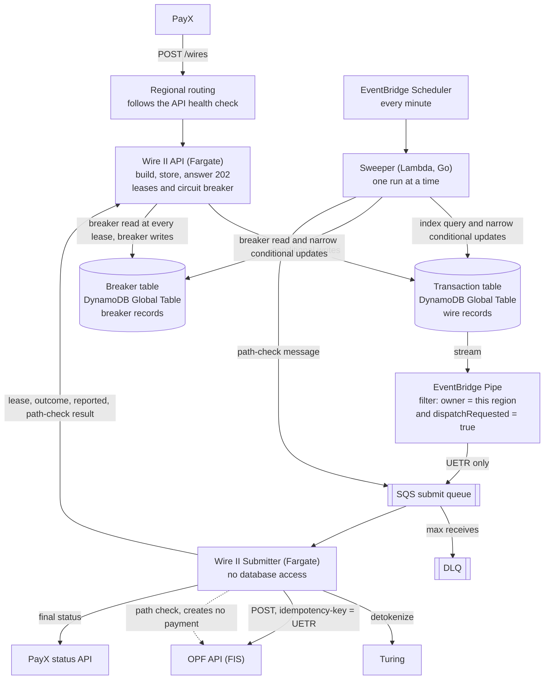
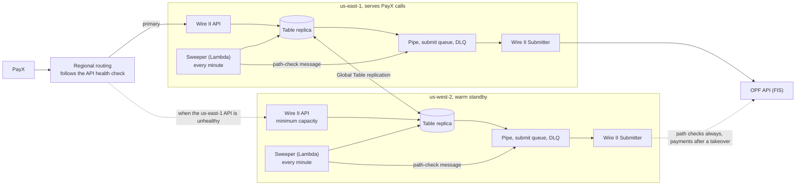
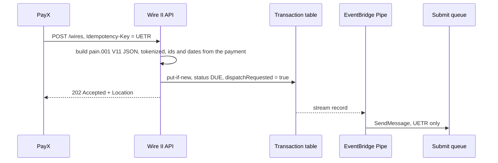
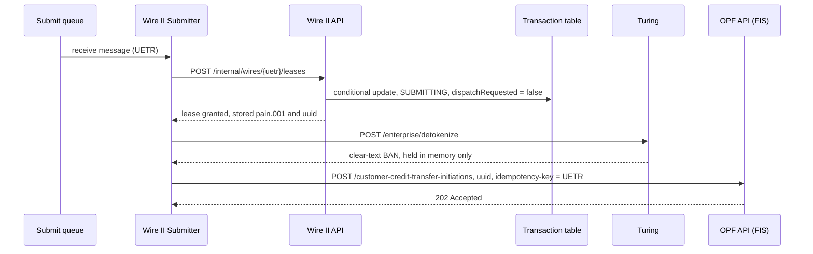
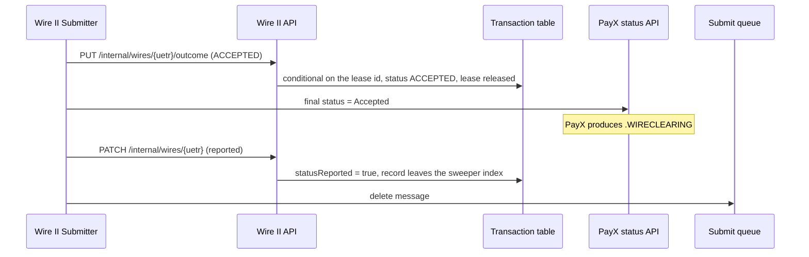
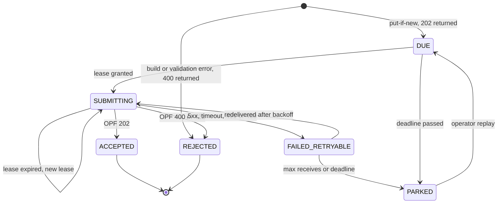
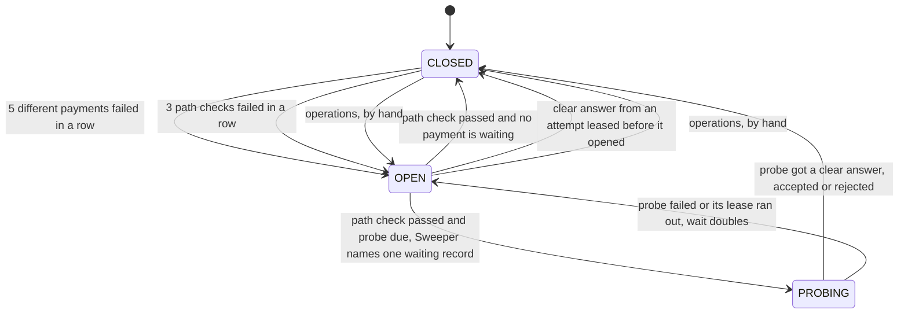
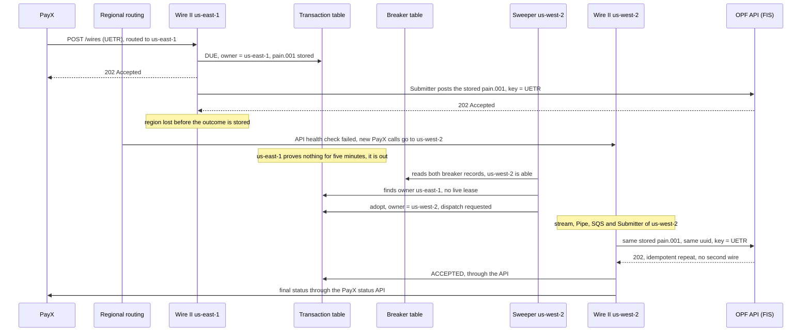

# Wire II Async Design — Detailed Design (Wire II API, Wire II Submitter, Pipe and SQS)

> **Status: DRAFT — proposal of 2026-11-18. The direction was agreed in design review the same day, with the breaker moved to its own table. Formal approval is pending.** This document describes option A of the Capability 10 ADR page (the Wire II API) and the Capability 3 ADR page (dispatch and the Wire II Submitter) with the additions made to it: the circuit breaker at the lease, the submit deadline with its parked reasons and the failure analysis. On top of that it carries a change proposed after the review and not yet agreed: the Sweeper moves out of the Wire II API into its own Lambda with narrow access to the table, each region proves its route to OPF with a path check, regional takeover of sending follows one rule on the two regions' breaker records and no longer depends on routing, and the internal API gains one endpoint (§14.2.1). The ADR pages do not show this change yet. This document supersedes the earlier detailed design, which described an event-driven pipeline with a notify path. Where the two differ, this document applies (§14.2). All starting values are proposals, to be tuned in performance and resilience testing.

## 1. Context and Goals

**Use case.** PayX must initiate payment instructions in OPF, but it does not call OPF's external API (FIS UEAPI) itself. Wire II (ASVWIREII) sits between them. It converts the completed PayX payment object into the `pain.001.001.11` (V11) JSON that OPF requires, resolves the tokenized account numbers through Turing, submits to OPF, and returns the outcome to PayX, which produces `.WIRECLEARING` or `.WIRECLEARING.STOP`. OPF is a third-party API on an external network. Its latency and availability are outside Capital One's control.

**Goals**

- The PayX call does not wait on third-party latency (OPF, and Turing in front of it).
- The PayX-facing API is idempotent on the UETR.
- Wire II owns recovery after the 202, up to the report that lets PayX produce `.WIRECLEARING`.
- Accepting a payment and submitting it are separate microservices, scaled and deployed independently.
- Clear-text BAN values are never persisted or logged.
- Replay is safe: no duplicate wire at FIS, and no `.WIRECLEARING.STOP` for a wire OPF accepted.
- The loss of us-east-1 is recovered without a manual data restore.
- A region that cannot reach OPF keeps accepting payments, and the other region sends for it.
- A vendor outage of hours costs delay and nothing else.
- Every failure case has a defined state and an owner (§11).

**Out of scope.** pain.008 (Phase 2). Stages before Wire II in PayX. Later bank outcomes inside OPF: no pain.002 over MQ is received in Phase 1. The field mapping from the v9 converter to V11, which is on the Capability 10 ADR page. Reports, sign-on and network changes.

**Design rules**

1. **Accepted means stored.** The API answers 202 only after the record is written. From then on Wire II owns the payment.
2. **One owner of a payment's record.** The Wire II API is the only writer of a payment's request and outcome. The Sweeper writes only who sends a payment next. The Submitter has no database access.
3. **The record is the truth.** A queue message for a payment is a pointer: it carries the UETR and nothing else. The only other message is a path check, which carries no payment data.
4. **One way to submit.** Everything that needs a submission sets `dispatchRequested` on the record and lets the Pipe enqueue it.
5. **Every step is safe to repeat.** A lease admits one attempt. Every attempt sends the stored payload byte for byte, with the same `uuid` and the same idempotency key.
6. **Never rebuild, never send late.** A stored payload is never built again. Nothing is sent after the submit deadline. If Wire II cannot tell whether OPF took a payment, it says so and a person checks.
7. **The component that holds clear-text BANs has no data-store access.**
8. **Ownership is data.** Which region drives a payment is an attribute on the record, changed by a conditional write.
9. **Sending follows ability; accepting follows API health.** Accepting a payment needs a healthy API and the table. Sending it needs a route to OPF. A region that cannot send keeps accepting, and the other region sends for it.

**Applicable ASPIRE practices**

| ID | Practice | How this design meets it |
|---|---|---|
| RE-13.3 | Born Platinum | The design is written for Platinum verification. Open point for verification: the topology is active and warm standby, not active/active (RE-10.1) |
| RE-5.1 | RTO / RPO & Resiliency Tier | New payments resume when routing moves PayX calls on the API health check. The in-flight payments of a region that is out are adopted by the other region: about six minutes for the first 60 (five minutes until the region counts as out, then the next sweep), then 60 per sweep (§8.3). Recovery point is the Global Table replication lag, typically about a second, covered by one PayX replay (§8.4), or zero with strong consistency (§8.8) |
| RE-10.1 | Compute in multi-AZ + secondary region, active/active | Both microservices and the Sweeper run in both regions. us-east-1 serves PayX calls and us-west-2 is a warm standby at minimum capacity. The standby proves its route to OPF every minute and sends for us-east-1 when us-east-1 cannot (§8). Accepting is active/passive and must be agreed at verification |
| RE-10.2 | Data stores multi-AZ + secondary region | DynamoDB Global Table with a replica in each region. SQS holds pointers only and is not a store of record |
| RE-10.3 | Regional affinity | API, Pipe, queue, Submitter and Sweeper of a region work together inside that region. Cross-region traffic is table replication only: a Sweeper reads the other region's breaker record from its own replica. Turing and the PayX status API are assumed reachable from both regions |
| RE-11.1 | Automated failover | Two parts. Routing moves PayX calls on the API health check, as the platform does today (OQ-E). Sending moves by itself: the Sweeper of a region that is able adopts the unfinished payments of a region that is out (§8.3). No person and no routing input is needed for the second part |
| OE-3.2 | Operational playbooks | Three operator actions need a playbook: moving PayX calls to the other region by hand, where the platform's routing needs it, replaying a PARKED record, and opening or closing a breaker by hand |
| OE-5.3 | Data-plane recovery | Adoption is a write to the record. The breaker is a record in the Breaker table, and the takeover rule reads only the two regions' breaker records. Wire II reads no routing state |
| RE-5.3 / RE-5.4 | Degraded mode / back pressure | SQS buffer, consumer concurrency, visibility backoff, circuit breaker (§6.6, §10) |
| OE-4.1 | Alerts on region shift and replication lag | §10 |
| CY-5.4 / CY-5.5 | HSHD handling / encryption at rest | §9 |
| RE-2.2 | API intermediary | PayX → Wire II, Turing and the PayX status API go through Exchange. The internal endpoints between the two microservices are private to ASVWIREII and are not published on Exchange |

## 2. Architecture Overview

One region, all components:



Two regions. us-east-1 serves PayX calls and us-west-2 is a warm standby. The Sweeper and the path check run in both:



**Key properties**

- **One owner of a payment's record.** The Wire II API is the only writer of a payment's request and outcome. The Sweeper writes only who sends a payment next, through a short list of conditional updates. The Submitter has no database access and reaches a record through the API's internal endpoints.
- **No dual write.** The queue message is produced from the committed write, by the stream and the Pipe. There is no gap between storing a payment and queueing it.
- **The queue carries no payment data.** A payment's message is the UETR only. A path-check message carries no payment at all. No payload, token or personal data enters SQS or a DLQ. Any message can be lost without losing a payment, because the Sweeper dispatches from the table.
- **Each region's Pipe passes only that region's records.** Replicated writes from the other region are never dispatched twice.
- **Retries wait in SQS, an outage waits in the table.** A retry is a redelivery after a visibility backoff. While a circuit breaker is open, payments wait as records and the queues stay empty.
- **Recovery belongs to Wire II.** SQS redelivery handles normal retries. The recovery Sweeper catches anything whose message is gone.
- **Sending follows ability; accepting follows API health.** Each region proves, minute by minute, that it can reach OPF. A region that cannot send keeps accepting, and the other region's Sweeper adopts its unfinished payments (§8). Routing only decides where PayX calls land.
- **Clear-text BANs exist in one place:** Submitter memory, for one attempt.

| Component | Job | Runs as | Data access | Sees clear-text BANs |
|---|---|---|---|---|
| Wire II API | Idempotent `POST /wires` and `GET /wires/{uetr}`. Builds and stores the pain.001. The only writer of a payment's request and outcome. Keeps the breaker records. Internal endpoints for the Submitter | ECS Fargate, both regions | Reads and writes the Transaction table and the Breaker table | No |
| Recovery Sweeper | Puts stalled, unreported and adopted records back on the normal path. Enforces the deadline. Drives probe and drain. Starts the path check. Adopts for a region that is out | A Lambda in each region, written in Go, outside the Wire II API. EventBridge Scheduler starts it every minute, one run at a time. It runs in both regions all the time | Its own narrow access: `Query` on the sparse index and conditional `UpdateItem` on a short list of attributes (§6.5). No put, no delete. It also sends path-check messages to the submit queue | No |
| Circuit breaker | Stops submissions to OPF or Turing while the dependency fails. Carries the proof that a region can reach OPF | A breaker record per region and dependency. The logic is in the Wire II API | Four breaker records in the Breaker table | No |
| Transaction table | Wire records, one per payment. The sweeper index | DynamoDB Global Table, replicas in us-east-1 and us-west-2 | — | No, tokens only |
| Breaker table | Breaker records, one per region and dependency | DynamoDB Global Table, replicas in us-east-1 and us-west-2, on-demand capacity, customer-managed KMS key per region | — | No |
| Dispatch | Turns a committed write that requests dispatch into a queue message | DynamoDB stream → one EventBridge Pipe per region → SQS submit queue with a DLQ. Managed, no code | Stream read, queue send | No, UETR only |
| Wire II Submitter | Receives from SQS, leases, detokenizes, submits to OPF, records the outcome, reports the final status to PayX, marks it reported. On a path-check message it makes one call to FIS that creates no payment and reports the result | ECS Fargate, both regions, scales on queue depth | None. Works only through the internal API | Yes, in memory only |
| Regional routing | Decides where PayX calls land. Follows the API health check, as the platform does today (OQ-E) | The platform's regional routing | None. Wire II does not read it | No |

**Languages and runtime.** The API holds the conversion, which extends the existing pain.001 converter. The Submitter needs no conversion code, because it sends what the API stored. The Sweeper is a Lambda and is written in Go, as the platform prefers for Lambdas. If the Submitter were run as a Lambda with an SQS trigger instead of an ECS service, it would be written in Go too, since Java is discouraged for Lambdas because of cold starts. The contract is the same.

## 3. Request Lifecycle (Happy Path)

**Accept and dispatch**



**Lease and submit**



**Outcome and report**



Step by step:

1. **Build.** The API builds the pain.001.001.11 JSON in memory with the BAN fields still tokenized. Every generated identifier and timestamp comes from the UETR and the payment, never from the wall clock. A build or validation failure is a rejection.
2. **Store.** One conditional put-if-new keyed on the UETR writes the payload hash, the built payload, the `uuid`, status DUE, the owning region, the submit deadline and `dispatchRequested` = true. A UETR that already exists is a repeat (§6.1).
3. **Answer.** The API responds 202 with a `Location`. The response never waits on Turing or OPF. Nothing in steps 1 to 3 leaves Capital One.
4. **Dispatch.** The stream record passes the Pipe filter of the owning region, and the Pipe sends one SQS message holding the UETR.
5. **Lease.** The Submitter asks the API for a lease. The API moves the record to SUBMITTING, clears `dispatchRequested` and returns the stored payload and `uuid`.
6. **Detokenize.** The Submitter calls Turing. The clear-text value is used for the next step only and never reaches DynamoDB, SQS or the logs.
7. **Submit.** The Submitter posts the stored payload to OPF with the `uuid` header and `idempotency-key` = UETR.
8. **Record.** The Submitter records ACCEPTED, REJECTED or FAILED_RETRYABLE through the API.
9. **Report.** For a terminal outcome the Submitter calls the PayX status API, marks the record reported through the API and deletes the message.

**Contract change for PayX**

- The inbound call returns 202 Accepted and no longer waits for OPF. The final status arrives later through the PayX status API (OQ-G).
- The `Idempotency-Key` header must equal the UETR in the payload. A mismatch is a 400.
- PayX re-calls when it got no 202 (timeout or 5xx). The call is idempotent on the UETR.
- When `.WIRECLEARING` misses its SLA, PayX alerts and replays the call once with the same UETR (OQ-D). Wire II still owns recovery in every case where the record exists. The replay matters only when the record is missing (§8.4).
- `GET /wires/{uetr}` lets PayX check a payment whose status report it did not receive.
- Paths and payloads are finalized in the Wire II API specification.

## 4. Data Model

**Transaction table.** DynamoDB Global Table with replicas in us-east-1 and us-west-2. It holds wires only: one record per payment, keyed on the UETR. The circuit breaker records are in their own table, the Breaker table (below).

**Wire record.** One per payment, keyed on the UETR. The Wire II API is the only writer of the request and the outcome. The Sweeper writes only the attributes of its write contract (§6.5).

| Attribute | Type | Purpose |
|---|---|---|
| `uetr` (partition key) | string | Idempotency key from the Payment Network Gateway. One record per payment |
| `status` | string | DUE, SUBMITTING, ACCEPTED, REJECTED, FAILED_RETRYABLE or PARKED (§5) |
| `payloadHash` | string | SHA-256 of the canonical PayX payment object. Detects a reused UETR with different content |
| `pain001` | string | The built pain.001 V11 JSON with BAN fields still tokenized. Re-sent byte for byte on every attempt |
| `requestUuid` | string | The `uuid` header. Derived from the UETR as a name-based UUID, not random, and reused on every attempt. A record created again in the other region sends exactly the same headers (OQ-A) |
| `ownerRegion` | string | The region whose Pipe dispatches the record and whose Submitter may lease it |
| `dispatchRequested` | boolean | Set by the API on create, by the recovery Sweeper and by operator replay. Cleared by a lease. The Pipe filter matches on it |
| `pendingRegion` / `checkAt` | string / number | Keys of the sparse sweeper index. Present only while the record is non-terminal or its outcome is unreported. `pendingRegion` = owner. `checkAt` = last update + stall threshold |
| `leaseId` / `leaseUntil` | string / number | The current attempt's claim and its expiry |
| `attempts` | number | OPF submission attempts |
| `unansweredAttempts` | number | How many attempts may have reached OPF without a clear answer. Raised when a lease is granted. Taken back when the outcome is clear, or when the Submitter reports that nothing was sent |
| `submitDeadline` | string (ISO-8601) | Set at acceptance. After it, no lease is granted and the payment is never sent automatically (§11.4) |
| `parkedReason` | string | Set with PARKED: `MAX_RECEIVES`, `NOT_SENT` or `OUTCOME_UNKNOWN`. Tells the operator whether a replay is safe |
| `opfResponse` | map | HTTP status, OPF error code and time of the last response. Never a clear-text BAN |
| `statusReported` | boolean | Whether PayX has been told the final status |
| `createdRegion` | string | Where the record was created, for failover diagnostics |
| `createdAt` / `updatedAt` | string (ISO-8601) | Audit timestamps |
| `version` | number | Optimistic-lock counter checked on every conditional update |
| `expiresAt` | number | DynamoDB TTL. Retention to be set with records management (OQ-F) |

- The Wire II API reaches a record by its key: get, conditional put, conditional update. The Sweeper queries the sweeper index and makes the conditional updates of its write contract (§6.5). No other component has access. The Submitter has none.
- Encryption at rest uses a customer-managed KMS key in each replica region. The record holds Turing tokens, never clear-text BAN values.

**Sparse sweeper index.** A global secondary index on `pendingRegion` and `checkAt`. Only records that still need work carry these attributes, so the index stays small. Removing `pendingRegion` when a record is terminal and reported takes it out. The index exists in every replica, so each region's Sweeper can see the other region's pending records.

**Breaker table.** A DynamoDB Global Table with replicas in us-east-1 and us-west-2, on-demand capacity, encrypted with a customer-managed KMS key in each replica region like the Transaction table. The partition key is `breakerId`, the region and the dependency: `<region>#<dependency>`. There are four records: `us-east-1#OPF`, `us-east-1#TURING`, `us-west-2#OPF` and `us-west-2#TURING`. The breaker is a record of its own, not a field on each payment and not a library inside a service (§6.6). The Global Table copies the records, which is how one region reads the other region's breaker. There is no index and no pipe, and nothing consumes its stream.

| Field | Meaning |
|---|---|
| `breakerId` (partition key) | `<region>#<dependency>`, for example `us-east-1#OPF` |
| `state` | CLOSED, OPEN or PROBING |
| `failedUetrs` | The different payments that failed in a row. A clear answer empties it |
| `openedAt` | When it opened |
| `nextProbeAt`, `probeInterval` | When the next probe may go, and the current wait |
| `probeUetr` | The one payment that may get a lease while the breaker is not closed |
| `lastProvenAt` | Last clear answer from OPF or last passing path check |
| `checkFailures` | Path checks failed in a row |

The Wire II API keeps the state, the failed set, `openedAt`, `lastProvenAt` and `checkFailures`. The API sets PROBING when it grants the probe's lease, and CLOSED or OPEN with a doubled wait when the probe's outcome arrives. The API reads the breaker record with a GetItem on the Breaker table at every lease request. The Sweeper reads the breaker records of both regions by key, from its own region's replica of the Breaker table. It writes `probeUetr` and `nextProbeAt` when it names a probe, and it puts the state back to OPEN with a doubled wait when a probe's lease runs out without an outcome. These are conditional updates on the Breaker table. The Submitter never sees a breaker record. It only sees a granted or a refused lease. The Sweeper needs no lock record: the Lambda has a reserved concurrency of 1, so one run happens at a time.

**Why a table of its own.** A breaker record is not a transaction. It is always easy to reach: one GetItem by key. Breaker records stay out of the transaction stream and out of anything that reads the Transaction table in bulk, such as a report or an export. Permissions can be set per table: the Sweeper may query the sparse index of the Transaction table and update the Breaker table, and the Submitter has no access to either. The cost is one more small global table to provision, encrypt and replicate. The option not taken was to keep the breaker records as extra rows in the Transaction table.

## 5. State Machine



| Status | It means | Terminal |
|---|---|---|
| `DUE` | Stored, 202 returned, waiting to be leased. Also a payment that waits while a breaker is open, and a record an operator has replayed | No |
| `SUBMITTING` | One Submitter holds the record under a lease. If the lease expires (stopped task, region loss), redelivery or the Sweeper leads to a new lease | No |
| `FAILED_RETRYABLE` | The last attempt ended with 5xx, a timeout, 401 / 403 or a retryable Turing error. The message is redelivered after backoff, or the record waits while a breaker is open | No |
| `PARKED` | Automatic work has stopped. `parkedReason` says why. Alerted until an operator replays the record | No |
| `ACCEPTED` | OPF answered 202 | Yes |
| `REJECTED` | The build failed, OPF refused the payment (400, 422), or Turing gave a non-retryable answer (§11.3) | Yes |

**Reasons on PARKED.** The two deadline reasons are very different:

| `parkedReason` | Set when | What the operator may do |
|---|---|---|
| `NOT_SENT` | The submit deadline passed and no attempt ever reached OPF, for example because the breaker was open the whole time | Replay. It is always safe |
| `OUTCOME_UNKNOWN` | The submit deadline passed and at least one attempt ended without a clear answer (`unansweredAttempts` above zero). OPF may hold the payment | Check OPF first. Never replay before that |
| `MAX_RECEIVES` | The message reached the maximum number of receives while the record was not terminal | Find the cause, fix it, then replay |

**Rules for every write**

- The Wire II API is the only writer of a payment's request and outcome. The Sweeper writes only who sends a payment next: the dispatch flag, `version`, `checkAt` and, on adoption, the owner. The one status the Sweeper sets is PARKED at the submit deadline, with its reason (§6.5). The Submitter writes nothing.
- Every update, from the API or the Sweeper, is conditional. It carries the version it read and the state it expects, and fails if the record has moved.
- One record per UETR, created by a conditional put. Two first calls at the same moment resolve to one winner.
- A lease is granted only if: the owner is this region, no lease is live, the outcome is not reported, the submit deadline has not passed, and the breakers for OPF and Turing are closed or this UETR is the probe.
- An outcome is written only with the matching lease id. The first terminal outcome wins.
- ACCEPTED and REJECTED never change, and a terminal record never causes another OPF call.
- PARKED is for non-terminal records only. A terminal record whose report to PayX keeps failing stays terminal.
- "Reported" is written only on a terminal record. It removes the record from the sweeper index.
- A re-dispatch always changes the item: the Sweeper raises `version` and moves `checkAt`, also when `dispatchRequested` is already true. A write that changes nothing produces no stream event.
- A stored payload is never rebuilt.

## 6. Components

### 6.1 Wire II API

**PayX-facing API, idempotent on the UETR**

| Request | Response | Effect |
|---|---|---|
| `POST /wires`, new UETR | 202 Accepted + `Location: /wires/{uetr}` | Payment stored and dispatched. The outcome follows through the PayX status API |
| `POST /wires`, build or validation failure | 400 Bad Request, reason in the error body | Recorded as REJECTED. PayX produces `.WIRECLEARING.STOP` |
| `POST /wires`, `Idempotency-Key` differs from the UETR in the payload | 400 Bad Request | — |
| `POST /wires`, same UETR, same payload, in flight | 202 Accepted, same as the first response | No change. Recovery is owned by Wire II |
| `POST /wires`, same UETR, same payload, terminal | 200 OK with the stored outcome | OPF is never called again |
| `POST /wires`, same UETR, different payload | 409 Conflict, duplicate UETR with different content | Record unchanged. Alert. PayX produces `.WIRECLEARING.STOP` |
| Two first calls at the same moment | One 202. The other gets the repeat response | The conditional put admits exactly one |
| The table cannot be written | 5xx | Nothing is stored. PayX re-calls |
| `GET /wires/{uetr}` | 200 OK with the current status | Lets PayX check a payment whose status report it did not receive |

**Idempotency rules**

1. **One record per UETR.** The first call creates it with a conditional put. Any later call with the same UETR is a repeat.
2. **Same UETR, different content** (payload hash differs): 409, record unchanged, alert.
3. **Terminal record** (ACCEPTED or REJECTED): 200 with the stored outcome. OPF is never called again. If PayX was never told, the Sweeper dispatches a report-only attempt.
4. **In flight** (DUE, SUBMITTING, FAILED_RETRYABLE or PARKED): 202 and no change. Recovery is SQS redelivery, the recovery Sweeper and operator replay. A repeat from PayX never re-drives a record.
5. **Never rebuild a stored payload.** Every attempt re-sends the stored pain.001 with the stored `uuid` and the same idempotency key.
6. **Deterministic generation.** The BAH business message identifier and the group-header message identifier are the UETR with hyphens removed (32 characters, within the 35-character limit). Creation date and time come from the PayX payment's creation timestamp (OQ-C). The `uuid` header is derived from the UETR in the same way. A payload built again, in either region, is byte-identical.
7. **At-least-once delivery is expected.** SQS may deliver a message twice, and the Sweeper may dispatch a record that already has a message. The conditional lease admits one attempt, and the OPF idempotency key covers anything that slips through.

The stored record of a build failure is terminal from the start. Whether it counts as already reported, since the 400 is the answer, is to be fixed in the Wire II API specification.

### 6.2 Internal API

Used only by the Submitter, plus two operator actions. Private to ASVWIREII, authenticated service to service, not published on Exchange. The Sweeper calls none of these endpoints.

| Endpoint | Caller and when | Purpose | Guard | Answers |
|---|---|---|---|---|
| `POST /internal/wires/{uetr}/leases` | Submitter, every time it takes a UETR from the queue | Claim the record for one attempt. On a grant: SUBMITTING, `dispatchRequested` false, attempts + 1, unanswered + 1, lease for two minutes (proposed). Returns the stored payload, `uuid` and status | Conditional: owner = this region, no live lease, not reported, submit deadline not passed, and the breakers for OPF and Turing closed (or this UETR is the probe). A terminal but unreported record returns the outcome, so the Submitter can report it | Granted, with the stored request and `uuid`. Terminal but not reported, with the outcome. Refused, with the reason |
| `PUT /internal/wires/{uetr}/outcome` | Submitter, once per attempt, after OPF or Turing answered or failed | Record the result and release the lease: ACCEPTED, REJECTED or FAILED_RETRYABLE, with the OPF code. With FAILED_RETRYABLE the Submitter states the cause and whether the request left Capital One. The API corrects the unanswered count and updates the breaker | Conditional on the lease id. The first terminal outcome wins | 200. Conflict if the lease id is not the current one |
| `PATCH /internal/wires/{uetr}` | Submitter, after PayX took the final status | Mark the outcome as reported to PayX. The record leaves the sweeper index | Only on a terminal record | 200. Refused on a record that is not terminal |
| `POST /internal/breakers/{dependency}/checks` | Submitter, after a path check | Record pass or fail on this region's breaker record for that dependency (§6.7) | — | 200 |
| `POST /internal/wires/{uetr}/dispatches` | Operator, to replay a parked record | Operator replay: request dispatch again, to revive a PARKED record or force a re-drive. A new deadline is set | Operations role only. Never on a terminal record that is already reported | 202. Refused on a record that is terminal and reported |
| `PUT /internal/breakers/{dependency}` | Operator, for maintenance or to force a state | Manual control of a circuit breaker: OPEN or CLOSED by hand | Operations role only. Restricted and audited | 200 |

The paths `POST /internal/breakers/{dependency}/checks` and `PUT /internal/breakers/{dependency}`, and the answer codes of all internal endpoints, are proposals for the Wire II API specification.

What the API does with the outcome call, besides the status:

- It counts FAILED_RETRYABLE results by cause for the breaker of that dependency (§6.6). A failure adds the UETR to the failed set. The fifth different one opens the breaker.
- On a clear answer, accepted or rejected, it empties the failed set, sets `lastProvenAt` and closes the breaker.
- It keeps `unansweredAttempts` right: taken back on a clear answer, or when the Submitter reports that nothing was sent.

**What the Submitter does with each lease answer**

| Lease answer | Submitter |
|---|---|
| Granted | Detokenize, post to OPF, call the outcome endpoint |
| Terminal, not yet reported | Report to PayX, call the reported endpoint, delete the message |
| Refused: breaker open | Delete the message. The payment waits in the table and the Sweeper dispatches it again later |
| Refused: not the owner | Delete the message. The other region has it |
| Refused: lease held | Leave the message. It comes back |
| Refused: already reported, or deadline passed | Delete the message |

A refused lease is normal. It is how duplicates, stale messages and stranded messages from another region are discarded.

**The calls, flow by flow**

| Flow | Calls in order |
|---|---|
| Accepted | `POST /wires` → 202. Stream, Pipe, queue. `POST …/leases` granted. Turing detokenize. OPF post → 202. `PUT …/outcome` ACCEPTED. PayX status API. `PATCH` reported |
| OPF 503 or timeout | `POST …/leases` granted. OPF fails. `PUT …/outcome` FAILED_RETRYABLE. The message returns after the backoff. `POST …/leases` granted again. Same bytes |
| OPF 400 | `POST …/leases` granted. OPF → 400. `PUT …/outcome` REJECTED. PayX status API: rejected. `PATCH` reported |
| Breaker open | `POST …/leases` refused. Message deleted. Nothing else |
| Probe | The Sweeper names the payment in the table. `POST …/leases` granted for that UETR. OPF. `PUT …/outcome`: a clear answer closes the breaker |
| PayX was not told | The Sweeper pushes the terminal record. `POST …/leases` answers "terminal, not yet reported". PayX status API. `PATCH` reported |
| Path check | The Sweeper puts a check on the queue. The Submitter calls FIS. `POST /internal/breakers/OPF/checks` |
| Operator replay | `POST …/dispatches`. Then as "Accepted" |

### 6.3 Dispatch (stream, Pipe, SQS)

Dispatch is configuration, not code. The table's change stream feeds one EventBridge Pipe in each region. The Pipe passes only records owned by that region whose `dispatchRequested` flag is true, and sends an SQS message carrying the UETR alone.

Pipe filter (proposed form; each region deploys its own region name):

```json
{
  "eventName": ["INSERT", "MODIFY"],
  "dynamodb": {
    "NewImage": {
      "ownerRegion": { "S": ["us-east-1"] },
      "dispatchRequested": { "BOOL": [true] }
    }
  }
}
```

The Breaker table has no stream consumer, so no breaker record ever reaches the Pipe.

| Setting | Value |
|---|---|
| Pipes | One per region. Source: the stream of that region's replica. Target: that region's submit queue |
| Message | The UETR only, produced by the Pipe's input transformer |
| Path-check message | Put on the submit queue by the Sweeper, not by the Pipe. It carries no payment data (§6.7) |
| Undeliverable events | Pipe retries, then the Pipe's own DLQ. Anything lost is re-dispatched by the recovery Sweeper |
| Submit queue | SQS standard queue with a DLQ. Order is not preserved and not needed |
| Retention | Working queue 12 hours, DLQ 24 hours (proposed), so a DLQ empties itself |
| Maximum receives | Set so that it equals about 2 hours of retries (proposed). With the backoff of §11.1 that is 12 to 13 receives |
| Visibility timeout | Longer than the worst-case Turing + OPF attempt, like the lease |
| Encryption | Queue and DLQs with a customer-managed KMS key |
| us-west-2 | Pipe, queue and DLQ are deployed and enabled before any failover, not created at failover time |

**A re-dispatch must change the item.** A stream filter matches fixed values on the new image. It cannot compare old and new. And a write that changes nothing produces no stream event at all. So every dispatch request is a real change to the record: the Sweeper sets `dispatchRequested`, raises `version` and moves `checkAt`, and an operator replay follows the same rule. The lease clears the flag, so later writes (outcome, reported) do not match the filter and enqueue nothing.

If EventBridge Pipes cannot be deployed through the pipeline, a small stream-triggered Lambda applies the same filter and sends to SQS (OQ-H). Nothing else changes.

### 6.4 Wire II Submitter

The only component that holds a clear-text BAN. It has no DynamoDB permissions.

It handles two kinds of message from the submit queue: a payment, which is a UETR sent by the Pipe, and a path check, which is sent by the Sweeper.

**A payment**

1. **Receive** the SQS message (UETR).
2. **Lease** the record: `POST /internal/wires/{uetr}/leases`. On a grant the API has moved the record to SUBMITTING and returns the stored payload and `uuid`. Other answers are handled as in §6.2.
3. **Detokenize** the BAN value(s) through Turing: `POST /enterprise/detokenize`, OAuth token from the DevExchange Gateway, type BAN, GLOBALBAN, UKBAN or NONUSBAN. The clear-text value is held in memory for this attempt only. It replaces the token in the stored payload in memory. Nothing else in the payload changes.
4. **Submit** the stored payload to OPF: `POST /customer-credit-transfer-initiations` with the stored `uuid` and `idempotency-key` = UETR.
5. **Record the outcome** through the API: ACCEPTED, REJECTED or FAILED_RETRYABLE, with cause and whether the request left Capital One.
6. **Finish.**
   - Terminal outcome: report the final status through the PayX status API, mark it reported, delete the message. If the report fails, the message is left for redelivery, and the next lease answers "terminal, not yet reported".
   - Retryable outcome: leave the message and set its visibility to the next backoff. SQS redelivers it.
   - After the maximum number of receives the message moves to the DLQ and a non-terminal record is marked PARKED with `MAX_RECEIVES`, with an alert.

**A path check**

1. **Receive** the path-check message.
2. **Call FIS** once: an authenticated call that creates no payment. Which call to use is open (OQ-M). No lease is taken and nothing is detokenized, because no payment is sent.
3. **Report** pass or fail to the API of its region: `POST /internal/breakers/{dependency}/checks`. The API updates the breaker record (§6.7).

The check travels the same road as a payment: queue, Submitter, proxy, partner gateway, FIS, API, table.

**No immediate retry after a timeout.** A timeout or a 5xx is never retried at once inside the attempt, because OPF may still be working on the first request. The next attempt is the redelivery.

**Runtime**

- An ECS Fargate service in each region. It scales on queue depth and the age of the oldest message, independently of the API.
- Consumer concurrency is the back-pressure limit on Turing and OPF. Bursts wait in the queue.
- On deploy or scale-in, tasks stop receiving on SIGTERM and finish in-flight attempts within the stop timeout. An attempt that is cut off leaves its message to reappear and its lease to expire.
- Each step is an internal call to the API, so the Submitter depends on the API being up in its region.

### 6.5 Recovery Sweeper

- **Where and when.** A Lambda in each region, written in Go, outside the Wire II API. EventBridge Scheduler starts it every minute, and one run is active at a time. It runs in both regions all the time, whichever region serves PayX calls. It needs no lock. A second run would be harmless anyway, because every write is conditional.
- **How it finds work.** It queries the sparse index for `pendingRegion` = this region with `checkAt` ≤ now. During a takeover it also queries `pendingRegion` = the other region and takes the unfinished records that have no live lease, oldest first.
- **What else it reads.** The breaker records of both regions: its own to hold, probe and drain, and the other region's for the takeover rule (§8.3).
- **Thresholds (proposed).** The same-region stall threshold is about 20 minutes. It exceeds the longest SQS backoff plus the lease time, so the Sweeper never races normal retries. A takeover starts when the other region has been out for five minutes and this region is able. It moves 60 records per sweep, stops as soon as the other region is able again, and never moves an adopted record back (§8.3).
- **It never calls Turing, OPF or PayX,** and it calls none of the API's endpoints. Every submission still goes through the Pipe, the queue, the lease and the stored payload.
- **It never touches** a stored request, a hash, an outcome or the reported flag.
- **The two regions never adopt from each other.** A region adopts only when it is able and the other region is out, and a region cannot be both (§8.3).

**The Sweeper's whole write contract**

| Action | Write | Condition |
|---|---|---|
| Push a stalled payment again | `dispatchRequested = true`, `version + 1`, `checkAt` moved on | Owner is this region, version unchanged, not terminal and reported |
| Name the probe | `probeUetr`, `nextProbeAt` on the breaker record, then the push above for that payment | Breaker is OPEN and a probe is due |
| Adopt | `ownerRegion = this region`, `pendingRegion = this region`, `dispatchRequested = true`, `version + 1` | Owner is the other region, no live lease, version unchanged |
| Reset a lost probe | On the breaker record: `state` from PROBING back to OPEN, `probeInterval` doubled, `nextProbeAt` | State is PROBING, `probeUetr` unchanged, and that payment's lease has run out with no outcome |
| Park | `status = PARKED`, `parkedReason` | Deadline passed, no live lease, not terminal |
| Path check | A message on the submit queue. No table write | This region has proven nothing for a minute |

**Its access.** On the Transaction table: `Query` on the sparse index and conditional `UpdateItem` limited to the dispatch flag, `version`, `checkAt`, `ownerRegion`, `status` to PARKED with `parkedReason`, and `pendingRegion` on adoption. On the Breaker table: `GetItem` on the breaker records of both regions, read from its own replica, and conditional `UpdateItem` of `probeUetr`, `nextProbeAt` and the reset of a lost probe. No put, no delete. Besides the tables it can send a path-check message to its region's submit queue. Whether the pipeline can limit a Lambda's `UpdateItem` to named attributes is open (OQ-N).

**Why direct access.** The options that were weighed, and the reasons, are in §14.1.1. In short: every write is conditional, so DynamoDB enforces the rules of the record whoever sends the write, and the Sweeper cannot write the parts that matter most.

**What it costs.** Two deployables know the shape of the record. The Sweeper knows about ten attributes. Rule: those attributes change only by adding, and the Sweeper's pipeline runs a contract test against the record schema.

| Found | Sweeper action |
|---|---|
| DUE, SUBMITTING with an expired lease, or FAILED_RETRYABLE, owned by this region and stalled | Request dispatch again. The Submitter re-sends the stored payload with the same key |
| ACCEPTED or REJECTED with the outcome not reported to PayX | Request dispatch again. The lease answers "terminal, not yet reported" and the Submitter only reports. Repeated until PayX has been told |
| This region has proven nothing for a minute | Put a path-check message on this region's submit queue (§6.7) |
| The other region has been out for five minutes and this region is able | Adopt the other region's unfinished records that have no live lease (owner = this region) and request dispatch. Oldest first, 60 per sweep. Stop as soon as the other region is able again. Never move a record back |
| Both regions' breakers are open | No adoption. That is an outage of OPF itself. Records wait where they are |
| The circuit breaker of this region is open | **Hold.** Do not request dispatch for pending records. When a probe is due and a path check has passed, name one waiting record as the probe and request dispatch for it only |
| A probe was named, and its lease has run out with no outcome | Treat the probe as failed. The breaker is OPEN again, the wait doubles, and the next probe is another record |
| The circuit breaker has just closed | **Drain.** Request dispatch for the waiting records, oldest first, 60 per sweep (proposed) |
| A pending record whose `submitDeadline` has passed, with no live lease | Mark PARKED with `parkedReason` = `NOT_SENT` or `OUTCOME_UNKNOWN`. Alert (§11.4) |
| PARKED | No automatic action. It stays alerted until an operator replays the record |

### 6.6 Circuit breaker

OPF is a vendor system. Without a breaker, every in-flight payment retries on its own during an outage until its message reaches the DLQ, and operators would have to replay hundreds of records afterwards.

**Why a record.** The API runs as several tasks in two regions, each with its own memory. A breaker held in memory would exist once per task, and each task would learn about an outage separately. As a record in the Breaker table, every task reads the same state. There is one record per dependency (OPF, Turing) and per region, four in total (§4), because one region can lose its route to OPF while the other still has one. The Global Table copies the records, so each region can read the other's. The breaker lives in a table of its own, not in the Transaction table (§4).

**Why at the lease.** A Submitter cannot call OPF without a lease, so refusing leases stops the calls. The Submitter needs no breaker logic and no access to the breaker record. A refused lease writes nothing, burns no receive and counts no attempt.



**Who touches it**

| Who | When | What |
|---|---|---|
| API, outcome call | Each attempt result | A failure adds the UETR to `failedUetrs`. The fifth different one sets OPEN and pages. A clear answer empties the set, sets `lastProvenAt` and closes the breaker |
| API, lease call | Each lease request | Reads only. Refuses unless the breaker is closed or the UETR is the probe |
| API, path-check call | Each check result | Pass: `lastProvenAt`, `checkFailures = 0`, and CLOSED if no payment is waiting. Fail: `checkFailures + 1`. Three set OPEN |
| Sweeper | Each minute | Names the probe when one is due. Holds while open. Drains after closing. Reads the other region's record for the takeover rule |
| Operations | Planned maintenance, or to force a state | OPEN or CLOSED by hand, through the API. Restricted and audited |
| Submitter | Never | It only sees a granted or a refused lease |

**What counts**

| OPF answer | Counts as failure | Effect on the payment |
|---|---|---|
| 2xx | No. Clear answer | ACCEPTED |
| 400, 422 | No. Clear answer: OPF is working and the payment is wrong | REJECTED, terminal |
| 401, 403 | Yes. Credentials or allow-list | FAILED_RETRYABLE |
| 5xx | Yes | FAILED_RETRYABLE |
| Timeout, connection error | Yes | FAILED_RETRYABLE, and the attempt stays unanswered |

For Turing the counted answers are 203 code 109, 401 / 403 and 500 (§11.3).

| Step | What happens |
|---|---|
| Opens | When five *different* payments have failed in a row, or three path checks have failed in a row, the API sets the breaker to OPEN, records `openedAt` and pages. One payment that keeps failing does not open it |
| While open | Lease requests are refused. The Submitter deletes the message. The record stays DUE or FAILED_RETRYABLE. The API keeps answering 202 to PayX. Queues stay empty. The backlog is in the table |
| Path check first | A payment is spent as a probe only after a path check has passed. While the route itself is broken, the check fails and no payment is spent |
| Probe | When a probe is due, the Sweeper names one waiting record and requests dispatch. The API grants the lease for that UETR only. A clear answer from OPF, accepted or rejected, closes the breaker and sets `lastProvenAt`. A failure reopens it and doubles the wait. The next probe is a different payment |
| A probe that never reports | If no outcome arrives, the state returns to OPEN when the probe's lease runs out, and the wait doubles |
| No payment waiting | A region with no payment waiting has nothing to probe with. Its breaker closes on a passing path check alone |
| Any clear answer | Any clear answer from OPF, accepted or rejected, closes the breaker and sets `lastProvenAt`. That includes the answer to an attempt that was leased just before the breaker opened |
| Drain | After closing, the Sweeper requests dispatch for the waiting records oldest first. Consumer concurrency still caps the call rate |

**Proposed values** (configuration, to be tuned with OPF's rate limit, OQ-J)

| Setting | Proposed |
|---|---|
| Opens after | 5 different payments failing in a row, or 3 failed path checks |
| First probe | 1 minute after opening |
| Probe interval | Doubles after each failed probe: 1, 2, 4, 8 minutes, then every 15 minutes |
| Path check | When nothing was proven for 1 minute |
| Able | CLOSED and proven within 3 minutes |
| Out | OPEN for 5 minutes, or nothing proven for 5 minutes |
| Drain and adoption | 60 records per sweep, oldest first |
| Opened or closed by hand | Allowed. Restricted and audited |

**A probe and a path check.** The FIS specification available to us has no health endpoint, so the only test that proves OPF takes payments is one real payment. The probe is a payment that is waiting anyway, sent with its normal idempotency key. If OPF is back, that payment is done and the breaker closes. A rejection also closes it: a 400 proves that OPF is answering. The path check (§6.7) is the cheaper test and goes first. It proves the road to FIS and spends no payment. It does not prove that OPF takes payments.

**At low volume** five different payments may never fail. The path check then opens the breaker after three failed checks, about three minutes after the route breaks.

The Turing breaker uses the same kind of record and the same steps. Leases are refused while either breaker is open. The ADR pages describe the probe result in OPF terms. What exactly closes the Turing breaker is to be fixed in build, and whether it gets its own path check is open (OQ-P).

### 6.7 Path check

A closed breaker in a region with no traffic is not evidence that the region can reach OPF. The standby has no traffic, so its breaker would stay closed whatever happens to OPF. The path check supplies the evidence, and `lastProvenAt` on the breaker record records it.

| Step | What happens |
|---|---|
| When | A region has proven nothing for a minute: no clear answer from OPF and no passing check. The Sweeper sees this on each run |
| Message | The Sweeper puts a path-check message on the region's submit queue. It writes nothing to the table |
| Call | The Submitter makes one authenticated call to FIS that creates no payment. The preferred call is a heartbeat or status URL from FIS, if one exists. The FIS specification available exposes only the payment POST. The fallback is a token request to the FIS gateway, which is the same host as the payment API. It proves the region's network path and credentials, not the OPF application behind the gateway. Which call to use is open (OQ-M) |
| Road | The same as a payment's: queue, Submitter, proxy, partner gateway, FIS, API, table |
| Report | The Submitter reports the result to the API of its region: `POST /internal/breakers/{dependency}/checks` |
| Pass | The API sets `lastProvenAt` and `checkFailures = 0`, and closes the breaker if no payment is waiting |
| Fail | The API raises `checkFailures`. Three failed checks in a row open the breaker |

- A real answer proves more than a check. A clear answer from OPF to a real payment sets `lastProvenAt` and resets `checkFailures`. The check runs only when nothing real was proven in the last minute.
- A payment is spent as a probe only after a path check has passed (§6.6).
- A passing check does not prove that OPF takes payments. If the check passes while OPF itself is failing, real failures open the breaker (§8.13).
- With the fallback call, an OPF application outage still leaves the token request passing. The standby region would look able, adopt one or two batches (up to 60 per sweep), fail on them and open its own breaker. Nothing is lost or sent twice. Those wires then wait in the standby region.
- The check runs in both regions all the time. That is how a broken route in the standby is found while there is still time to repair it.

**Details of the path check**

| Point | How |
|---|---|
| The message | A payment message is the bare UETR. A path-check message is a small JSON body naming the dependency, for example `{"check":"OPF"}`, with its send time |
| One attempt only | The Submitter deletes a check message after one attempt, whatever the result. It deletes unread any check older than two minutes. A check is never retried: the next minute brings a new one |
| A Submitter that crashes on it | The message comes back and ends in the DLQ like any other. That is correct: the DLQ alarm then points at a broken Submitter, and the region proves nothing and counts as out |
| "No payment is waiting" | When a check passes while the breaker is OPEN, the API runs one query on the sparse index for its region, limit 1. No result: it closes the breaker. A result: it leaves the breaker OPEN and the next probe is due at once |
| One run at a time | The Sweeper Lambda has a reserved concurrency of 1 |

### 6.8 Circuit breaker: edge cases

| # | Case | What happens |
|---|---|---|
| 1 | One bad payment fails again and again | It is one entry in the set. The breaker stays closed. The payment follows the normal backoff and is parked after about two hours |
| 2 | Failures mixed with successes | Every clear answer empties the set. It takes five different failures with no clear answer between them |
| 3 | A 400 during an outage count | Clear answer: the set is emptied. OPF is answering |
| 4 | Expired credentials (401) | Counts. The breaker opens and every probe fails until the secret is fixed. The page says 401, so the cause is visible |
| 5 | Leases granted just before it opened | Those attempts finish and report. A failure changes nothing. A success closes the breaker again, correctly |
| 6 | Two API tasks handle the fifth failure together | The write is conditional on the record's version. One sets OPEN. The other retries, sees OPEN and does nothing |
| 7 | New payments while open | 202 as always. Stored, pushed once, lease refused, they wait |
| 8 | The probe payment is itself invalid | OPF answers 400. That is a clear answer: the payment is REJECTED and the breaker closes |
| 9 | The probe times out | The breaker goes back to OPEN and the wait doubles. That payment now has one more unanswered attempt, so at its deadline it would be parked as `OUTCOME_UNKNOWN`, not `NOT_SENT` |
| 10 | Cost of probes over a long outage | In the four-hour example (§11.5), 18 payments each carry one extra unanswered attempt. That is why the path check goes first: when the route itself is broken, the check fails and no payment is spent |
| 11 | The Submitter dies holding the probe | No outcome arrives. When the probe's lease runs out, the Sweeper treats the probe as failed: OPEN, wait doubled, next probe is another payment |
| 12 | OPF comes back, then fails during the drain | Five different failures reopen it. Payments not yet sent stay DUE. Probing starts again at one minute |
| 13 | A payment's deadline passes while open | The Sweeper parks it: `NOT_SENT` if nothing ever left, `OUTCOME_UNKNOWN` if an attempt went out without a clear answer |
| 14 | Low volume | Fewer than five payments fail, so the count never opens it. The path check does, after three failed checks |
| 15 | Path check fails but payments succeed | A clear answer from a real payment resets `checkFailures`. The check only runs when nothing real was proven in the last minute |
| 16 | Open, and no payment is waiting | There is nothing to probe with. A passing path check closes it |
| 17 | Planned FIS maintenance | An operator opens it by hand before the window. Payments wait without burning attempts. Closed by hand or by the first probe afterwards |
| 18 | The API in the region is down | Not a breaker matter. The Submitter cannot lease. SQS redelivers. The health check moves PayX calls |
| 19 | The breaker record cannot be read | The lease call fails with a 5xx. The Submitter leaves the message and SQS brings it back. Nothing is sent blind |
| 20 | Turing is down, OPF is fine | The Turing breaker opens by the same rules. Leases are refused while either breaker is open |
| 21 | Both regions open | No takeover. See §8.3, rule 6 |

## 7. Why a Stream, a Pipe and SQS; and What the DLQ Means

The three do different jobs. The stream turns a committed write into an event. The Pipe filters it and hands it over without code. SQS is the work buffer: it decides how many submissions run at once and what happens to failures.

| Concern | This design | The alternative and its weakness |
|---|---|---|
| Storing and queueing | One write. The message comes from the committed write | The API writes, then sends to SQS itself: a crash between the two strands a payment |
| Dispatch code | None. A managed Pipe with a filter | A reconciler or worker in the same service as the API: request handling and third-party calls share one runtime, and all scheduling is custom code |
| Retry timing | SQS redelivery with visibility backoff | A custom timer per record |
| Rate toward Turing and OPF | Consumer concurrency on one queue. Bursts wait | Calls at the rate payments arrive |
| A message that cannot be processed | Maximum receives, then the DLQ and an alarm | Blocks or loops |
| Backlog visibility | Queue depth and age of the oldest message | Custom queries |
| Failover and drain surges | Adopted and drained records pass the same queue and the same concurrency limit | A burst straight at OPF |
| A lost message | The Sweeper dispatches from the table after the stall threshold | — |

A stream alone is not enough: it keeps records for 24 hours and cannot deliver to SQS by itself.

**What the DLQ means**

1. A queue message is only a pointer. The payment is in the table, never in the DLQ.
2. A message reaches the DLQ after the maximum number of receives. That means a defect (code, deploy, permission), or a payment that failed for about two hours while others succeeded.
3. A vendor outage does not fill the DLQ. The breaker refuses leases, messages are deleted, and payments wait in the table.
4. The record of that message is marked PARKED with `MAX_RECEIVES`, if it is not terminal.
5. The operator replays the **record** through the API (`POST /internal/wires/{uetr}/dispatches`), never the message. There is no DLQ redrive.
6. DLQ messages expire by themselves. DLQ retention is 24 hours and the working queue's is 12 hours. Nobody purges a DLQ.
7. The alarm is on arrival: it fires when a message arrives in the DLQ, not for as long as one is present.
8. A terminal record whose report to PayX keeps failing may also leave a message in the DLQ. The record stays terminal, and the Sweeper keeps dispatching report-only attempts until PayX has been told.
9. Whether an incident is over is read from the table: the PARKED count and the stalled-record alarm.

**One payment, with clock times.** The Submitter is broken from 09:55 to 10:40: a bad deploy leaves it with a wrong OPF client set-up, and every call is refused with 401. Volume is low, so fewer than five different payments fail and the breaker stays closed. The example shows SQS redelivery by itself, so it also assumes that the path check (§6.7) keeps passing. If the fault failed the path check as well, the breaker would open after three failed checks and the payment would wait in the table instead (§6.8, row 14). Values are the proposed ones.

| Time | What happens | On the record |
|---|---|---|
| 10:00:00 | The API stores the payment and answers 202. The Pipe sends one message. Receive 1: lease, Turing, OPF call refused. The Submitter records the failure and sets the visibility to 30 s | FAILED_RETRYABLE, `checkAt` about 10:20 |
| 10:00:30 | Receive 2. Fails. Visibility 1 min | Updated, `checkAt` moves |
| 10:01:30 | Receive 3. Fails. Visibility 2 min | Updated |
| 10:03:30 | Receive 4. Fails. Visibility 5 min | Updated |
| 10:08:30 | Receive 5. Fails. Visibility 10 min | Updated |
| 10:18:30 | Receive 6. Fails. Visibility 15 min | `checkAt` about 10:38 |
| every minute | The Sweeper runs. Each attempt updated the record, so its `checkAt` is always ahead of the clock. **The Sweeper does nothing for this payment.** It would act only if the message were lost and the record stood still for 20 minutes | Unchanged by the Sweeper |
| 10:33:30 | Receive 7. Fails. Visibility 15 min | `checkAt` about 10:53 |
| 10:40 | The fix is deployed | Unchanged |
| 10:48:30 | Receive 8. Lease, Turing, OPF 202. Outcome recorded, PayX told, message deleted | ACCEPTED, reported, out of the index |

If the fix had not come:

| Time | What happens | On the record |
|---|---|---|
| 10:48 to 11:48 | The message is redelivered every 15 minutes and fails each time | FAILED_RETRYABLE |
| about 12:00 | The maximum number of receives is reached after about two hours. SQS moves the message to the DLQ. The alarm fires on arrival. The record is marked PARKED | PARKED, `MAX_RECEIVES` |
| after | The Sweeper leaves a PARKED record alone. The alert stays until someone acts | PARKED |
| after the fix | The operator calls `POST /internal/wires/{uetr}/dispatches`. The Pipe sends a new message. The Submitter leases and sends the stored payload with the same key | DUE, SUBMITTING, then ACCEPTED |
| 24 hours after the message was created | SQS deletes the old message from the DLQ. Nobody touches it | — |

If the Submitter cannot run at all, it can neither set a backoff nor tell the API about a final attempt. The message then reappears each time its visibility timeout ends and moves to the DLQ at the receive limit, and the Sweeper re-dispatches the stalled record after the stall threshold. The DLQ alarm and the stalled-record alarm point at the fault. How the record is marked PARKED in that case is an implementation point to settle.

## 8. Regional Failover

### 8.1 Topology

Accepting is active and passive. us-east-1 serves PayX calls. us-west-2 runs the same two microservices at minimum capacity, with its own Pipe, queue, DLQ and Sweeper, against its Global Table replica. Each Pipe passes only its own region's records, so us-west-2 never dispatches a record that us-east-1 owns.

Sending is a separate question. Where a payment is accepted and where it is sent are two different things. Accepting needs only a healthy API and the table. Sending needs a route to OPF. **Sending follows ability; accepting follows API health.** A region that cannot send keeps accepting, and the other region sends for it.

- The Sweeper and the path check run in both regions all the time, so each region always knows whether it can reach OPF.
- Regional routing only decides where PayX calls land. It follows the API health check, as the platform does today (OQ-E).
- The Wire II design reads no routing state. Nothing in sending depends on which region routing points at.

### 8.2 Detection and switch

Two things are detected, by two different means.

| What fails | Detected by | What moves |
|---|---|---|
| The API of a region | The routing health check | New PayX calls go to the other region. There is no data restore step: the table is already replicated |
| A region's route to OPF, or the whole region | Its breaker record: OPEN, or nothing proven | Sending. The other region's Sweeper adopts the unfinished payments (§8.3) |

**Why the breaker state alone is not enough.** Each region keeps its own breaker. The first idea was: open in one region and closed in the other means a regional problem, and open in both means OPF is down. That comparison does not work, because the standby has no traffic. Its breaker stays closed whatever happens to OPF. A closed breaker in a quiet region is not evidence. `lastProvenAt` and the path check supply the evidence (§6.7).

### 8.3 Adoption

The rules:

1. **Proof.** The breaker record carries `lastProvenAt`. A clear answer from OPF (accepted or rejected) sets it. So does a successful path check.
2. **Path check.** When a region has proven nothing for a minute, its Sweeper puts a path-check message on its submit queue. The Submitter makes one authenticated call to FIS that creates no payment and reports the result to its API. Three failed checks in a row open the breaker (§6.7).
3. **Able.** A region is able when its breaker is CLOSED and `lastProvenAt` is less than three minutes old.
4. **Out.** A region is out when its breaker has been OPEN for five minutes, or it has proven nothing for five minutes.
5. **Takeover.** When the other region is out and this region is able, this region's Sweeper adopts the other's unfinished payments that have no live lease: oldest first, 60 per sweep. It stops as soon as the other region is able again. Adopted payments are never moved back.
6. **Both open.** Nobody adopts. That is an outage of OPF itself. Payments wait where they are, and no retry is used up.

Rules 3 and 4 cannot make the same region able and out at once, so the two regions never adopt from each other.

How a takeover works:

- **Adoption is one conditional write** by the adopting Sweeper: owner = this region, dispatch requested, `version` raised. It applies only if the owner is still the other region, no lease is live and the version is unchanged.
- **The normal path does the rest.** The adopting region's Pipe passes the record because the owner now matches its filter. Its Submitter leases the record from its own API and sends the stored request with the same key and `uuid`. The request is never rebuilt.
- **Payments already attempted.** A payment whose attempt in the other region timed out is re-sent with the same key. OPF treats a payload it already accepted as an idempotent repeat (to be confirmed, OQ-A).
- **New payments do not have to move.** The region that cannot send keeps answering 202, because a 202 never depends on OPF, and the other region sends. Moving the PayX calls as well is optional and saves about a minute per payment.
- **Who decides.** Three components, each with one job. The API of the failing region decides its own breaker from the outcomes its Submitter reports. The API of the other region keeps `lastProvenAt` from its path checks. The Sweeper of the other region reads both breaker records and adopts. No person and no new component is involved.

**Recovery objectives.** New payments are accepted wherever PayX calls land, and resume when routing moves on the API health check. In-flight payments: about six minutes for the first 60, which is five minutes until the region counts as out and then the next sweep. After that, 60 per minute. A payment that arrives during the takeover is sent about a minute after it is accepted. The recovery point is the Global Table replication lag, typically about a second. Whether the five-minute wait fits the PayX status deadline is open (OQ-Q).

### 8.4 The replication-lag window and the PayX replay

A payment accepted in the last moment before the loss, whose record had not yet replicated, is not in us-west-2. This is the one case Wire II cannot heal by itself, because the record is not there.

- When `.WIRECLEARING` misses its SLA, PayX replays the call once with the same UETR (OQ-D).
- us-west-2 has no record, creates it and submits.
- Deterministic generation makes the payload and the `uuid` identical. If us-east-1 had already reached OPF, this is an idempotent repeat.
- When us-east-1 returns, the older copy of the record loses to the newer one.
- Without a replay, the payment would wait until us-east-1's data replicates on recovery.

### 8.5 Stranded messages and fallback

- Messages left in the us-east-1 queue are harmless. When us-east-1 returns, its Submitter's lease request is refused because the record is owned by us-west-2, and the message is deleted.
- Adopted payments are never moved back. They finish in the region that adopted them.
- When us-east-1 is able again, us-west-2 stops adopting. us-east-1 sends the payments it still owns and every new one it accepts.
- Routing moves PayX calls back to us-east-1 once replication has caught up. That is a routing matter and changes nothing in sending.

### 8.6 Split-brain

DynamoDB conditional writes are evaluated per region, and concurrent writes in two regions resolve last-writer-wins. So the lease is not a cross-region lock. Protection comes from four things together:

1. the takeover rule, which cannot hold in both regions at once: a region adopts only when it is able and the other region is out (§8.3),
2. the region filter on the Pipes,
3. the deterministic request and `uuid`,
4. the UETR idempotency key at OPF, which is the backstop.

**The residual case.** The takeover rule is read from replicated breaker records. If replication between the regions stops while both are healthy, us-west-2 sees nothing new from us-east-1 and, after five minutes, treats it as out. The few payments that were in flight when replication stopped may be re-sent. The same key and the same bytes at OPF are the backstop, as in every other resend. Strong consistency on the table would close that window (§8.8).

### 8.7 Partial regional failure

A region can be healthy and still unable to send, for example when a security group or proxy change cuts its Submitter off from the partner gateway. The API accepts payments and grants leases. Every OPF call times out.

- The breaker of that region opens (§6.6). Payments wait. None is parked or sent to the DLQ because of it.
- The region keeps answering 202. Routing does not move, because the API is healthy.
- Its path checks fail, so no payment is spent as a probe.
- Once its breaker has been open for five minutes and the other region is able, the other region's Sweeper adopts the waiting records, 60 per sweep, and its Submitter sends them.
- The alarms "a region is not able" and "a takeover has started" name the situation (§10).
- Attempts that timed out count as unanswered although nothing reached OPF. The resend with the same key and bytes resolves them.
- When the route is repaired, a passing path check closes the breaker if no payment is waiting, and the other region stops adopting.

**One payment, with clock times: us-east-1 is cut from OPF**

| Time | What happens |
|---|---|
| 13:00:00 | A proxy change cuts the us-east-1 Submitter from the partner gateway. us-west-2 is unaffected. Its last path check passed at 12:59 |
| 13:00:10 | Payment W arrives in us-east-1. Stored, 202 to PayX, status DUE, owner us-east-1 |
| 13:00:12 | The Submitter leases W and posts to OPF. Timeout. Outcome FAILED_RETRYABLE. The API counts W on the us-east-1 breaker (1 of 5) |
| 13:01 | Four more payments time out. The us-east-1 breaker opens: `openedAt` 13:01. Leases are refused from now on. Payments wait as DUE or FAILED_RETRYABLE |
| 13:01 to 13:06 | us-east-1 runs path checks. They fail, so no payment is spent as a probe. The path checks of us-west-2 keep passing: it is able |
| 13:06:00 | The us-west-2 Sweeper runs. us-east-1 has been open for five minutes and us-west-2 is able. It adopts W and up to 59 others: owner us-west-2, dispatch requested |
| 13:06:02 | W flows through the us-west-2 Pipe and queue. Its Submitter leases W from the us-west-2 API and sends the stored bytes with the same key. OPF answers 202 |
| 13:06:03 | Outcome ACCEPTED, PayX is told, marked reported |
| 13:10:00 | Payment X arrives in us-east-1, which still answers 202. Its lease is refused in us-east-1 |
| 13:11:00 | The next us-west-2 sweep adopts X. It is sent a few seconds later |
| 13:40 | The route is repaired. us-east-1 has no payment waiting, so a passing path check closes its breaker. us-west-2 stops adopting |

### 8.8 Strong consistency as an option

With DynamoDB multi-Region strong consistency (replicas in us-east-1 and us-west-2 and a witness in a third region), the 202 is given only after a second region holds the record.

| Topic | Effect |
|---|---|
| Replication-lag window | Disappears. The recovery point at the table is zero |
| Lease | Becomes a real cross-region lock |
| Resend when replication stops (§8.6) | The window closes |
| Cost | Writes wait for a second region. A write that collides with one in the other region fails and is retried. A region that cannot reach a second region cannot write |
| Limits | The mode has no TTL and no transactions, so `expiresAt` would need another retention mechanism. The table must be empty when it is converted |
| Status | An option. It needs platform confirmation (OQ-I). The design above works without it |

### 8.9 Failover prerequisites (required before go-live)

- FIS allow-lists the NAT egress IPs of both regions.
- OPF, Turing and PayX status API credentials, and the Secrets Manager secrets, exist in us-west-2.
- KMS keys for the table, queues and secrets exist in both regions.
- The us-west-2 Pipe, queue and DLQ are deployed and enabled.
- The Sweeper Lambda and its one-minute schedule run in both regions.
- The FIS call for the path check is agreed (OQ-M), and path checks pass from both regions.
- Regional routing and its API health checks are in place. Wire II does not need to read any routing state.
- A regional failover game day passes in a non-production environment.

### 8.10 Failover and adoption, the worst case

us-east-1 is lost after OPF accepted the wire, before the outcome was recorded or PayX was told.



### 8.11 Testing

- **Failover game day**, non-production, before go-live: lose the region that serves PayX calls under load, verify adoption, no lost payment and no second wire. Then fall back.
- **Mid-attempt loss:** stop a Submitter after the OPF call and before the outcome call.
- **Partial failure:** block one region's route to OPF. Verify the breaker, the alarms, the takeover by the other region after five minutes, and that it stops when the route is repaired.
- **Standby route:** block the standby's route to OPF. Verify that its path checks fail, its breaker opens and the alarm fires, and that it adopts nothing.
- **Outage:** an OPF mock that fails for hours. Verify open, probe, drain, that nothing reaches the DLQ and that neither region adopts while both breakers are open.
- **Dispatch:** Pipe stopped, queue purged, a message that cannot be processed.
- **Sweeper contract test:** run the Sweeper's writes against the record schema in its pipeline (§6.5).
- **Contract test:** build the same payment twice and compare the bytes, including the `uuid`.
- **FIS sandbox:** a repeat with the same key and payload, and two repeats at once (§11.7).

### 8.12 Takeover: options considered

| # | Option | How | Verdict |
|---|---|---|---|
| 1 | By hand | An alarm, then a person moves PayX calls to the other region, and the region that now receives them adopts | Works, but takes 15 to 30 minutes and a person at any hour |
| 2 | The breaker feeds routing | An open breaker moves PayX calls automatically | Couples a vendor fault to traffic routing, moves the accepting when only the sending is broken, needs platform support that is not confirmed, and can flap |
| **3** | **Sending follows ability; accepting follows API health** | **The rules of §8.3** | **Chosen** |

The idea behind option 3: where a payment is accepted and where it is sent are two different questions. Accepting needs only a healthy API and the table. Sending needs a route to OPF.

### 8.13 The other cases under the same rules

| Case | What happens |
|---|---|
| us-east-1 is lost entirely | Routing moves new calls to us-west-2 on the API health check, as the platform does today. us-east-1 proves nothing, so after five minutes it is out and us-west-2 adopts its unfinished payments (§8.10) |
| OPF is down for everyone | Both breakers open. Nobody is able, nobody adopts. Each region probes. The first clear answer closes that region's breaker, and it drains its own payments |
| The path check passes but OPF itself is failing | us-east-1 opens on real failures. us-west-2 looks able, takes over after five minutes, and its first payments fail. After five different failures its own breaker opens and it stops. Cost: one moved batch and a few unanswered attempts. No flapping, because us-east-1 is not able either |
| Night, almost no payments | Five different payments may never fail. The path check opens the breaker after three failed checks, about three minutes after the route breaks and before the first payment arrives |
| The standby's route is broken | Its path checks fail, its breaker opens, and an alarm fires while there is still time to repair it. Without the path check nobody would know until the failover |
| Replication between the regions stops while both are healthy | us-west-2 sees nothing new from us-east-1 and, after five minutes, treats it as out. It may re-send the few payments that were in flight when replication stopped. The same key and bytes at OPF are the backstop, as in every other resend. Strong consistency on the table would close this window (§8.8) |

## 9. HSHD / BAN Handling and Least Privilege (CY-5.4, CY-5.5)

- Clear-text BANs exist only in Submitter memory, for one attempt. The table, the queue, the DLQs and the logs carry only tokens or UETRs.
- Turn off HTTP client wire logging in the Submitter. Exclude request and response bodies from tracing. Never cache detokenized values.
- `opfResponse` holds the HTTP status, OPF's error code and the time. Raw error bodies are not stored, because they may echo payload fields.
- Logs carry the UETR for correlation, and never a clear-text BAN or a full request or response body.
- The Submitter is the component in scope for the HSHD / un-tokenized data handling review. It has its own identity and no data-store access. The API cannot detokenize.
- The Sweeper has its own identity and its own narrow access to the table (§6.5). It never calls Turing, and the table holds tokens only, so it cannot see a clear-text BAN. It cannot write a stored request or an outcome.
- The table is encrypted with a customer-managed KMS key in each replica region. Queues and DLQs are encrypted with a customer-managed key.
- The stored pain.001 also holds names and addresses. Its retention follows the data classification (OQ-F).
- Operator replay is limited to an operations role. Manual breaker control is restricted and audited.
- Payload-level encryption to FIS stays an open, FIS-pending item (TLS only today). It is unaffected by this design.

| Identity | Allowed | Not allowed |
|---|---|---|
| Wire II API | Read and write on the Transaction table (conditional get / put / update and the sweeper index query) and on the Breaker table (GetItem and conditional update). KMS for both tables | SQS. Turing. OPF. PayX status API |
| EventBridge Pipe | Read the table stream. Send to the submit queue | Anything else |
| Wire II Submitter | Receive / delete / change visibility on its queue. Turing. OPF. PayX status API. The Wire II internal endpoints | Any DynamoDB access |
| Sweeper (Lambda) | Transaction table: `Query` on the sweeper index and conditional `UpdateItem` limited to `dispatchRequested`, `version`, `checkAt` and `ownerRegion`, `status` to PARKED with `parkedReason`, and `pendingRegion`. Breaker table: `GetItem` and conditional `UpdateItem` (`probeUetr`, `nextProbeAt`, reset of a lost probe). Send to its region's submit queue | Put or delete on either table. The stored request, the hash, the outcome and the reported flag. Turing. OPF. PayX status API. The Wire II internal endpoints |

Whether the pipeline can limit a Lambda's `UpdateItem` to named attributes is open (OQ-N).

## 10. Back-Pressure, Degraded Mode, and Alerts

**Back pressure (RE-5.4)**

- Submitter consumer concurrency caps the call rate to Turing and OPF. Bursts wait in the queue.
- Visibility backoff spaces the retries of one payment: 30 s, 1, 2, 5, 10, then 15 minutes (proposed).
- The drain after an outage and the adoption in a regional takeover are paced: 60 records per sweep (proposed).
- The Submitter scales on queue depth and the age of the oldest message.

**Degraded mode (RE-5.3)**

| Condition | Behavior |
|---|---|
| OPF or Turing fails for several different payments | The breaker for that dependency and region opens. The API keeps answering 202. The backlog grows in the table. One probe at a time tests recovery, after a passing path check, then the backlog drains |
| One region cannot reach OPF | That region keeps accepting. Its breaker opens. After five minutes the other region, if it is able, adopts the waiting payments and sends them (§8.7) |
| PayX status API unreachable | The outcome is already stored. The message is redelivered, and the Sweeper dispatches report-only attempts. `GET /wires/{uetr}` and a repeat `POST` also return the outcome |
| Wire II API down in a region | The Submitter of that region cannot work. Routing moves PayX calls to the other region on the API health check. The region proves nothing, so after five minutes it is out and the other region adopts its unfinished payments |
| Sweeper not running in a region | The normal path still works. Lost messages wait until it runs again. Meanwhile that region runs no path check, probe, drain, parking or adoption |

**Alerts, per region (OE-4.1)**

- A metric per state transition, tagged with the region.
- Age of the oldest message in the submit queue.
- A message arriving in the DLQ.
- Pipe delivery failures, and records the Sweeper had to re-dispatch.
- Records that are terminal but not reported to PayX within the expected window.
- Stalled records.
- Any OPF 422, and any 409 from the API.
- Global Table replication latency.
- A circuit breaker opens, by dependency and region.
- A region is not able: its breaker is not closed, or nothing was proven within three minutes. This covers the standby too.
- Path checks failing, by region.
- A takeover has started: one region's Sweeper adopts the other region's payments.
- A breaker is open in one region while the other region is able.
- PARKED records, by `parkedReason`.
- Sweeper metrics per run: records re-dispatched, records adopted, PARKED count. Alarm when no sweep has run in a region for five minutes.
- A change of the region where PayX calls land.
- On the PayX side: `.WIRECLEARING` not produced within the SLA. This is the last line of defense, and it triggers the one replay.

## 11. Failure Handling

### 11.1 Retries

| Layer | Owner | Trigger | Proposed starting values |
|---|---|---|---|
| Pipe dispatch | EventBridge Pipe | A write with `dispatchRequested` = true and owner = this region | Pipe retries and its own DLQ for undeliverable events. Anything lost is re-dispatched by the Sweeper |
| Redelivery with backoff | SQS + Wire II Submitter | Retryable outcome (5xx, timeout, 401 / 403, Turing 203 code 109) while the breaker is closed | Visibility set from the receive count: 30 s, 1 min, 2 min, 5 min, 10 min, then 15 min |
| Circuit breaker | Wire II API | Several different payments failing in a row, or failed path checks | Opens after 5 different payments or 3 failed path checks. Probes after 1, 2, 4, 8 minutes, then every 15, each after a passing path check. Drains 60 per sweep (§6.6) |
| Path check | Sweeper, Wire II Submitter, Wire II API | A region has proven nothing for a minute | One authenticated call to FIS that creates no payment. Three failures in a row open the breaker (§6.7) |
| Lease expiry | SQS | A Submitter task stopped mid-attempt | Visibility timeout and lease time both exceed the worst-case Turing + OPF attempt |
| Parking | SQS DLQ, Wire II API, Sweeper | Maximum receives reached (about 2 hours of retries), or the submit deadline | Alarm when a message arrives in the DLQ. The record is marked PARKED with its reason: `MAX_RECEIVES` at the receive limit, `NOT_SENT` or `OUTCOME_UNKNOWN` by the Sweeper at the deadline |
| Recovery sweep | Sweeper, in each region | Stalled or unreported record. Unfinished record of a region that is out | Every minute. Stall threshold about 20 min. Adoption when the other region has been out for five minutes and this region is able, 60 per sweep (§6.5, §8.3) |
| Operator replay | Operations | Investigated PARKED record | `POST /internal/wires/{uetr}/dispatches`. The DLQ message is not needed |
| PayX call retry | PayX | No 202 received (timeout or 5xx) | Per PayX policy. Idempotent on the UETR |
| PayX replay | PayX | `.WIRECLEARING` missed its SLA | Once, with the same UETR (OQ-D) |

SQS redelivery handles normal retries. The Sweeper acts only after the stall threshold, which is longer than the longest backoff, so the two never race.

### 11.2 OPF response mapping

| OPF response | Wire II status | Reported to PayX | PayX stage |
|---|---|---|---|
| 202 Accepted | ACCEPTED | Accepted | `.WIRECLEARING` |
| 400 Bad Request (validation) | REJECTED | Rejected | `.WIRECLEARING.STOP` |
| 422 Idempotent replay, different payload | REJECTED (alert) | Rejected, duplicate UETR with different content | `.WIRECLEARING.STOP` |
| 401 / 403 | FAILED_RETRYABLE (alert). Counts toward the breaker | Nothing yet. Redelivered after backoff, or held while the breaker is open | None until a terminal outcome |
| 500 / 503 / timeout | FAILED_RETRYABLE. Counts toward the breaker | Nothing yet. Redelivered after backoff, or held while the breaker is open | None until a terminal outcome |
| Maximum receives reached | PARKED (alert), reason `MAX_RECEIVES` | Nothing yet. An operator replay revives it | None until a terminal outcome |

A 422 should be impossible on a genuine repeat, because the stored payload is re-sent byte for byte and a payload built again is identical. Any 422 therefore signals a defect or a reused UETR, and raises an alert.

### 11.3 Turing response handling

Read against Turing's documented error codes for 203, not as one blanket policy. "Retryable" means the message is redelivered after backoff.

| Turing response | Meaning | Treatment |
|---|---|---|
| 200 | Success, clear-text value returned | Proceed to the OPF submission |
| 203, code 105 (ID parameter length exceeds limit) | Malformed request construction | Block submission. Non-retryable. Alert: a Wire II defect, not a transient issue |
| 203, code 106 (VALUE parameter invalid or out of range) | The stored token value itself is malformed | Block submission. Non-retryable. Alert: a bad token upstream of this call |
| 203, code 108 (token parameter invalid) | Not a valid Turing token | Block submission. Non-retryable. Alert |
| 203, code 109 (lookup database internal error) | Transient backend lookup failure | Retryable. Counts toward the Turing breaker |
| 400 | Bad request (malformed call) | Block submission. Non-retryable. Alert. Same bucket as OPF 400 |
| 401 / 403 | Unauthorized, or client not entitled | Technical failure. Alert. Same bucket as OPF 401 / 403. Counts toward the Turing breaker |
| 500 | Turing backend error | Technical failure, retryable. Counts toward the Turing breaker |

The ADR pages do not name the status for the non-retryable rows. This document reads them as REJECTED, as for OPF 400, since that is the only non-retryable outcome the API accepts. To be confirmed. A Turing failure means nothing was sent to OPF, so the Submitter reports that the request did not leave Capital One and the attempt is not counted as unanswered.

### 11.4 Submit deadline and unknown outcome

`submitDeadline` is set at acceptance. It is the earliest of three limits (OQ-L):

- how long FIS remembers an idempotency key (OQ-A),
- the cut-off for the payment's execution date,
- how long product allows a payment to wait.

No lease is granted after it, so a retry can never reach OPF after the key has been forgotten. When the deadline passes, the Sweeper marks the record PARKED once no lease is live:

- **`NOT_SENT`** if `unansweredAttempts` is zero. Nothing ever reached OPF. A replay is always safe.
- **`OUTCOME_UNKNOWN`** if `unansweredAttempts` is above zero. OPF may hold the payment. It is not replayed before someone has checked OPF. A status inquiry by UETR would help here, if OPF offers one (OQ-B).

What else holds:

- PayX is told nothing while a record is PARKED. A repeat call from PayX gets 202 and changes nothing.
- The lease guard refuses a record whose deadline has passed. A replay after the deadline therefore needs a new deadline. How the operator sets it is not yet defined and belongs with OQ-L.
- PARKED reached through maximum receives keeps the reason `MAX_RECEIVES`.

### 11.5 FIS down for hours: a worked example

OPF stops answering at 13:00 and returns at 17:00. Values are the proposed ones. The table follows one region.

| Time | What happens | State |
|---|---|---|
| 13:00 | OPF calls start to time out. Payments A, B, C and D fail once each, so the failed set has four entries. Each is recorded as FAILED_RETRYABLE, and its message comes back after 30 seconds | Four payments carry an unanswered attempt |
| 13:01 | Payment A is retried and fails again. Still four entries: A is already in the set | Breaker CLOSED |
| 13:02 | Payment E fails. Five different payments have failed in a row. The API opens the breaker (`openedAt` 13:02), sets the first probe for 13:03 and pages | Breaker OPEN |
| from 13:02 | The API keeps answering 202. New payments are stored as DUE and dispatched once. The lease is refused, and the Submitter deletes the message. Redelivered messages of the earlier failures end the same way | **Queues empty. The backlog is in the table** |
| 13:03 | Probe 1. The Sweeper names the oldest waiting payment and pushes it. The API grants its lease although the breaker is open. Timeout. Back to OPEN, and the wait doubles | OPEN, then PROBING, then OPEN |
| 13:05, 13:09, 13:17 | Probes 2, 3 and 4, after 2, 4 and 8 minutes. Each is a different payment. All fail | OPEN, then PROBING, then OPEN |
| 13:32, 13:47 ... 16:47 | A probe every 15 minutes. Each fails | 18 failed probes in four hours |
| any time | A waiting payment whose `submitDeadline` passes is parked: `NOT_SENT` if nothing was sent, `OUTCOME_UNKNOWN` if an attempt went out | PARKED, alert |
| 17:00 | OPF is back | — |
| 17:02 | The next probe gets 202. That payment is ACCEPTED and reported. The breaker closes and `lastProvenAt` is set | Breaker CLOSED |
| from 17:03 | The Sweeper pushes the waiting payments, oldest first, 60 per sweep, which is 60 a minute. 1,200 waiting payments take 20 minutes. The number of Submitter tasks still caps the rate at OPF | Backlog ÷ 60 minutes to drain |
| after | Payments that carried an unanswered attempt are re-sent with the same key and bytes | Depends on how OPF treats a repeat (§11.7) |

What this costs, and what it does not:

- No message reaches the DLQ, nobody replays anything and no operator action is needed.
- No receive is burned and no attempt is counted while the breaker is open.
- Each failed probe leaves one payment with an unanswered attempt: 18 payments in this example. Probes rotate, so no single payment collects them.
- The recovery is noticed within one probe interval, 15 minutes at the longest. Here it takes two minutes. Operations can close the breaker by hand sooner if FIS confirms the recovery.
- A payment waits only until its submit deadline.

**Where the path check comes in.** A payment is spent as a probe only after a path check has passed (§6.6). The table shows the case in which the check still passes while payment calls time out, so every probe is spent. If the path check fails as well, the breaker stays open, no payment is spent, and the first probe goes once a check has passed. What the other region does in the two cases is in §8.13: while both breakers are open nobody adopts, and a standby whose path check still passes takes one batch and then opens too.

### 11.6 Failure analysis

Severity is the effect on a payment if the response did not exist: **High** = money could move twice or a payment could be lost. **Medium** = delay. **Low** = none.

| # | Component | Failure | Detected by | Response | Severity |
|---|---|---|---|---|---|
| 1 | Wire II API | Down in the region that serves PayX calls | Routing health check | Routing moves PayX calls to the other region. If the region then proves nothing for five minutes it is out, and the other region's Sweeper adopts its unfinished payments (§8.3) | Medium |
| 2 | Wire II API | Stops after the write, before the 202 | PayX timeout | PayX re-calls and gets the repeat response | Low |
| 3 | Transaction table | Cannot be written | 5xx rate, health check | API answers 5xx. PayX re-calls. Nothing is stored | Medium |
| 4 | Pipe | Stopped, or not delivering to SQS | Pipe failures. Records the Sweeper had to re-dispatch | Pipe retries and its DLQ. The Sweeper re-dispatches after the stall threshold | Medium |
| 5 | Submit queue | Message lost or queue purged | Stalled-record alarm | Sweeper re-dispatches | Low |
| 6 | Submitter | Stops mid-attempt, after OPF accepted | Lease expiry | Redelivery or Sweeper. Same payload, same key | High |
| 7 | Submitter | Cannot run: defect, bad deploy, missing permission | Message in the DLQ. Stalled records | Record PARKED with `MAX_RECEIVES`. Operator replay after the fix | Medium |
| 8 | Submitter | Cannot reach OPF from one region | That region's breaker opens, on five different payments or three path checks. Alarm: region not able | The region keeps accepting. After five minutes the other region, if it is able, adopts and sends (§8.7). Routing does not have to move | Medium |
| 9 | Turing | Down | Breaker for Turing | Payments wait. Probe. Drain | Medium |
| 10 | OPF | 5xx or timeout on some calls | Error rate | Redelivery with backoff. Same key | High |
| 11 | OPF | Down for hours | Breaker open | Wait in the table. Path check, probe, drain (§11.5). No takeover while both regions' breakers are open | Medium |
| 12 | OPF | Rejects our credentials or set-up (401 / 403) | Same answer on several payments | Breaker opens and pages. No payment is failed | Medium |
| 13 | OPF | Accepts a repeat as a new payment | Reconciliation. OPF duplicate checks | None beyond same key, same bytes and the deadline. Must be ruled out with FIS (OQ-A, OQ-K) | High |
| 14 | PayX status API | Unreachable | Terminal-not-reported alarm | Message redelivered. The Sweeper dispatches report-only attempts until PayX is told. The record stays terminal, never PARKED | Medium |
| 15 | Sweeper | Not running in a region | No-sweep alarm | The normal path still works. Lost messages wait, and that region runs no path check, probe, drain, parking or adoption. If the region proves nothing for five minutes it counts as out, and the other region's Sweeper adopts its unfinished payments | Medium |
| 16 | Region | Lost with payments in flight | Routing health check. The region proves nothing | Routing moves PayX calls. After five minutes the region is out and the other region's Sweeper adopts its unfinished payments (§8.10) | Medium |
| 17 | Region | Record not replicated before the loss | PayX SLA alert | PayX replays once with the same UETR and the region that takes the call creates the record again (§8.4). Without a replay it waits for the region. Removed by strong consistency (§8.8) | High |
| 18 | Deploy | The conversion changes while payments wait | Contract test | The stored payload is re-sent, never rebuilt | High |

Rows added from the risks on the Capability 10 ADR page. Their severity is proposed here.

| # | Component | Failure | Detected by | Response | Severity |
|---|---|---|---|---|---|
| 19 | Wire II API | A non-deterministic field slips into the payload | OPF 422 alarm. Contract test | Deterministic-generation rule. Contract test that builds the same payment twice and compares the bytes | High |
| 20 | Routing | Both regions receive PayX calls at once | Routing state | Active / passive routing of PayX calls. Region-scoped Pipes: a payment is dispatched only by the region that owns it. The OPF idempotency key is the backstop | High |
| 21 | Region | us-west-2 not allow-listed at FIS, or credentials missing there | The standby's path checks fail and its breaker opens, before any takeover is needed | Prerequisites checklist and the failover game day (§8.9). A region that is not able never adopts | Medium |
| 22 | PayX | The same UETR arrives with different content | 409 alarm | 409. Record unchanged. PayX produces `.WIRECLEARING.STOP` | High |

Rows added with the Sweeper, the path check and the takeover rule. Their severity is proposed here.

| # | Component | Failure | Detected by | Response | Severity |
|---|---|---|---|---|---|
| 23 | Region | The standby's route to OPF is broken | Its path checks fail and its breaker opens after three. Alarm: region not able | Repair it while the other region still sends. Without the path check nobody would know until the failover | Medium |
| 24 | OPF | The path check passes but OPF itself is failing | Breaker open on real failures in one region, then in the other | The first region opens on real failures. The other looks able, takes over after five minutes, and opens after five different failures of its own. Cost: one moved batch and a few unanswered attempts. No flapping, because neither region is able | Medium |
| 25 | Volume | Very low volume: five different payments never fail | Path checks failing | The path check opens the breaker after three failed checks, about three minutes after the route breaks | Medium |
| 26 | Transaction table | Replication between the regions stops while both are healthy | Replication latency alarm. Takeover alarm | After five minutes one region treats the other as out and may re-send the few payments that were in flight. The same key and bytes at OPF are the backstop. Strong consistency would close the window (§8.6, §8.8) | High |

The High rows are 6, 10, 13, 17, 18, 19, 20, 22 and 26. Rows 6, 10, 13 and 26 depend on one answer from FIS, which is the go-live gate below.

### 11.7 Go-live gate

Wire II repeats a request with the same key by design: after a stopped task, an unclear result, a redelivery, a probe, or a regional takeover or failover. It must not go live until FIS has confirmed how OPF treats such a repeat (OQ-A):

- how long the idempotency key is remembered,
- whether the payload comparison is byte-exact,
- whether the `uuid` header takes part,
- what OPF returns for a repeat that arrives while the first request is still in progress.

This must also be tested in the FIS sandbox: a repeat with the same key and payload, and two repeats at once. A mock cannot prove it. If idempotency cannot be guaranteed, Wire II would have to query OPF by UETR before any re-send (OQ-B).

## 12. Configuration That Matters

These are the settings where a wrong value causes an incident. Values are proposals.

| Part | AWS service | Settings |
|---|---|---|
| Wire II API | ECS Fargate, both regions | Health check feeds regional routing. us-west-2 at minimum capacity. Reads no routing state |
| Transaction table | DynamoDB Global Table, replicas in us-east-1 and us-west-2 | Stream enabled on each replica with the new image. The view type cannot be changed later. Sparse sweeper index. Wire records only. TTL on `expiresAt`. Customer-managed KMS key per replica |
| Breaker table | DynamoDB Global Table, replicas in us-east-1 and us-west-2, on-demand capacity | Partition key `breakerId` = `<region>#<dependency>`. Four records. No index, no pipe, no stream consumer. No TTL. Customer-managed KMS key per replica |
| Dispatch | EventBridge Pipes, one Pipe per region | Source: the replica's stream. Filter on `ownerRegion` and `dispatchRequested`. Target: the submit queue. Message = UETR only. Retries and the Pipe's own DLQ |
| Submit queue | SQS standard, with a DLQ, per region | Retention 12 hours, DLQ 24 hours. Visibility timeout above the worst-case attempt. Maximum receives equal to about 2 hours of retries. Alarm on arrival in the DLQ. Encrypted |
| Wire II Submitter | ECS Fargate service, both regions | Consumer concurrency sized from OPF's rate limit. Scales on queue depth and oldest-message age. Explicit client timeouts on Turing and OPF. Visibility backoff 30 s, 1, 2, 5, 10, then 15 min. Stops receiving on SIGTERM. Stop timeout above one attempt |
| Lease | Attribute on the record | Two minutes (proposed). The lease time must stay above the worst-case Turing + OPF attempt |
| Recovery Sweeper | Lambda written in Go, one per region, started by EventBridge Scheduler | Every minute, in both regions, one run at a time. Stall threshold about 20 min. Access limited to its write contract (§6.5). Contract test against the record schema in its pipeline |
| Circuit breaker | breaker records in the Breaker table, one per region and dependency | Opens after 5 different payments failing in a row, or 3 failed path checks. First probe 1 minute after opening. Probe interval 1, 2, 4, 8 minutes, then every 15. Drain 60 per sweep, oldest first. Manual control restricted and audited |
| Path check | Message on the submit queue, one call by the Submitter | Runs when nothing was proven for 1 minute. The FIS call to use is open (OQ-M) |
| Regional takeover | Rule in the Sweeper, read from the two regions' breaker records | Able: CLOSED and proven within 3 minutes. Out: OPEN for 5 minutes, or nothing proven for 5 minutes. Adoption 60 per sweep, oldest first |
| Submit deadline | Attribute on the record | Earliest of FIS key retention, execution cut-off and the allowed wait (OQ-L) |
| Routing | The platform's regional routing | Decides only where PayX calls land. Follows the API health check. Wire II does not read it (OQ-E) |
| Secrets and keys | Secrets Manager, KMS | OPF, Turing and PayX status API credentials in both regions. Keys for table, queues and secrets in both regions |
| Alarms | CloudWatch | The list in §10 |

## 13. Reuse After Phase 1

The ADR pages record this path as transitional: the V11 JSON generation, the Submitter, the dispatch resources and the failover configuration exist for OPF's interim API and are retired at the full OPF exit in Phase 2. The table below is a proposal, not a decision. It shows what could carry over if the same pattern is used for a later channel.

| Part | Phase 1: OPF by API | Phase 2: files to correspondent banks | End state: messages to Fed or SWIFT |
|---|---|---|---|
| Wire II API, contract, idempotency rules | Built | Reusable | Reusable |
| Transaction table, states, sweeper index | Built | Reusable | Reusable |
| Internal API: lease, outcome, reported, operator replay | Built | Reusable | Reusable |
| Status report to PayX | Built, done by the Submitter | Reusable, driven by file acknowledgements | Reusable |
| Recovery Sweeper, submit deadline, adoption | Built | Reusable | Reusable |
| Circuit breaker | Built | Reusable per bank connection | Reusable |
| Alarms, playbooks, failover set-up | Built | Reusable | Reusable |
| Pipe and submit queue | Built | Replaced by a scheduled batcher that builds files | Reusable |
| Wire II Submitter | Built | Replaced by the batcher | Reusable, with the channel call swapped |
| Conversion to the OPF format | Built | Replaced by the bank file formats | Replaced by the Fed and SWIFT formats |

In short: the OPF-specific parts are the conversion and one outbound call.

## 14. Options Considered, and What Changed

### 14.1 Options considered

| # | Option | How it works | Main trade-off | Outcome |
|---|---|---|---|---|
| A | Two microservices: Wire II API (the only writer of a payment's request and outcome) + Wire II Submitter, dispatched through DynamoDB stream → EventBridge Pipe → SQS, with a Sweeper Lambda | The API stores the payment and returns 202. The stream feeds SQS through a filtered Pipe. The Submitter works on the record only through the API's internal endpoints. A Sweeper Lambda in each region re-dispatches anything whose message is gone (§14.1.1) | A Pipe, a queue and a DLQ per region (managed, no code), and a small Lambda per region. One extra internal call per step | **Chosen** |
| B | One service, asynchronous, with an in-service reconciler | The API returns 202. A background worker and a 30-second reconciler in the same service submit and retry | No queue to run, but request handling and third-party calls share one runtime, and all retry and scheduling is custom code | Not chosen |
| C | API writes DynamoDB, then sends to SQS itself | Two separate writes in the request path | Dual write: a crash between the two strands a payment unless a Sweeper is added | Not chosen |
| D | Two microservices that both read and write the table | The Submitter updates the record directly | Shared-database coupling. Lease and replay rules in two codebases. The component holding clear-text BANs would also hold data-store access | Not chosen |
| E | Synchronous inline Wire II | One request lifecycle including the OPF call | OPF latency becomes PayX latency | Not chosen |
| F | Event-driven pipeline with a separate notify path | Several Lambdas and queues, control records | About ten components and three overlapping recovery paths | Not chosen as a whole. Three of its parts are adopted into option A: the circuit breaker (§6.6), the submit deadline with its two reasons (§11.4) and the failure analysis (§11.6). Its notify path, extra queues and Lambdas are not adopted |
| G | Wire II → SQS → separate submit service, outcome path unspecified | As earlier proposed at architecture review | No defined way for the outcome to reach PayX. Option A closes this: the Submitter records the outcome through the API and reports it to PayX | Rejected at architecture review |

#### 14.1.1 The Sweeper: where it runs and how it reaches the table

Four options were weighed after the review.

| # | What it is | Verdict |
|---|---|---|
| 1 | Sweeper as a part of the Wire II API, which is how option A was first written | Rejected in the review: a scheduled job in a request and response service, hard to test and deploy, and a sweep fault can hurt API calls |
| 2 | Lambda that does every read and write through new API endpoints | Rejected. The sweep work still runs in the API's tasks, so the concern behind option 1 is not removed. It adds four endpoints with one caller. "Single writer" survives in name only |
| 3 | Lambda as a timer that calls one "sweep now" endpoint | Rejected. Same as option 1 with an external clock |
| **4** | **Lambda with its own narrow access to the table** | **Chosen** |

Why option 4 is right, not just convenient:

1. The purpose of "single writer" is that one place enforces the rules of the record. With conditional writes, DynamoDB enforces them, whoever sends the write. Every Sweeper write carries the version it read and the state it expects, and fails if the record moved.
2. The Sweeper never writes what matters most: the stored request, the hash, the outcome, the reported flag. Its IAM policy allows `Query` on the sparse index and `UpdateItem` on a short list of attributes. No put, no delete.
3. A sweep of thousands of waiting payments after a long outage no longer competes with `POST /wires` for the API's capacity.

What it costs is in §6.5: two deployables know the shape of the record, so the Sweeper's attributes change only by adding and its pipeline runs a contract test.

Option D of the table above stays rejected. There the Submitter, which holds clear-text BANs, would write the record and its outcome. The Sweeper holds no BAN and writes neither the request nor the outcome.

### 14.2 What changed from the earlier detailed design

| Topic | Earlier design | This design | Why |
|---|---|---|---|
| Components | Relay with an event bus, two queues, three Lambdas, a control table | Two Fargate microservices, one Pipe, one queue with a DLQ per region | Fewer parts and one recovery path |
| Who writes the table | API, Submitter, Notifier and Sweeper | The Wire II API writes a payment's request and outcome. The Sweeper writes only who sends a payment next. The Submitter has no access | No shared-database coupling on a payment's content. The BAN holder has no data-store access |
| Report to PayX | A second queue and a Notifier | The Submitter reports after recording the outcome. The Sweeper dispatches report-only attempts | No separate notify path to run and recover |
| Retry wait | In the table, re-queued by a Sweeper on a per-item timer | SQS redelivery with visibility backoff | Retry and parking come from SQS, not custom scheduling |
| Sweeper | A scheduled Lambda that drove retries | A scheduled Lambda in each region, dispatch-only, acts after the stall threshold | A safety net that never races normal retries |
| Circuit breaker | Read by the Submitter from a control table | Owned by the API, gate at the lease | The Submitter needs no table access and no breaker logic |
| End of retries | A technical-failure status, with the unknown case reported to PayX as a third status | PARKED with `parkedReason`. PayX is told only a terminal outcome | One contract with PayX: accepted or rejected |
| Regions | Both active. Fence-first takeover by runbook, with an owner epoch | Active and warm standby for accepting. Sending follows ability: the Sweeper of the able region adopts for a region that is out | Adoption is one write. No fence to manage |
| PayX replay | The redrive for payments that were never sent | Once, on a missed SLA. It creates a record only when none exists | Wire II owns recovery wherever the record exists |
| `uuid` header | Not covered | Derived from the UETR | A record created again sends the same headers |
| Table mode | Strong consistency proposed, eventual as fallback | Eventual as the baseline, strong consistency as an option (OQ-I) | The design works without it. The PayX replay covers the window |
| Retention | Scheduled purge | DynamoDB TTL (OQ-F) | Available in the baseline table mode |

#### 14.2.1 The change proposed on 2026-11-18, after the review

Not yet agreed. It changes option A in these points and nothing else.

| Topic | Before this change | Proposed |
|---|---|---|
| Where the Sweeper runs | As a part of the Wire II API | Its own Lambda on a one-minute schedule, one per region |
| How the Sweeper reaches the table | Through the API's own access | Directly, with a narrow set of conditional writes |
| The single-writer rule | Absolute: the API alone touched the table | The API is the only writer of a payment's request and outcome. The Sweeper writes only who sends a payment next |
| Table | Payment records and control items, with a lock for the Sweeper | Transaction table with wire records only, and a separate Breaker table. No lock |
| Proof that a region can reach OPF | Breaker state only. A standby with no traffic is always "closed" | `lastProvenAt` on the breaker record, kept fresh by real answers and by a path check |
| Breaker | Opens on five different failures. Probes with a waiting payment | Also opens on three failed path checks. A payment is spent as a probe only after a path check has passed. With no payment waiting, a passing path check closes it |
| Who decides a regional takeover of sending | Open: a breaker open for a set time was to become an input to routing | The Sweeper of the able region, by one rule on the two breaker records |
| Does sending depend on routing | Yes. The Sweeper ran in one region at a time, the one that served PayX calls | No. Routing only decides where PayX calls land |
| Internal API | Four endpoints and a manual breaker control | One more: the path-check result. The manual breaker control gets a path |

## 15. Open Questions

**FIS**

- **OQ-A (blocks go-live).** How OPF applies the idempotency key: retention window, whether the payload comparison is byte-exact, whether the `uuid` header takes part, and what OPF returns for a repeat that arrives while the first request is still in progress.
- **OQ-B.** Does OPF offer a status inquiry by UETR? Needed if OQ-A cannot be guaranteed, and useful for `OUTCOME_UNKNOWN`. It would also be the ideal path check (OQ-M).
- **OQ-J.** OPF's rate limit and any planned maintenance windows, to set the breaker threshold, the probe interval, the drain rate and the Submitter concurrency.
- **OQ-K.** If a repeat were ever accepted as a second payment, would OPF's own duplicate checks stop it?
- **OQ20.** The FIS "V11" is a canonical JSON representation, not the ISO 20022 V11 XSD. Map against the FIS specification, or the converter will emit types OPF does not accept.
- **OQ-M.** Which FIS call can serve as the path check: authenticated, cheap and creating no payment? The preferred call is a heartbeat or status URL from FIS, if one exists. The FIS specification available exposes only the payment POST. The fallback is a token request to the FIS gateway, the same host as the payment API. It proves the region's network path and credentials, not the OPF application behind the gateway. With the fallback, in an OPF application outage the standby region would look able, adopt one or two batches (up to 60 per sweep), fail on them and open its own breaker. Nothing is lost or sent twice. Those wires then wait in the standby region. Not agreed with FIS. A status inquiry by UETR would also serve (OQ-B).
- Also required from FIS, not a question: allow-listing of the NAT egress IPs of both regions (§8.9).

**PayX**

- **OQ-C.** Confirm that the PayX payment object carries a stable creation timestamp for the BAH creation date and the group-header creation date-time.
- **OQ-D.** Confirm PayX's behavior around the call: it retries when no 202 is received, and it alerts and replays once with the same UETR when `.WIRECLEARING` misses its SLA. Agree the SLA value.
- **OQ-G.** Confirm that Wire II can return 202 and report the outcome later through the PayX status API, and whether PayX should record an intermediate stage on the 202.
- **OQ-Q.** Is a five-minute wait before a regional takeover acceptable against the PayX status deadline?
- Existing: confirm that `.WIRECLEARING` / `.WIRECLEARING.STOP` do not collide with existing PayX stage names on other rails.

**Platform**

- **OQ-E.** The regional routing mechanism and control (for example Route 53 ARC): how PayX calls are moved to the other region, automatically on the API health check or by runbook. This now only concerns where PayX calls land. Wire II does not read the control, and the regional takeover of sending does not depend on it (§8.3).
- **OQ-H.** EventBridge Pipes is an approved service. Confirm that a Pipe with a DynamoDB stream source, an SQS target and event filtering is supported by the deployment pipeline. Otherwise use a stream-triggered Lambda forwarder.
- **OQ-I.** Is DynamoDB multi-Region strong consistency, with a witness region, available through the provisioning template, with customer-managed keys? It closes the replication-lag window (§8.8).
- **OQ-N.** Can the deployment pipeline limit a Lambda's `UpdateItem` to named attributes? The Sweeper's narrow access relies on it (§6.5).
- Existing: which Turing token types apply across all Phase 1 destinations. BAN alone may not cover UKBAN or NONUSBAN destinations.
- Existing: ordering across concurrent payments is not specified. A standard SQS queue does not preserve order.

**Product**

- **OQ-F.** Retention (TTL) for transaction records and stored payloads, per data classification.
- **OQ-L.** The value of the submit deadline: FIS's key retention, the execution cut-off, and the longest wait product allows. Also how a new deadline is set when a parked record is replayed (§11.4).
- **OQ-O.** The expected number of wires per hour, to set "60 per sweep" for the drain and for adoption.

**To settle in build** (found while writing this document)

- Whether a record rejected at build time counts as already reported (§6.1).
- The status recorded for a non-retryable Turing answer (§11.3).
- What closes the Turing breaker (§6.6).
- How a record is marked PARKED when the Submitter cannot run at all (§7).
- **OQ-P.** Does the Turing breaker get its own path check (§6.6)?

## 16. References and AWS Facts

- The Capability 10 ADR page (Wire II — pain.001 generation, the Wire II API), as updated on 2026-11-18.
- The Capability 3 ADR page (Submit Request to OPF API: dispatch and the Wire II Submitter), as updated on 2026-11-18.
- The Capability 2 ADR page (OPF API integration): the connection to OPF and the FIS-pending items.
- Architecture Resiliency & Reliability Standard 2703.1.022 (ASPIRE RE-5.x, RE-10.x, RE-11.1, RE-13.x, OE-3.2, OE-4.1, OE-5.3).
- Application Intermediaries Standard 2703.1.001 (RE-2.2).
- Information Security Standard 2701.1.001 (CY-5.5). HSHD Procedure (CY-5.4).

**AWS facts this design relies on** (as checked against the AWS documentation in November 2026)

- *DynamoDB global tables.* The eventually consistent mode resolves conflicting writes by last-writer-wins for the whole item, and a conditional write is checked only against the local replica. The strongly consistent mode replicates a write to at least one other region before it returns and gives a recovery point of zero. A colliding write fails with a conflict error. A region that cannot reach a second region cannot write. It needs exactly three regions, as three replicas or two replicas and a witness. In the US the set is N. Virginia, Ohio and Oregon. Streams and global secondary indexes are supported in that mode. TTL, transactions and local secondary indexes are not. The table must be empty when it is converted.
- *DynamoDB Streams.* A stream keeps records for 24 hours and cannot deliver to SQS by itself. No more than two readers per shard, and one is recommended for a global table. The view type cannot be changed after the stream is created. An event filter matches fixed values and cannot compare the old and new image. A write that changes nothing produces no stream record.
- *SQS.* A standard queue delivers at least once and does not preserve order. Retention is at most 14 days. A message expires by its original enqueue time, which does not change when it moves to a dead-letter queue. AWS advises a longer retention on the dead-letter queue than on its source.
- *EventBridge Pipes.* A pipe connects one source to one target. A DynamoDB stream is a supported source, with a filter on the event and an input transformer. SQS is a supported target.
- *If the Submitter were a Lambda.* The SQS event source has its own maximum concurrency. AWS recommends a visibility timeout of at least six times the function timeout. The same message can reach the function more than once.
